# Multi-Model KV Cache Tier Benchmark Report

## Scope

This report compares vLLM inference performance with the KV cache placed in GPU HBM (GDDR), host DRAM (DDR), and NVMe-backed LMCache L2. It includes only completed benchmark cases. Mixtral 8x7B and Mixtral 8x22B were excluded because all three of their tier runs failed and therefore produced no valid performance data.

| Field | Value |
|---|---|
| Test date | 2026-09-04 |
| Host | `SC009011168H0070` |
| Result source | `/mnt/nvme1n1p1/AIHeadNode/vllm_kv_multimodel_results_20260904_005508/comparison.csv` |
| Test driver | `run_vllm_kv_multimodel_bench.sh` |
| Dataset | `/mnt/datasets_backup/sharegpt/ShareGPT_V3_unfiltered_cleaned_split.json` |
| Dataset size | 642 MiB |
| Prompts per case | 2,048 |
| Client concurrency | 128 for every reported case |
| Decode policy | Greedy, `--temperature 0` |

## Environment

| Component | Configuration |
|---|---|
| Virtual environment | `/mnt/nvme1n1p1/venvs/.venv-vllm-updated` |
| vLLM | 0.28.0 |
| LMCache | 0.5.4 |
| PyTorch | 2.13.0+cu130 |
| CUDA runtime | 13.0 |
| Hardware | 4 x NVIDIA H100, 80 GiB HBM each |
| Precision | BF16 |
| GPU memory utilization | 0.60 |
| Model context | 8,192 tokens, except Llama 2 7B at 4,096 tokens |
| Tensor parallelism | TP=2 for 7B/8B/14B; TP=4 for 70B/72B |
| vLLM API | `http://127.0.0.1:8000` |
| LMCache ZMQ API | `tcp://localhost:5555` |

## KV Placement Design

```mermaid
flowchart LR
    C[ShareGPT clients<br/>2,048 prompts / concurrency 128] --> V[vLLM serve]
    V --> G[GDDR tier<br/>GPU HBM KV cache]
    V --> D[DDR tier<br/>LMCache L1: 80 GiB DRAM]
    V --> N[NVMe tier<br/>LMCache L1: DRAM<br/>L2: fs adapter on NVMe]
    N --> S[/mnt/nvme1n1p1<br/>NVMe persistent KV files]
```

| Tier | KV-cache implementation | LMCache configuration |
|---|---|---|
| GDDR | vLLM GPU-resident KV cache baseline | No LMCache service or connector |
| DDR | Host-memory KV cache | LMCache L1 = 80 GiB; no L2 adapter |
| NVMe | Host-memory L1 plus persistent NVMe L2 | LMCache L1 = 20 GiB; `fs` L2 adapter using `/mnt/nvme1n1p1/lmcache_kv_multimodel` |

## Test Code

The driver resolved each local Hugging Face snapshot, launched one model at a time, waited for `/health`, ran the ShareGPT client workload, wrote the result to `comparison.csv`, and stopped all vLLM and LMCache workers before continuing to the next model and tier.

```bash
# GDDR: no LMCache connector
vllm serve "$LOCAL_MODEL" \
  --host 127.0.0.1 --port 8000 \
  --dtype bfloat16 --tensor-parallel-size "$TP" \
  --max-model-len "$MAX_MODEL_LEN" \
  --gpu-memory-utilization 0.60 --enforce-eager

# DDR/NVMe: LMCache connector added after starting lmcache server
vllm serve "$LOCAL_MODEL" \
  --host 127.0.0.1 --port 8000 \
  --dtype bfloat16 --tensor-parallel-size "$TP" \
  --max-model-len "$MAX_MODEL_LEN" \
  --gpu-memory-utilization 0.60 --enforce-eager \
  --kv-transfer-config '{"kv_connector":"LMCacheMPConnector","kv_role":"kv_both"}'

# Common benchmark command for all tiers
vllm bench serve \
  --backend vllm --base-url http://127.0.0.1:8000 \
  --model "$LOCAL_MODEL" \
  --dataset-name sharegpt --dataset-path "$SHAREGPT_DATASET_PATH" \
  --num-prompts 2048 --max-concurrency 128 --temperature 0 \
  --percentile-metrics ttft,tpot,itl,e2el \
  --metric-percentiles 50,90,99
```

NVMe LMCache server command:

```bash
lmcache server --host localhost --port 5555 \
  --l1-size-gb 20 --eviction-policy LRU \
  --l2-adapter '{"type":"fs","base_path":"/mnt/nvme1n1p1/lmcache_kv_multimodel"}'
```

## Procedure

1. Activate the updated vLLM environment and export the ShareGPT dataset path.
2. Remove stale `vllm`, `EngineCore`, tensor-parallel worker, and LMCache processes.
3. Resolve a model snapshot from the local Hugging Face cache.
4. Start the tier-specific cache configuration and then start `vllm serve`.
5. Wait until `GET /health` on port 8000 succeeds.
6. Run `vllm bench serve` using 2,048 ShareGPT prompts at concurrency 128.
7. Persist server logs, benchmark logs, configuration, and one CSV result row.
8. Stop all services, then repeat for the next model and tier.

## Result Summary

All 27 reported runs completed with 2,048 successful requests and zero failed requests. The reported tiers are directly comparable because every successful test used concurrency 128.

| Model | TP | GDDR output tok/s | DDR output tok/s | NVMe output tok/s | DDR vs GDDR | NVMe vs GDDR |
|---|---:|---:|---:|---:|---:|---:|
| Llama 3.1 8B | 2 | 7,871.83 | 7,140.67 | 6,855.38 | -9.3% | -12.9% |
| Llama 2 7B | 2 | 6,366.62 | 6,073.41 | 6,080.13 | -4.6% | -4.5% |
| Llama 3.1 70B | 4 | 1,651.01 | 1,652.00 | 1,619.99 | +0.1% | -1.9% |
| Llama 3.3 70B | 4 | 1,663.33 | 1,583.58 | 1,566.01 | -4.8% | -5.8% |
| Qwen 2.5 7B | 2 | 8,549.30 | 7,917.53 | 7,469.78 | -7.4% | -12.6% |
| Qwen 2.5 14B | 2 | 4,841.95 | 4,683.22 | 4,635.92 | -3.3% | -4.3% |
| Qwen 2.5 72B | 4 | 1,666.80 | 1,644.62 | 1,630.57 | -1.3% | -2.2% |
| DeepSeek R1 Distill Qwen 7B | 2 | 8,686.82 | 7,824.15 | 7,930.15 | -9.9% | -8.7% |
| DeepSeek R1 Distill Llama 70B | 4 | 1,714.03 | 1,672.60 | 1,679.19 | -2.4% | -2.0% |

## Throughput Graph

```mermaid
xychart-beta
    title "Output Token Throughput by KV Tier"
    x-axis [L31-8B, L2-7B, L31-70B, L33-70B, Q25-7B, Q25-14B, Q25-72B, DS-Q7B, DS-L70B]
    y-axis "tokens/s" 0 --> 9000
    bar [7872, 6367, 1651, 1663, 8549, 4842, 1667, 8687, 1714]
    bar [7141, 6073, 1652, 1584, 7918, 4683, 1645, 7824, 1673]
    bar [6855, 6080, 1620, 1566, 7470, 4636, 1631, 7930, 1679]
```



Graph series are ordered GDDR, DDR, and NVMe. The visual shows that the largest relative tier penalty occurs primarily for the smaller TP=2 models, while the TP=4 70B/72B models remain close to their GDDR baselines.

## Model-Wise Latency Graphs

The following graphs use P50 values. In the request, `TTL` is interpreted as TPOT, the time per output token after the first output token.

### Time To First Token

```mermaid
xychart-beta
  title "P50 TTFT by Model and KV Tier"
  x-axis [L31-8B, L2-7B, L31-70B, L33-70B, Q25-7B, Q25-14B, Q25-72B, DS-Q7B, DS-L70B]
  y-axis "milliseconds" 0 --> 300
  bar [48, 55, 234, 225, 45, 68, 229, 44, 225]
  bar [52, 58, 234, 229, 48, 70, 234, 49, 230]
  bar [57, 63, 271, 263, 55, 77, 265, 55, 252]
```



### Time Per Output Token

```mermaid
xychart-beta
  title "P50 TPOT by Model and KV Tier"
  x-axis [L31-8B, L2-7B, L31-70B, L33-70B, Q25-7B, Q25-14B, Q25-72B, DS-Q7B, DS-L70B]
  y-axis "milliseconds" 0 --> 80
  bar [13, 18, 72, 70, 12, 22, 71, 11, 69]
  bar [14, 19, 72, 71, 13, 22, 72, 13, 70]
  bar [14, 19, 73, 71, 13, 23, 72, 13, 70]
```



### Inter-Token Latency

```mermaid
xychart-beta
  title "P50 ITL by Model and KV Tier"
  x-axis [L31-8B, L2-7B, L31-70B, L33-70B, Q25-7B, Q25-14B, Q25-72B, DS-Q7B, DS-L70B]
  y-axis "milliseconds" 0 --> 55
  bar [10, 15, 50, 50, 10, 17, 51, 10, 50]
  bar [12, 16, 50, 50, 11, 18, 51, 11, 50]
  bar [12, 16, 50, 50, 11, 18, 51, 11, 50]
```



### End-To-End Latency

The source `comparison.csv` declares a `p50_e2el_ms` field but the supplied rows do not contain E2EL values. An E2EL model-wise chart cannot be produced from this data without inventing measurements. The raw per-case `benchmark.log` files retain the `P50 E2EL (ms)` values and should be parsed into the CSV before this chart is added.

## Latency Results

| Model | Tier | P50 TTFT ms | P50 TPOT ms | P50 ITL ms |
|---|---|---:|---:|---:|
| Llama 3.1 8B | GDDR / DDR / NVMe | 48.07 / 52.38 / 57.29 | 12.58 / 14.01 / 14.38 | 10.40 / 11.87 / 11.96 |
| Llama 2 7B | GDDR / DDR / NVMe | 55.06 / 57.85 / 63.34 | 17.75 / 18.63 / 18.62 | 15.03 / 15.69 / 15.63 |
| Llama 3.1 70B | GDDR / DDR / NVMe | 234.09 / 233.93 / 270.60 | 71.89 / 71.60 / 72.98 | 49.61 / 50.08 / 50.38 |
| Llama 3.3 70B | GDDR / DDR / NVMe | 224.56 / 228.55 / 262.80 | 69.79 / 70.56 / 71.45 | 49.78 / 50.34 / 50.23 |
| Qwen 2.5 7B | GDDR / DDR / NVMe | 44.89 / 48.39 / 54.50 | 11.65 / 12.59 / 13.32 | 10.04 / 10.94 / 11.29 |
| Qwen 2.5 14B | GDDR / DDR / NVMe | 68.07 / 70.23 / 76.99 | 21.82 / 22.47 / 22.50 | 17.28 / 17.96 / 17.79 |
| Qwen 2.5 72B | GDDR / DDR / NVMe | 228.96 / 234.42 / 264.52 | 70.97 / 71.88 / 72.02 | 50.58 / 51.33 / 51.07 |
| DeepSeek R1 Distill Qwen 7B | GDDR / DDR / NVMe | 44.36 / 49.19 / 54.52 | 11.42 / 12.74 / 13.35 | 9.56 / 10.96 / 11.26 |
| DeepSeek R1 Distill Llama 70B | GDDR / DDR / NVMe | 224.52 / 230.40 / 252.10 | 68.94 / 70.28 / 70.18 | 49.64 / 50.16 / 50.03 |

## Findings

- GDDR was the fastest tier in eight of nine successful models. The exception was Llama 3.1 70B, where DDR was within measurement noise at +0.1% output throughput.
- DDR overhead relative to GDDR ranged from 1.3% to 9.9% across the successful model set.
- NVMe overhead relative to GDDR ranged from 1.9% to 12.9% while preserving 100% request completion for all nine successful models.
- The highest measured output throughput was 8,686.82 tok/s for DeepSeek R1 Distill Qwen 7B on GDDR.
- The highest 70B/72B throughput was 1,714.03 tok/s for DeepSeek R1 Distill Llama 70B on GDDR.
- NVMe added the largest P50 TTFT increase for the TP=4 models, particularly Qwen 2.5 72B (+35.56 ms relative to GDDR), while P50 TPOT and ITL changed only modestly.

## Outcome

The GDDR, DDR, and NVMe KV-cache placements completed successfully for nine dense model workloads at identical concurrency. These measurements provide a valid three-tier performance comparison. Mixtral MoE models are intentionally excluded pending root-cause analysis of their failed runs.
