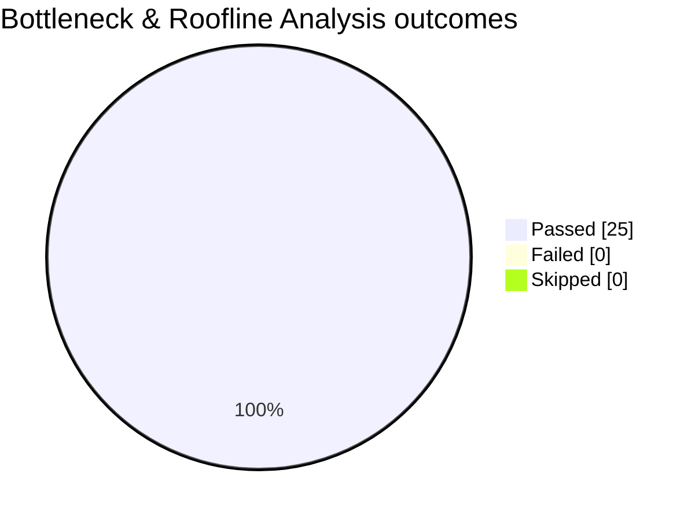
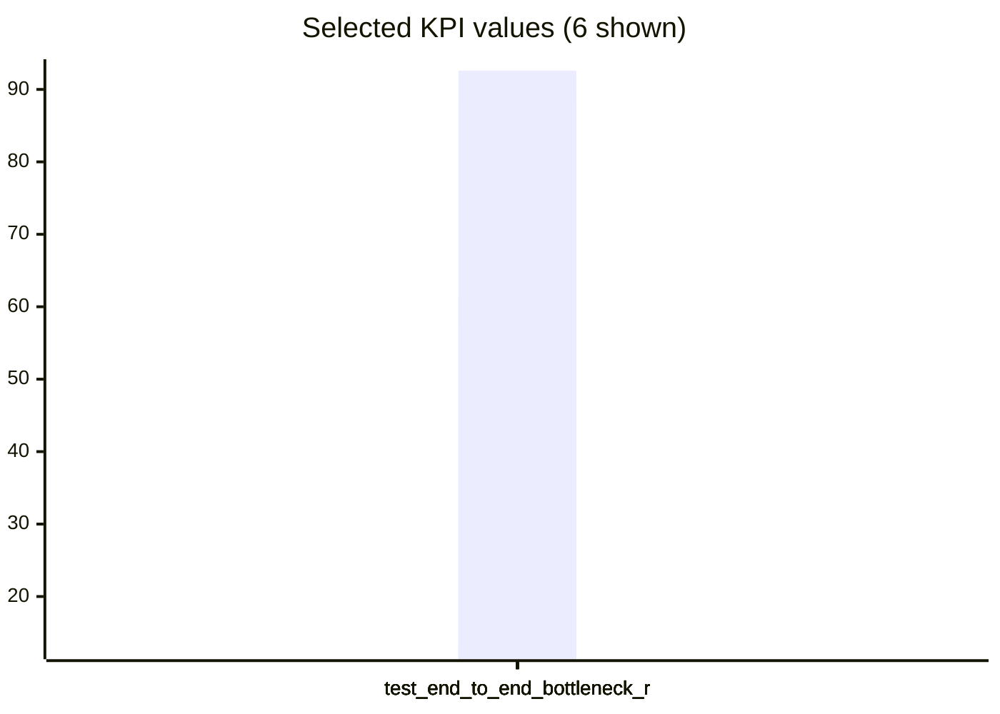

# Bottleneck & Roofline Analysis

> **Test run:** 2026-08-17 | **Platform:** Linux, Python 3.12.13 | **Accelerators:** 4 x NVIDIA H100 PCIe

## Executive Dashboard

| Collected | Passed | Failed | Skipped | Warnings | Duration | Pass rate* |
|---:|---:|---:|---:|---:|---:|---:|
| 25 | 25 | 0 | 0 | 15 | 37.88s | 100.0% |

*Pass rate excludes skipped tests.

## Result Visuals

## Key Findings

- **Result:** No test failures were recorded in this module.

## Individual Test Results

| # | Test class | Test | Result | KPI records |
|---:|---|---|---|---:|
| 1 | `TestCPUComputeBottleneck` | `test_cpu_fp32_efficiency_report` | **PASS** | 0 |
| 2 | `TestCPUMemoryBandwidthBottleneck` | `test_cpu_dram_bandwidth_vs_hbm` | **PASS** | 0 |
| 3 | `TestCPUMemoryBandwidthBottleneck` | `test_cpu_dram_bandwidth_measured` | **PASS** | 0 |
| 4 | `TestGPUComputeBottleneck` | `test_per_gpu_fp16_efficiency` | **PASS** | 0 |
| 5 | `TestGPUComputeBottleneck` | `test_aggregate_4gpu_fp16_tflops` | **PASS** | 0 |
| 6 | `TestHBMBandwidthBottleneck` | `test_hbm_bandwidth_per_gpu_vs_theoretical` | **PASS** | 0 |
| 7 | `TestHBMBandwidthBottleneck` | `test_hbm_is_limiting_for_memory_bound_kernels` | **PASS** | 0 |
| 8 | `TestPCIeBottleneck` | `test_pcie_h2d_bandwidth_vs_theoretical` | **PASS** | 0 |
| 9 | `TestPCIeBottleneck` | `test_pcie_bottleneck_ratio_vs_hbm` | **PASS** | 0 |
| 10 | `TestNVLinkBottleneck` | `test_nvlink_bw_vs_theoretical` | **PASS** | 0 |
| 11 | `TestNVLinkBottleneck` | `test_nvlink_faster_than_pcie_bottleneck` | **PASS** | 0 |
| 12 | `TestRooflineAnalysis` | `test_roofline_knee_fp16` | **PASS** | 0 |
| 13 | `TestRooflineAnalysis` | `test_roofline_memory_bound_regime` | **PASS** | 0 |
| 14 | `TestRooflineAnalysis` | `test_roofline_compute_bound_regime` | **PASS** | 0 |
| 15 | `TestRooflineAnalysis` | `test_roofline_knee_per_precision[FP16-756.0-FP16` | **PASS** | 0 |
| 16 | `TestRooflineAnalysis` | `test_roofline_knee_per_precision[BF16-989.0-BF16` | **PASS** | 0 |
| 17 | `TestRooflineAnalysis` | `test_roofline_knee_per_precision[FP32-67.0-FP32` | **PASS** | 0 |
| 18 | `TestRooflineAnalysis` | `test_roofline_knee_per_precision[FP64-34.0-FP64` | **PASS** | 0 |
| 19 | `TestRooflineAnalysis` | `test_roofline_knee_per_precision[INT8-3958.0-INT8` | **PASS** | 0 |
| 20 | `TestCPUGPUPipelineBottleneck` | `test_data_preprocessing_not_bottleneck` | **PASS** | 0 |
| 21 | `TestMultiGPUScalingBottleneck` | `test_scaling_efficiency_2_vs_1_gpu` | **PASS** | 0 |
| 22 | `TestMultiGPUScalingBottleneck` | `test_scaling_efficiency_4_vs_1_gpu` | **PASS** | 0 |
| 23 | `TestSystemLevelSummary` | `test_theoretical_platform_summary` | **PASS** | 0 |
| 24 | `TestSystemLevelSummary` | `test_known_bottlenecks_summary` | **PASS** | 0 |
| 25 | `TestSystemLevelSummary` | `test_end_to_end_bottleneck_report` | **PASS** | 1 |

## KPI & Measurement Details

### test_cpu_fp32_efficiency_report

**Result:** PASS

- `CPU FP32 (1 processes × 32 threads)                 measured=     5.125  theoretical=    27.238  efficiency= 18.82%  threshold=     5%`
- `CPU FP32 (4 processes × 52 threads)                 measured=     7.013  theoretical=    27.238  efficiency= 25.75%  threshold=     5%`

### test_cpu_dram_bandwidth_measured

**Result:** PASS

- `CPU DRAM BW (multi-thread STREAM Copy)              measured=  1564.830  theoretical=   307.200  efficiency=509.38%  threshold=    75%`

### test_per_gpu_fp16_efficiency

**Result:** PASS

- `GPU 0 FP16 Tensor Core                              measured=   465.674  theoretical=   756.000  efficiency= 61.60%  threshold=    60%`
- `GPU 1 FP16 Tensor Core                              measured=   464.662  theoretical=   756.000  efficiency= 61.46%  threshold=    60%`
- `GPU 2 FP16 Tensor Core                              measured=   482.180  theoretical=   756.000  efficiency= 63.78%  threshold=    60%`
- `GPU 3 FP16 Tensor Core                              measured=   486.148  theoretical=   756.000  efficiency= 64.31%  threshold=    60%`

### test_aggregate_4gpu_fp16_tflops

**Result:** PASS

- `4-GPU aggregate FP16 TFLOPS                         measured=  1904.813  theoretical=  3024.000  efficiency= 62.99%  threshold=    60%`

### test_hbm_bandwidth_per_gpu_vs_theoretical

**Result:** PASS

- `GPU 0 HBM3 bandwidth                                measured=     1.855  theoretical=     2.000  efficiency= 92.75%  threshold=    80%`
- `GPU 1 HBM3 bandwidth                                measured=     1.857  theoretical=     2.000  efficiency= 92.85%  threshold=    80%`
- `GPU 2 HBM3 bandwidth                                measured=     1.855  theoretical=     2.000  efficiency= 92.76%  threshold=    80%`
- `GPU 3 HBM3 bandwidth                                measured=     1.855  theoretical=     2.000  efficiency= 92.73%  threshold=    80%`

### test_pcie_h2d_bandwidth_vs_theoretical

**Result:** PASS

- `GPU 0 H2D PCIe bandwidth                            measured=    55.266  theoretical=    63.000  efficiency= 87.72%  threshold=    65%`
- `GPU 1 H2D PCIe bandwidth                            measured=    55.700  theoretical=    63.000  efficiency= 88.41%  threshold=    65%`
- `GPU 2 H2D PCIe bandwidth                            measured=    56.171  theoretical=    63.000  efficiency= 89.16%  threshold=    65%`
- `GPU 3 H2D PCIe bandwidth                            measured=    55.702  theoretical=    63.000  efficiency= 88.42%  threshold=    65%`

### test_nvlink_bw_vs_theoretical

**Result:** PASS

- `NVLink P2P BW GPU 0->1                              measured=   263.970  theoretical=   300.000  efficiency= 87.99%  threshold=    70%`

### test_scaling_efficiency_2_vs_1_gpu

**Result:** PASS

- `2-GPU FP16 scaling efficiency                       measured=   919.439  theoretical=   925.368  efficiency= 99.36%  threshold=    80%`

### test_scaling_efficiency_4_vs_1_gpu

**Result:** PASS

- `4-GPU FP16 scaling efficiency                       measured=  1873.028  theoretical=   690.741  efficiency=271.16%  threshold=    80%`

### test_end_to_end_bottleneck_report

**Result:** PASS

**TC-BN-10_system_throughput_summary**

| KPI | Value |
|---|---:|
| `CPU DRAM BW (single-thread STREAM).efficiency_pct` | 12.9 |
| `CPU DRAM BW (single-thread STREAM).measured` | 39.48682959010367 |
| `CPU DRAM BW (single-thread STREAM).theoretical` | 307.2 |
| `CPU DRAM BW (single-thread STREAM).unit` | GB/s |
| `GPU 0 FP16 Tensor Core.efficiency_pct` | 61.6 |
| `GPU 0 FP16 Tensor Core.measured` | 465.44635382914896 |
| `GPU 0 FP16 Tensor Core.theoretical` | 756.0 |
| `GPU 0 FP16 Tensor Core.unit` | TFLOPS |
| `GPU 0 FP32 CUDA Core.efficiency_pct` | 57.3 |
| `GPU 0 FP32 CUDA Core.measured` | 38.35964434090964 |
| `GPU 0 FP32 CUDA Core.theoretical` | 67.0 |
| `GPU 0 FP32 CUDA Core.unit` | TFLOPS |
| `GPU 0 HBM3 BW.efficiency_pct` | 92.6 |
| `GPU 0 HBM3 BW.measured` | 1.8513823358502075 |
| `GPU 0 HBM3 BW.theoretical` | 2.0 |
| `GPU 0 HBM3 BW.unit` | TB/s |
| `GPU 0 PCIe H2D BW.efficiency_pct` | 89.3 |
| `GPU 0 PCIe H2D BW.measured` | 56.247547116792674 |
| `GPU 0 PCIe H2D BW.theoretical` | 63.0 |
| `GPU 0 PCIe H2D BW.unit` | GB/s |
| `NVLink BW (GPU 0->1).efficiency_pct` | 88.3 |
| `NVLink BW (GPU 0->1).measured` | 264.94899346868834 |
| `NVLink BW (GPU 0->1).theoretical` | 300.0 |
| `NVLink BW (GPU 0->1).unit` | GB/s |

## Traceability

- Source log: `dmr_all_test-aug17.log`
- Pytest module: `tests/test_bottleneck_analysis.py`
- Results and KPI values are transcribed from the captured run; no missing values were estimated.
