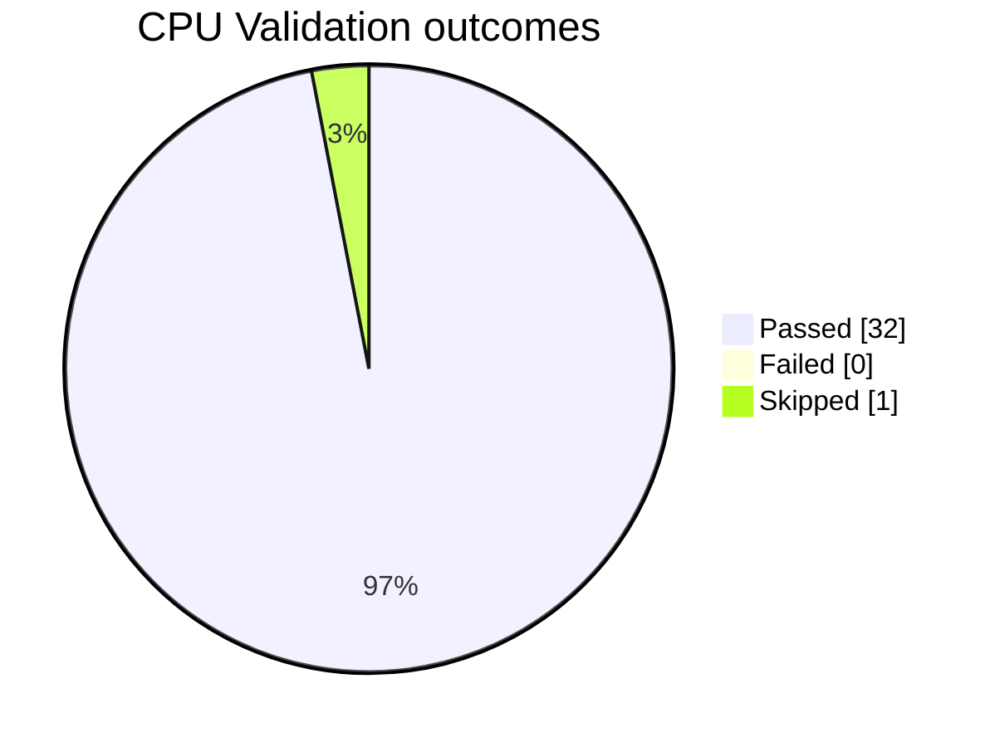
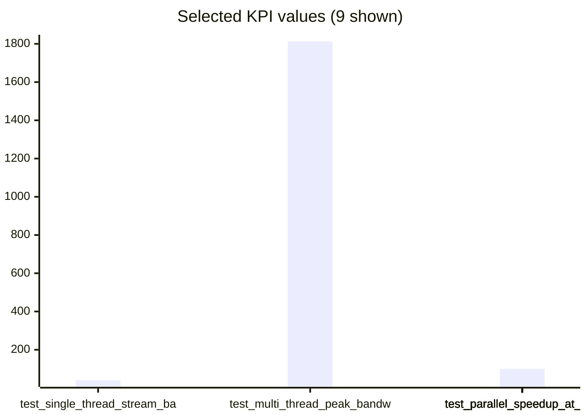

# CPU Validation

> **Test run:** 2026-08-17 | **Platform:** Linux, Python 3.12.13 | **Accelerators:** 4 x NVIDIA H100 PCIe

## Executive Dashboard

| Collected | Passed | Failed | Skipped | Warnings | Duration | Pass rate* |
|---:|---:|---:|---:|---:|---:|---:|
| 33 | 32 | 0 | 1 | 0 | 635.69s (0:10:35) | 100.0% |

*Pass rate excludes skipped tests.

## Result Visuals

## Key Findings

- **Result:** No test failures were recorded in this module.
- **Coverage note:** 1 test(s) were skipped because of topology, dependency, model, or environment constraints.

## Individual Test Results

| # | Test class | Test | Result | KPI records |
|---:|---|---|---|---:|
| 1 | `TestCPUTopology` | `test_physical_core_count` | **PASS** | 0 |
| 2 | `TestCPUTopology` | `test_logical_thread_count` | **PASS** | 0 |
| 3 | `TestCPUTopology` | `test_os_cpu_count_matches_logical` | **PASS** | 0 |
| 4 | `TestCPUTopology` | `test_smt_is_enabled` | **PASS** | 0 |
| 5 | `TestNUMATopology` | `test_numa_node_count` | **PASS** | 0 |
| 6 | `TestNUMATopology` | `test_numa_node_file_exists` | **PASS** | 0 |
| 7 | `TestNUMATopology` | `test_numa_node1_file_exists` | **SKIP** | 0 |
| 8 | `TestSingleCoreFP32` | `test_single_core_gflops_above_floor` | **PASS** | 1 |
| 9 | `TestAllCoreFP32Scaling` | `test_all_core_fp32_gflops` | **PASS** | 1 |
| 10 | `TestAllCoreFP32Scaling` | `test_all_core_throughput_scales_with_cores` | **PASS** | 0 |
| 11 | `TestMemoryBandwidth` | `test_single_thread_stream_bandwidth` | **PASS** | 1 |
| 12 | `TestMemoryBandwidth` | `test_multi_thread_peak_bandwidth` | **PASS** | 1 |
| 13 | `TestL3CacheBandwidth` | `test_l3_bandwidth_gbs` | **PASS** | 1 |
| 14 | `TestParallelSpeedup` | `test_parallel_speedup_at_n_cores[1]` | **PASS** | 1 |
| 15 | `TestParallelSpeedup` | `test_parallel_speedup_at_n_cores[2]` | **PASS** | 1 |
| 16 | `TestParallelSpeedup` | `test_parallel_speedup_at_n_cores[4]` | **PASS** | 1 |
| 17 | `TestParallelSpeedup` | `test_parallel_speedup_at_n_cores[8]` | **PASS** | 1 |
| 18 | `TestParallelSpeedup` | `test_parallel_speedup_at_n_cores[16]` | **PASS** | 1 |
| 19 | `TestParallelSpeedup` | `test_parallel_speedup_at_n_cores[32]` | **PASS** | 1 |
| 20 | `TestParallelSpeedup` | `test_parallel_speedup_at_n_cores[64]` | **PASS** | 1 |
| 21 | `TestNUMABandwidth` | `test_numa_node0_accessible` | **PASS** | 1 |
| 22 | `TestNUMABandwidth` | `test_numa_local_bw_exceeds_remote` | **PASS** | 1 |
| 23 | `TestIntegerThroughput` | `test_integer_vector_ops_throughput` | **PASS** | 1 |
| 24 | `TestIntegerThroughput` | `test_integer_multiply_throughput` | **PASS** | 1 |
| 25 | `TestBranchPrediction` | `test_predictable_branch_loop` | **PASS** | 1 |
| 26 | `TestBranchPrediction` | `test_unpredictable_branch_penalty` | **PASS** | 1 |
| 27 | `TestThreadPoolOverhead` | `test_threadpool_spawn_latency` | **PASS** | 1 |
| 28 | `TestThreadPoolOverhead` | `test_threadpool_reuse_overhead` | **PASS** | 1 |
| 29 | `TestCacheCoherency` | `test_false_sharing_detection` | **PASS** | 1 |
| 30 | `TestFrequencyStability` | `test_frequency_does_not_degrade_under_load` | **PASS** | 1 |
| 31 | `TestSMTThroughput` | `test_smt_provides_throughput_gain` | **PASS** | 1 |
| 32 | `TestCPUAffinity` | `test_process_can_set_affinity` | **PASS** | 1 |
| 33 | `TestCPUAffinity` | `test_all_cores_schedulable` | **PASS** | 1 |

## KPI & Measurement Details

### test_single_core_gflops_above_floor

**Result:** PASS

- `Single-core FP32 GFLOPS                             measured=   793.490  theoretical=   121.600  efficiency=652.54%  threshold=    35%`

**TC-CPU-03_single_core_fp32**

| KPI | Value |
|---|---:|
| `gflops_measured` | 793.49 |
| `gflops_theoretical` | 121.6 |

### test_all_core_fp32_gflops

**Result:** PASS

- `All-core FP32 GFLOPS (BLAS)                         measured= 28535.908  theoretical= 27238.400  efficiency=104.76%  threshold=    20%`

**TC-CPU-04_allcore_fp32**

| KPI | Value |
|---|---:|
| `cores_used` | 16 |
| `tflops_measured` | 28.536 |

### test_all_core_throughput_scales_with_cores

**Result:** PASS

- `FP32 scaling efficiency (8 cores)                   measured=   941.742  theoretical=   940.503  efficiency=100.13%  threshold=    85%`

### test_single_thread_stream_bandwidth

**Result:** PASS

**TC-CPU-05a_single_thread_stream_bw**

| KPI | Value |
|---|---:|
| `bandwidth_gbs` | 40.5 |
| `threshold_gbs` | 30.0 |

### test_multi_thread_peak_bandwidth

**Result:** PASS

- `Aggregate DRAM bandwidth (multi-thread)             measured=  1812.603  theoretical=   307.200  efficiency=590.04%  threshold=    75%`

**TC-CPU-05_dram_bandwidth**

| KPI | Value |
|---|---:|
| `bandwidth_gbs` | 1812.6 |
| `theoretical_gbs` | 307.2 |

### test_l3_bandwidth_gbs

**Result:** PASS

**TC-CPU-06_l3_cache_bandwidth**

| KPI | Value |
|---|---:|
| `n_threads` | 224 |
| `per_thread_bw_gbs` | 6.1 |
| `scaled_threshold_gbs` | 200.0 |
| `total_bw_gbs` | 1365.65 |

### test_parallel_speedup_at_n_cores[1]

**Result:** PASS

- `Parallel speedup at 1 cores                         measured=   130.788  theoretical=   131.543  efficiency= 99.43%  threshold=    85%`

**TC-CPU-07_parallel_speedup_n1**

| KPI | Value |
|---|---:|
| `affinity_cores` | [0] |
| `efficiency_pct` | 99.43 |
| `ideal_gflops` | 131.543 |
| `multi_gflops` | 130.788 |
| `n_cores` | 1 |
| `single_gflops` | 131.543 |
| `speedup` | 0.994 |
| `threshold_pct` | 85.0 |

### test_parallel_speedup_at_n_cores[2]

**Result:** PASS

- `Parallel speedup at 2 cores                         measured=   236.466  theoretical=   264.076  efficiency= 89.54%  threshold=    85%`

**TC-CPU-07_parallel_speedup_n2**

| KPI | Value |
|---|---:|
| `affinity_cores` | [0, 1] |
| `efficiency_pct` | 89.54 |
| `ideal_gflops` | 264.076 |
| `multi_gflops` | 236.466 |
| `n_cores` | 2 |
| `single_gflops` | 132.038 |
| `speedup` | 1.791 |
| `threshold_pct` | 85.0 |

### test_parallel_speedup_at_n_cores[4]

**Result:** PASS

- `Parallel speedup at 4 cores                         measured=   525.595  theoretical=   530.113  efficiency= 99.15%  threshold=    85%`

**TC-CPU-07_parallel_speedup_n4**

| KPI | Value |
|---|---:|
| `affinity_cores` | [0, 1, 2, 3] |
| `efficiency_pct` | 99.15 |
| `ideal_gflops` | 530.113 |
| `multi_gflops` | 525.595 |
| `n_cores` | 4 |
| `single_gflops` | 132.528 |
| `speedup` | 3.966 |
| `threshold_pct` | 85.0 |

### test_parallel_speedup_at_n_cores[8]

**Result:** PASS

- `Parallel speedup at 8 cores                         measured=   987.566  theoretical=  1050.461  efficiency= 94.01%  threshold=    85%`

**TC-CPU-07_parallel_speedup_n8**

| KPI | Value |
|---|---:|
| `affinity_cores` | [0, 1, 2, 3, 4, 5, 6, 7] |
| `efficiency_pct` | 94.01 |
| `ideal_gflops` | 1050.461 |
| `multi_gflops` | 987.566 |
| `n_cores` | 8 |
| `single_gflops` | 131.308 |
| `speedup` | 7.521 |
| `threshold_pct` | 85.0 |

### test_parallel_speedup_at_n_cores[16]

**Result:** PASS

- `Parallel speedup at 16 cores                        measured=  1981.679  theoretical=  2076.901  efficiency= 95.42%  threshold=    85%`

**TC-CPU-07_parallel_speedup_n16**

| KPI | Value |
|---|---:|
| `affinity_cores` | [0, 1, 2, 3, 4, 5, 6, 7, 8, 9, 10, 11, 12, 13, 14, 15] |
| `efficiency_pct` | 95.42 |
| `ideal_gflops` | 2076.901 |
| `multi_gflops` | 1981.679 |
| `n_cores` | 16 |
| `single_gflops` | 129.806 |
| `speedup` | 15.266 |
| `threshold_pct` | 85.0 |

### test_parallel_speedup_at_n_cores[32]

**Result:** PASS

- `Parallel speedup at 32 cores                        measured=  3945.929  theoretical=  4181.395  efficiency= 94.37%  threshold=    85%`

**TC-CPU-07_parallel_speedup_n32**

| KPI | Value |
|---|---:|
| `affinity_cores` | [0, 1, 2, 3, 4, 5, 6, 7, 8, 9, 10, 11, 12, 13, 14, 15, 16, 17, 18, 19, 20, 21, 22, 23, 24, 25, 26, 27, 28, 29, 30, 31] |
| `efficiency_pct` | 94.37 |
| `ideal_gflops` | 4181.395 |
| `multi_gflops` | 3945.929 |
| `n_cores` | 32 |
| `single_gflops` | 130.669 |
| `speedup` | 30.198 |
| `threshold_pct` | 85.0 |

### test_parallel_speedup_at_n_cores[64]

**Result:** PASS

- `Parallel speedup at 64 cores                        measured=  7337.888  theoretical=  7426.567  efficiency= 98.81%  threshold=    85%`

**TC-CPU-07_parallel_speedup_n64**

| KPI | Value |
|---|---:|
| `affinity_cores` | [0, 1, 2, 3, 4, 5, 6, 7, 8, 9, 10, 11, 12, 13, 14, 15, 16, 17, 18, 19, 20, 21, 22, 23, 24, 25, 26, 27, 28, 29, 30, 31, 32, 33, 34, 35, 36, 37, 38, 39, 40, 41, 42, 43, 44, 45, 46... |
| `efficiency_pct` | 98.81 |
| `ideal_gflops` | 7426.567 |
| `multi_gflops` | 7337.888 |
| `n_cores` | 64 |
| `single_gflops` | 116.04 |
| `speedup` | 63.236 |
| `threshold_pct` | 85.0 |

### test_numa_node0_accessible

**Result:** PASS

**TC-CPU-08a_numa_node0_accessible**

| KPI | Value |
|---|---:|
| `accessible` | True |
| `node0_cpulist` | 0-223 |

### test_numa_local_bw_exceeds_remote

**Result:** PASS

**TC-CPU-08b_numa_topology**

| KPI | Value |
|---|---:|
| `node0_sysfs_present` | True |
| `numa_nodes_detected` | 1 |

### test_integer_vector_ops_throughput

**Result:** PASS

**TC-CPU-09a_int64_add_throughput**

| KPI | Value |
|---|---:|
| `n_threads` | 32 |
| `per_thread_gops` | 0.361 |
| `threshold_gops` | 1.6 |
| `total_gops` | 11.54 |

### test_integer_multiply_throughput

**Result:** PASS

**TC-CPU-09b_int64_multiply_throughput**

| KPI | Value |
|---|---:|
| `n_threads` | 32 |
| `per_thread_gops` | 0.474 |
| `threshold_gops` | 1.6 |
| `total_gops` | 15.17 |

### test_predictable_branch_loop

**Result:** PASS

**TC-CPU-10a_predictable_branch**

| KPI | Value |
|---|---:|
| `elapsed_sec` | 0.2485 |
| `iterations` | 10000000 |
| `threshold_sec` | 0.5 |

### test_unpredictable_branch_penalty

**Result:** PASS

**TC-CPU-10b_unpredictable_branch**

| KPI | Value |
|---|---:|
| `branch_penalty_ratio` | 176.0 |
| `elapsed_sec` | 0.176 |
| `iterations` | 10000000 |
| `threshold_sec` | 5.0 |

### test_threadpool_spawn_latency

**Result:** PASS

**TC-CPU-11a_threadpool_spawn_latency**

| KPI | Value |
|---|---:|
| `n_threads` | 224 |
| `spawn_elapsed_sec` | 0.0352 |
| `threshold_sec` | 2.0 |

### test_threadpool_reuse_overhead

**Result:** PASS

**TC-CPU-11b_threadpool_reuse_overhead**

| KPI | Value |
|---|---:|
| `n_tasks` | 1000 |
| `submit_elapsed_sec` | 0.018 |
| `tasks_completed` | 1000 |
| `threshold_sec` | 1.0 |

### test_false_sharing_detection

**Result:** PASS

**TC-CPU-12_false_sharing**

| KPI | Value |
|---|---:|
| `false_sharing_overhead_ratio` | 1.009 |
| `n_iters` | 300000 |
| `n_threads` | 8 |
| `padded_median_sec` | 0.2188 |
| `unpadded_median_sec` | 0.2208 |

### test_frequency_does_not_degrade_under_load

**Result:** PASS

**TC-CPU-13_frequency_stability**

| KPI | Value |
|---|---:|
| `degradation_pct` | -1.35 |
| `max_degradation_pct` | 15.0 |
| `run_a_median_gflops` | 808.99 |
| `run_a_samples` | [808.99, 489.24, 819.58] |
| `run_b_median_gflops` | 819.92 |
| `run_b_samples` | [819.92, 496.99, 820.22] |

### test_smt_provides_throughput_gain

**Result:** PASS

**TC-CPU-14_smt_throughput**

| KPI | Value |
|---|---:|
| `physical_core_count` | 224 |
| `physical_cores_gflops` | 25912.3 |
| `smt_ratio` | 0.992 |
| `smt_ratio_floor` | 0.9 |
| `smt_thread_count` | 224 |
| `smt_threads_gflops` | 25705.62 |

### test_process_can_set_affinity

**Result:** PASS

**TC-CPU-15a_affinity_set**

| KPI | Value |
|---|---:|
| `can_set_affinity` | True |
| `original_cpu_count` | 224 |
| `test_affinity` | [0, 1] |

### test_all_cores_schedulable

**Result:** PASS

**TC-CPU-15b_all_cores_schedulable**

| KPI | Value |
|---|---:|
| `affinity_max_cpu` | 223 |
| `affinity_min_cpu` | 0 |
| `expected_threads` | 224 |
| `schedulable_cpus` | 224 |

## Traceability

- Source log: `dmr_all_test-aug17.log`
- Pytest module: `tests/test_cpu_validation.py`
- Results and KPI values are transcribed from the captured run; no missing values were estimated.
