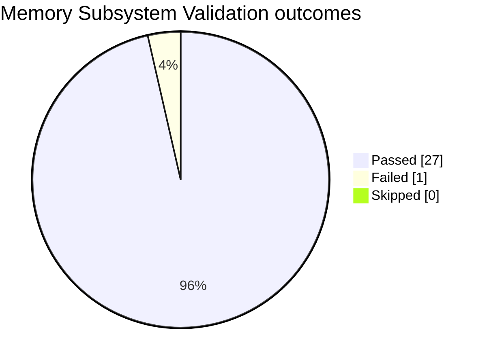
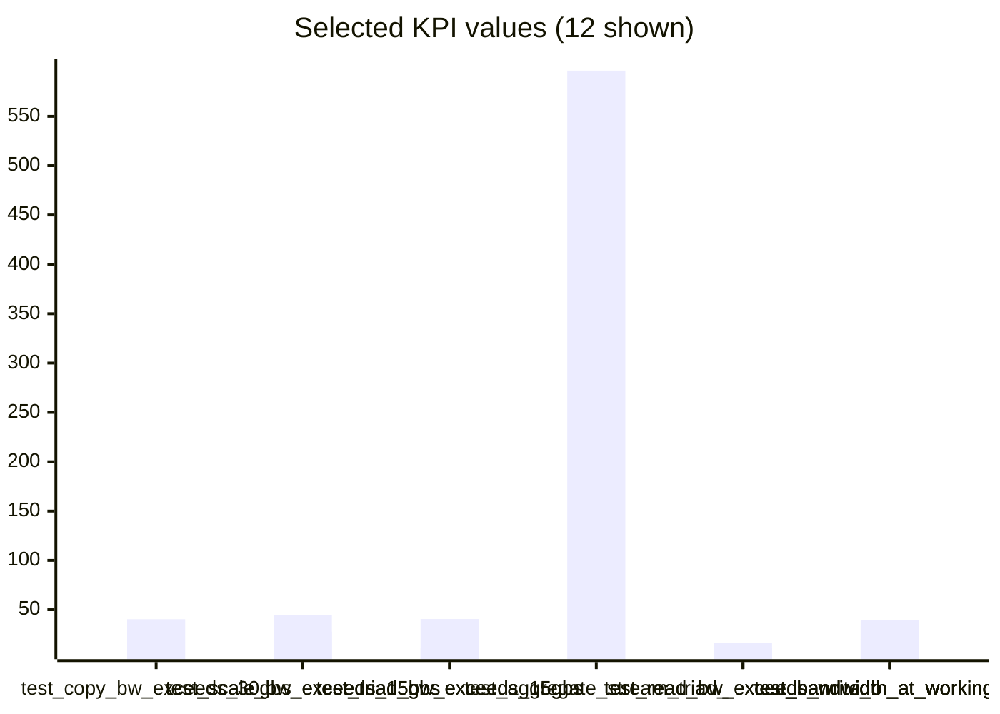

# Memory Subsystem Validation

> **Test run:** 2026-08-17 | **Platform:** Linux, Python 3.12.13 | **Accelerators:** 4 x NVIDIA H100 PCIe

## Executive Dashboard

| Collected | Passed | Failed | Skipped | Warnings | Duration | Pass rate* |
|---:|---:|---:|---:|---:|---:|---:|
| 28 | 27 | 1 | 0 | 0 | 27.74s | 96.4% |

*Pass rate excludes skipped tests.

## Result Visuals

## Key Findings

- **Action required:** 1 test(s) failed; root causes are summarized below.
- **Failure signal:** Single-thread STREAM Triad reached 11.30 GB/s versus a 16.21 GB/s adaptive threshold; aggregate bandwidth still passed at 596.33 GB/s.

## Individual Test Results

| # | Test class | Test | Result | KPI records |
|---:|---|---|---|---:|
| 1 | `TestRAMCapacity` | `test_total_ram_at_least_1tb` | **PASS** | 1 |
| 2 | `TestRAMCapacity` | `test_total_ram_equals_2tb` | **PASS** | 1 |
| 3 | `TestRAMCapacity` | `test_available_ram_reasonable` | **PASS** | 1 |
| 4 | `TestDRAMInfo` | `test_meminfo_exists` | **PASS** | 1 |
| 5 | `TestDRAMInfo` | `test_huge_pages_entry_present` | **PASS** | 1 |
| 6 | `TestDRAMInfo` | `test_transparent_hugepages_mode` | **PASS** | 1 |
| 7 | `TestStorageCapacity` | `test_storage_capacity_matches_detected_baseline` | **PASS** | 1 |
| 8 | `TestSingleThreadBandwidth` | `test_copy_bw_exceeds_30gbs` | **PASS** | 1 |
| 9 | `TestSingleThreadBandwidth` | `test_scale_bw_exceeds_15gbs` | **PASS** | 1 |
| 10 | `TestSingleThreadBandwidth` | `test_triad_bw_exceeds_15gbs` | **FAIL** | 1 |
| 11 | `TestAggregateMemoryBandwidth` | `test_aggregate_stream_triad_bandwidth` | **PASS** | 1 |
| 12 | `TestReadWriteAsymmetry` | `test_read_bw_exceeds_write_bw` | **PASS** | 1 |
| 13 | `TestMemoryLatency` | `test_latency_at_working_set[32-4.0]` | **PASS** | 1 |
| 14 | `TestMemoryLatency` | `test_latency_at_working_set[512-8.0]` | **PASS** | 1 |
| 15 | `TestMemoryLatency` | `test_latency_at_working_set[16384-30.0]` | **PASS** | 1 |
| 16 | `TestMemoryLatency` | `test_latency_at_working_set[524288-120.0]` | **PASS** | 1 |
| 17 | `TestCacheHierarchyBandwidth` | `test_bandwidth_at_working_set[L1-cache-0.03125-5.0]` | **PASS** | 1 |
| 18 | `TestCacheHierarchyBandwidth` | `test_bandwidth_at_working_set[L2-cache-0.5-30.0]` | **PASS** | 1 |
| 19 | `TestCacheHierarchyBandwidth` | `test_bandwidth_at_working_set[L3-cache-8.0-20.0]` | **PASS** | 1 |
| 20 | `TestCacheHierarchyBandwidth` | `test_bandwidth_at_working_set[DRAM-512.0-15.0]` | **PASS** | 1 |
| 21 | `TestNUMALocality` | `test_numa_nodes_visible` | **PASS** | 1 |
| 22 | `TestNUMALocality` | `test_numa_meminfo_node0` | **PASS** | 1 |
| 23 | `TestHugepages` | `test_hugepages_configured` | **PASS** | 1 |
| 24 | `TestECCEnabled` | `test_ecc_edac_sysfs_present` | **PASS** | 1 |
| 25 | `TestECCEnabled` | `test_no_uncorrected_errors` | **PASS** | 1 |
| 26 | `TestMemoryPressure` | `test_large_allocation_and_free` | **PASS** | 1 |
| 27 | `TestMemoryPressure` | `test_repeated_alloc_free_no_oom` | **PASS** | 1 |
| 28 | `TestSustainedBandwidth` | `test_bandwidth_does_not_degrade` | **PASS** | 1 |

## Failure Analysis

### test_triad_bw_exceeds_15gbs

**Result:** FAIL

**Observed failure:** STREAM Triad measured 11.30 GB/s, below the adaptive 16.21 GB/s threshold.

## KPI & Measurement Details

### test_total_ram_at_least_1tb

**Result:** PASS

**TC-MEM-01a_total_ram_min**

| KPI | Value |
|---|---:|
| `threshold_gb` | 1024.0 |
| `total_gb` | 3022.62 |

### test_total_ram_equals_2tb

**Result:** PASS

**TC-MEM-01b_total_ram_baseline**

| KPI | Value |
|---|---:|
| `baseline_gb` | 3022.62 |
| `deviation_pct` | 0.0 |
| `threshold_deviation_pct` | 5.0 |
| `total_gb` | 3022.62 |

### test_available_ram_reasonable

**Result:** PASS

**TC-MEM-01c_available_ram**

| KPI | Value |
|---|---:|
| `available_fraction` | 0.9944 |
| `available_gb` | 3005.82 |
| `threshold_fraction` | 0.5 |
| `total_gb` | 3022.62 |

### test_meminfo_exists

**Result:** PASS

**TC-MEM-02a_meminfo_exists**

| KPI | Value |
|---|---:|
| `exists` | True |
| `path` | /proc/meminfo |

### test_huge_pages_entry_present

**Result:** PASS

**TC-MEM-02b_hugepages_entry**

| KPI | Value |
|---|---:|
| `has_hugepages_total_entry` | True |

### test_transparent_hugepages_mode

**Result:** PASS

**TC-MEM-02c_thp_mode**

| KPI | Value |
|---|---:|
| `acceptable_modes` | ["always", "madvise"] |
| `mode` | [always] madvise never |

### test_storage_capacity_matches_detected_baseline

**Result:** PASS

**TC-MEM-13_storage_capacity**

| KPI | Value |
|---|---:|
| `baseline_gb` | 1675.69 |
| `deviation_pct` | 0.0 |
| `threshold_deviation_pct` | 5.0 |
| `total_gb` | 1675.69 |

### test_copy_bw_exceeds_30gbs

**Result:** PASS

**TC-MEM-03a_copy_bw**

| KPI | Value |
|---|---:|
| `bandwidth_gbs` | 40.368 |
| `threshold_gbs` | 30.0 |

### test_scale_bw_exceeds_15gbs

**Result:** PASS

**TC-MEM-03b_scale_bw**

| KPI | Value |
|---|---:|
| `copy_bandwidth_gbs` | 44.847 |
| `scale_bandwidth_gbs` | 27.63 |
| `threshold_gbs` | 17.939 |

### test_triad_bw_exceeds_15gbs

**Result:** FAIL

**TC-MEM-03c_triad_bw**

| KPI | Value |
|---|---:|
| `copy_bandwidth_gbs` | 40.53 |
| `threshold_gbs` | 16.212 |
| `triad_bandwidth_gbs` | 11.301 |

### test_aggregate_stream_triad_bandwidth

**Result:** PASS

- `Aggregate STREAM Triad BW                           measured=   596.330  theoretical=   307.200  efficiency=194.12%  threshold=    75%`

**TC-MEM-04_aggregate_stream_triad**

| KPI | Value |
|---|---:|
| `bandwidth_gbs` | 596.33 |
| `theoretical_gbs` | 307.2 |

### test_read_bw_exceeds_write_bw

**Result:** PASS

**TC-MEM-05_read_write_asymmetry**

| KPI | Value |
|---|---:|
| `read_bandwidth_gbs` | 11.668 |
| `read_to_write_ratio` | 0.713 |
| `write_bandwidth_gbs` | 16.367 |

### test_latency_at_working_set[32-4.0]

**Result:** PASS

**TC-MEM-06_latency_ws32kb**

| KPI | Value |
|---|---:|
| `latency_ns` | 0.94 |
| `max_latency_ns` | 4.0 |
| `ws_kb` | 32 |

### test_latency_at_working_set[512-8.0]

**Result:** PASS

**TC-MEM-06_latency_ws512kb**

| KPI | Value |
|---|---:|
| `latency_ns` | 0.95 |
| `max_latency_ns` | 8.0 |
| `ws_kb` | 512 |

### test_latency_at_working_set[16384-30.0]

**Result:** PASS

**TC-MEM-06_latency_ws16384kb**

| KPI | Value |
|---|---:|
| `latency_ns` | 6.12 |
| `max_latency_ns` | 30.0 |
| `ws_kb` | 16384 |

### test_latency_at_working_set[524288-120.0]

**Result:** PASS

**TC-MEM-06_latency_ws524288kb**

| KPI | Value |
|---|---:|
| `latency_ns` | 7.24 |
| `max_latency_ns` | 120.0 |
| `ws_kb` | 524288 |

### test_bandwidth_at_working_set[L1-cache-0.03125-5.0]

**Result:** PASS

**TC-MEM-07_cache_bw_L1-cache**

| KPI | Value |
|---|---:|
| `bandwidth_gbs` | 33.552 |
| `threshold_gbs` | 5.0 |
| `working_set_mb` | 0.03125 |

### test_bandwidth_at_working_set[L2-cache-0.5-30.0]

**Result:** PASS

**TC-MEM-07_cache_bw_L2-cache**

| KPI | Value |
|---|---:|
| `bandwidth_gbs` | 38.881 |
| `threshold_gbs` | 30.0 |
| `working_set_mb` | 0.5 |

### test_bandwidth_at_working_set[L3-cache-8.0-20.0]

**Result:** PASS

**TC-MEM-07_cache_bw_L3-cache**

| KPI | Value |
|---|---:|
| `bandwidth_gbs` | 20.788 |
| `threshold_gbs` | 20.0 |
| `working_set_mb` | 8.0 |

### test_bandwidth_at_working_set[DRAM-512.0-15.0]

**Result:** PASS

**TC-MEM-07_cache_bw_DRAM**

| KPI | Value |
|---|---:|
| `bandwidth_gbs` | 39.189 |
| `threshold_gbs` | 15.0 |
| `working_set_mb` | 512.0 |

### test_numa_nodes_visible

**Result:** PASS

**TC-MEM-08_numa_nodes_visible**

| KPI | Value |
|---|---:|
| `expected_nodes` | 1 |
| `visible_nodes` | 1 |

### test_numa_meminfo_node0

**Result:** PASS

**TC-MEM-08b_numa_node0_meminfo**

| KPI | Value |
|---|---:|
| `has_memtotal` | True |
| `path` | /sys/devices/system/node/node0/meminfo |

### test_hugepages_configured

**Result:** PASS

**TC-MEM-09_hugepages**

| KPI | Value |
|---|---:|
| `explicit_hugepages_configured` | False |
| `thp_active` | True |

### test_ecc_edac_sysfs_present

**Result:** PASS

**TC-MEM-10_ecc_sysfs_present**

| KPI | Value |
|---|---:|
| `edac_path_exists` | False |
| `mc_path_exists` | True |

### test_no_uncorrected_errors

**Result:** PASS

**TC-MEM-10b_uncorrected_errors**

| KPI | Value |
|---|---:|
| `controllers_checked` | 16 |
| `max_ue_count` | 0 |

### test_large_allocation_and_free

**Result:** PASS

**TC-MEM-11_large_alloc_free**

| KPI | Value |
|---|---:|
| `allocated_gb` | 8.0 |
| `elapsed_sec` | 1.888 |
| `threshold_sec` | 30.0 |

### test_repeated_alloc_free_no_oom

**Result:** PASS

**TC-MEM-11b_repeated_alloc_free**

| KPI | Value |
|---|---:|
| `alloc_size_gb` | 1.0 |
| `cycles` | 20 |

### test_bandwidth_does_not_degrade

**Result:** PASS

**TC-MEM-12_sustained_bandwidth**

| KPI | Value |
|---|---:|
| `max_degradation` | 0.0152 |
| `readings_gbs` | [44.263, 44.658, 45.367, 44.399, 43.591] |
| `threshold_degradation` | 0.15 |

## Traceability

- Source log: `dmr_all_test-aug17.log`
- Pytest module: `tests/test_memory_validation.py`
- Results and KPI values are transcribed from the captured run; no missing values were estimated.
