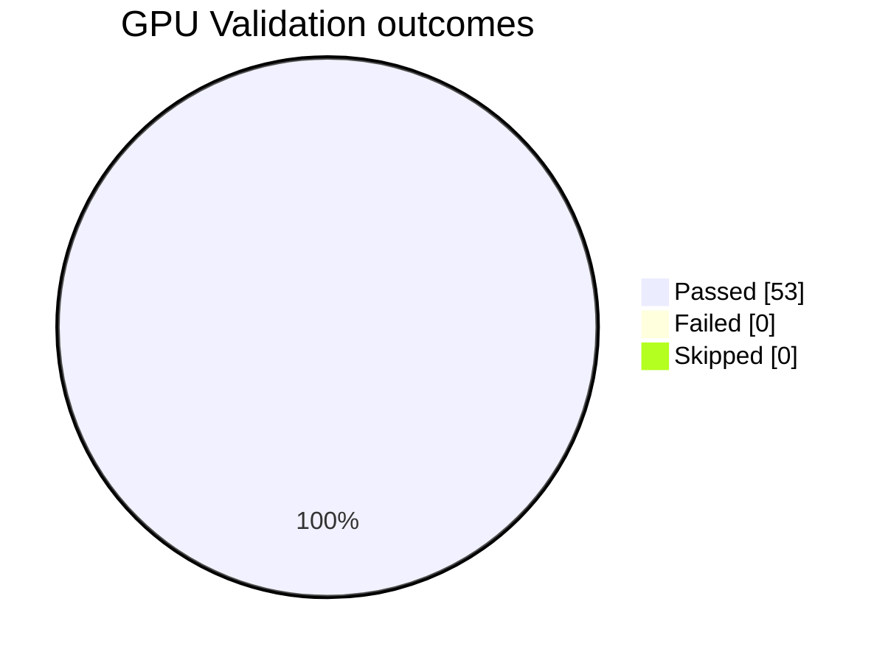

# GPU Validation

> **Test run:** 2026-08-17 | **Platform:** Linux, Python 3.12.13 | **Accelerators:** 4 x NVIDIA H100 PCIe

## Executive Dashboard

| Collected | Passed | Failed | Skipped | Warnings | Duration | Pass rate* |
|---:|---:|---:|---:|---:|---:|---:|
| 53 | 53 | 0 | 0 | 1 | 29.43s | 100.0% |

*Pass rate excludes skipped tests.

## Result Visuals

## Key Findings

- **Result:** No test failures were recorded in this module.

## Individual Test Results

| # | Test class | Test | Result | KPI records |
|---:|---|---|---|---:|
| 1 | `TestGPUDiscovery` | `test_gpu_count_equals_four` | **PASS** | 0 |
| 2 | `TestGPUDiscovery` | `test_all_gpus_initialise` | **PASS** | 0 |
| 3 | `TestGPUModel` | `test_gpu_model_is_h100` | **PASS** | 0 |
| 4 | `TestGPUModel` | `test_cuda_version_12_or_above` | **PASS** | 0 |
| 5 | `TestGPUModel` | `test_compute_capability_90` | **PASS** | 0 |
| 6 | `TestHBMCapacity` | `test_hbm_capacity_per_gpu` | **PASS** | 0 |
| 7 | `TestHBMCapacity` | `test_total_gpu_memory` | **PASS** | 0 |
| 8 | `TestHBMBandwidth` | `test_hbm_bandwidth_per_gpu[0]` | **PASS** | 1 |
| 9 | `TestHBMBandwidth` | `test_hbm_bandwidth_per_gpu[1]` | **PASS** | 1 |
| 10 | `TestHBMBandwidth` | `test_hbm_bandwidth_per_gpu[2]` | **PASS** | 1 |
| 11 | `TestHBMBandwidth` | `test_hbm_bandwidth_per_gpu[3]` | **PASS** | 1 |
| 12 | `TestFP32Throughput` | `test_fp32_gflops_per_gpu[0]` | **PASS** | 1 |
| 13 | `TestFP32Throughput` | `test_fp32_gflops_per_gpu[1]` | **PASS** | 1 |
| 14 | `TestFP32Throughput` | `test_fp32_gflops_per_gpu[2]` | **PASS** | 1 |
| 15 | `TestFP32Throughput` | `test_fp32_gflops_per_gpu[3]` | **PASS** | 1 |
| 16 | `TestFP16ThroughputGPU` | `test_fp16_tflops_per_gpu[0]` | **PASS** | 1 |
| 17 | `TestFP16ThroughputGPU` | `test_fp16_tflops_per_gpu[1]` | **PASS** | 1 |
| 18 | `TestFP16ThroughputGPU` | `test_fp16_tflops_per_gpu[2]` | **PASS** | 1 |
| 19 | `TestFP16ThroughputGPU` | `test_fp16_tflops_per_gpu[3]` | **PASS** | 1 |
| 20 | `TestBF16Throughput` | `test_bf16_tflops_per_gpu[0]` | **PASS** | 1 |
| 21 | `TestBF16Throughput` | `test_bf16_tflops_per_gpu[1]` | **PASS** | 1 |
| 22 | `TestBF16Throughput` | `test_bf16_tflops_per_gpu[2]` | **PASS** | 1 |
| 23 | `TestBF16Throughput` | `test_bf16_tflops_per_gpu[3]` | **PASS** | 1 |
| 24 | `TestINT8Throughput` | `test_int8_tops_per_gpu[0]` | **PASS** | 1 |
| 25 | `TestINT8Throughput` | `test_int8_tops_per_gpu[1]` | **PASS** | 1 |
| 26 | `TestINT8Throughput` | `test_int8_tops_per_gpu[2]` | **PASS** | 1 |
| 27 | `TestINT8Throughput` | `test_int8_tops_per_gpu[3]` | **PASS** | 1 |
| 28 | `TestFP64Throughput` | `test_fp64_tflops_per_gpu[0]` | **PASS** | 1 |
| 29 | `TestFP64Throughput` | `test_fp64_tflops_per_gpu[1]` | **PASS** | 1 |
| 30 | `TestFP64Throughput` | `test_fp64_tflops_per_gpu[2]` | **PASS** | 1 |
| 31 | `TestFP64Throughput` | `test_fp64_tflops_per_gpu[3]` | **PASS** | 1 |
| 32 | `TestMultiGPUCompute` | `test_all_gpus_concurrent_fp16_tflops` | **PASS** | 0 |
| 33 | `TestGPUUtilisation` | `test_gpu_utilisation_near_100_percent` | **PASS** | 0 |
| 34 | `TestGPUTemperature` | `test_gpu_temperature_in_range` | **PASS** | 0 |
| 35 | `TestGPUPowerDraw` | `test_gpu_power_within_tdp_at_idle` | **PASS** | 0 |
| 36 | `TestGPUECC` | `test_gpu_ecc_enabled` | **PASS** | 0 |
| 37 | `TestGPUECC` | `test_no_uncorrected_gpu_errors` | **PASS** | 0 |
| 38 | `TestCUDAStreamConcurrency` | `test_concurrent_streams_faster_than_serial` | **PASS** | 0 |
| 39 | `TestGPUEnumerationPCIeTopology` | `test_gpu_enumeration_count_consistent` | **PASS** | 0 |
| 40 | `TestGPUEnumerationPCIeTopology` | `test_each_gpu_has_unique_pci_bus_id` | **PASS** | 0 |
| 41 | `TestGPUEnumerationPCIeTopology` | `test_pcie_max_link_generation_is_gen5` | **PASS** | 0 |
| 42 | `TestGPUEnumerationPCIeTopology` | `test_pcie_max_link_width_is_x16` | **PASS** | 0 |
| 43 | `TestGPUEnumerationPCIeTopology` | `test_pcie_current_link_gen_not_degraded` | **PASS** | 0 |
| 44 | `TestGPUEnumerationPCIeTopology` | `test_pcie_current_link_width_not_degraded` | **PASS** | 0 |
| 45 | `TestGPUEnumerationPCIeTopology` | `test_gpu_pci_bus_numbers_are_unique` | **PASS** | 0 |
| 46 | `TestGPUEnumerationPCIeTopology` | `test_pcie_host_to_device_bandwidth[0]` | **PASS** | 0 |
| 47 | `TestGPUEnumerationPCIeTopology` | `test_pcie_host_to_device_bandwidth[1]` | **PASS** | 0 |
| 48 | `TestGPUEnumerationPCIeTopology` | `test_pcie_host_to_device_bandwidth[2]` | **PASS** | 0 |
| 49 | `TestGPUEnumerationPCIeTopology` | `test_pcie_host_to_device_bandwidth[3]` | **PASS** | 0 |
| 50 | `TestGPUEnumerationPCIeTopology` | `test_pcie_device_to_host_bandwidth[0]` | **PASS** | 0 |
| 51 | `TestGPUEnumerationPCIeTopology` | `test_pcie_device_to_host_bandwidth[1]` | **PASS** | 0 |
| 52 | `TestGPUEnumerationPCIeTopology` | `test_pcie_device_to_host_bandwidth[2]` | **PASS** | 0 |
| 53 | `TestGPUEnumerationPCIeTopology` | `test_pcie_device_to_host_bandwidth[3]` | **PASS** | 0 |

## KPI & Measurement Details

### test_hbm_bandwidth_per_gpu[0]

**Result:** PASS

- `HBM3 bandwidth GPU 0                                measured=     1.855  theoretical=     2.000  efficiency= 92.74%  threshold=    80%`

**TC-GPU-04_hbm_bandwidth_gpu0**

| KPI | Value |
|---|---:|
| `bandwidth_tbs` | 1.8548 |
| `device_idx` | 0 |
| `theoretical_tbs` | 2.0 |

### test_hbm_bandwidth_per_gpu[1]

**Result:** PASS

- `HBM3 bandwidth GPU 1                                measured=     1.856  theoretical=     2.000  efficiency= 92.82%  threshold=    80%`

**TC-GPU-04_hbm_bandwidth_gpu1**

| KPI | Value |
|---|---:|
| `bandwidth_tbs` | 1.8565 |
| `device_idx` | 1 |
| `theoretical_tbs` | 2.0 |

### test_hbm_bandwidth_per_gpu[2]

**Result:** PASS

- `HBM3 bandwidth GPU 2                                measured=     1.855  theoretical=     2.000  efficiency= 92.77%  threshold=    80%`

**TC-GPU-04_hbm_bandwidth_gpu2**

| KPI | Value |
|---|---:|
| `bandwidth_tbs` | 1.8555 |
| `device_idx` | 2 |
| `theoretical_tbs` | 2.0 |

### test_hbm_bandwidth_per_gpu[3]

**Result:** PASS

- `HBM3 bandwidth GPU 3                                measured=     1.856  theoretical=     2.000  efficiency= 92.78%  threshold=    80%`

**TC-GPU-04_hbm_bandwidth_gpu3**

| KPI | Value |
|---|---:|
| `bandwidth_tbs` | 1.8557 |
| `device_idx` | 3 |
| `theoretical_tbs` | 2.0 |

### test_fp32_gflops_per_gpu[0]

**Result:** PASS

- `FP32 GFLOPS GPU 0                                   measured= 37122.261  theoretical= 67000.000  efficiency= 55.41%  threshold=    52%`

**TC-GPU-05_fp32_gflops_gpu0**

| KPI | Value |
|---|---:|
| `device_idx` | 0 |
| `gflops_measured` | 37122.26 |
| `tflops_theoretical` | 67.0 |

### test_fp32_gflops_per_gpu[1]

**Result:** PASS

- `FP32 GFLOPS GPU 1                                   measured= 37404.567  theoretical= 67000.000  efficiency= 55.83%  threshold=    52%`

**TC-GPU-05_fp32_gflops_gpu1**

| KPI | Value |
|---|---:|
| `device_idx` | 1 |
| `gflops_measured` | 37404.57 |
| `tflops_theoretical` | 67.0 |

### test_fp32_gflops_per_gpu[2]

**Result:** PASS

- `FP32 GFLOPS GPU 2                                   measured= 37046.702  theoretical= 67000.000  efficiency= 55.29%  threshold=    52%`

**TC-GPU-05_fp32_gflops_gpu2**

| KPI | Value |
|---|---:|
| `device_idx` | 2 |
| `gflops_measured` | 37046.7 |
| `tflops_theoretical` | 67.0 |

### test_fp32_gflops_per_gpu[3]

**Result:** PASS

- `FP32 GFLOPS GPU 3                                   measured= 37103.192  theoretical= 67000.000  efficiency= 55.38%  threshold=    52%`

**TC-GPU-05_fp32_gflops_gpu3**

| KPI | Value |
|---|---:|
| `device_idx` | 3 |
| `gflops_measured` | 37103.19 |
| `tflops_theoretical` | 67.0 |

### test_fp16_tflops_per_gpu[0]

**Result:** PASS

- `FP16 TFLOPS GPU 0                                   measured=   471.802  theoretical=   756.000  efficiency= 62.41%  threshold=    40%`

**TC-GPU-06_fp16_tflops_gpu0**

| KPI | Value |
|---|---:|
| `device_idx` | 0 |
| `efficiency_threshold` | 0.4 |
| `tflops_measured` | 471.8025 |
| `tflops_theoretical` | 756.0 |
| `tflops_trials` | [466.3779, 471.8025, 455.0761] |

### test_fp16_tflops_per_gpu[1]

**Result:** PASS

- `FP16 TFLOPS GPU 1                                   measured=   477.709  theoretical=   756.000  efficiency= 63.19%  threshold=    40%`

**TC-GPU-06_fp16_tflops_gpu1**

| KPI | Value |
|---|---:|
| `device_idx` | 1 |
| `efficiency_threshold` | 0.4 |
| `tflops_measured` | 477.7092 |
| `tflops_theoretical` | 756.0 |
| `tflops_trials` | [463.801, 477.7092, 436.5615] |

### test_fp16_tflops_per_gpu[2]

**Result:** PASS

- `FP16 TFLOPS GPU 2                                   measured=   498.209  theoretical=   756.000  efficiency= 65.90%  threshold=    40%`

**TC-GPU-06_fp16_tflops_gpu2**

| KPI | Value |
|---|---:|
| `device_idx` | 2 |
| `efficiency_threshold` | 0.4 |
| `tflops_measured` | 498.2094 |
| `tflops_theoretical` | 756.0 |
| `tflops_trials` | [485.2327, 498.2094, 396.017] |

### test_fp16_tflops_per_gpu[3]

**Result:** PASS

- `FP16 TFLOPS GPU 3                                   measured=   512.690  theoretical=   756.000  efficiency= 67.82%  threshold=    40%`

**TC-GPU-06_fp16_tflops_gpu3**

| KPI | Value |
|---|---:|
| `device_idx` | 3 |
| `efficiency_threshold` | 0.4 |
| `tflops_measured` | 512.6904 |
| `tflops_theoretical` | 756.0 |
| `tflops_trials` | [484.5912, 500.2002, 512.6904] |

### test_bf16_tflops_per_gpu[0]

**Result:** PASS

- `BF16 TFLOPS GPU 0                                   measured=   500.563  theoretical=   756.000  efficiency= 66.21%  threshold=    40%`

**TC-GPU-07_bf16_tflops_gpu0**

| KPI | Value |
|---|---:|
| `device_idx` | 0 |
| `efficiency_threshold` | 0.4 |
| `tflops_measured` | 500.5632 |
| `tflops_theoretical` | 756.0 |
| `tflops_trials` | [499.3671, 500.5632, 464.1186] |

### test_bf16_tflops_per_gpu[1]

**Result:** PASS

- `BF16 TFLOPS GPU 1                                   measured=   524.815  theoretical=   756.000  efficiency= 69.42%  threshold=    40%`

**TC-GPU-07_bf16_tflops_gpu1**

| KPI | Value |
|---|---:|
| `device_idx` | 1 |
| `efficiency_threshold` | 0.4 |
| `tflops_measured` | 524.8147 |
| `tflops_theoretical` | 756.0 |
| `tflops_trials` | [510.1998, 524.8147, 145.3541] |

### test_bf16_tflops_per_gpu[2]

**Result:** PASS

- `BF16 TFLOPS GPU 2                                   measured=   533.229  theoretical=   756.000  efficiency= 70.53%  threshold=    40%`

**TC-GPU-07_bf16_tflops_gpu2**

| KPI | Value |
|---|---:|
| `device_idx` | 2 |
| `efficiency_threshold` | 0.4 |
| `tflops_measured` | 533.2287 |
| `tflops_theoretical` | 756.0 |
| `tflops_trials` | [518.2917, 524.7031, 533.2287] |

### test_bf16_tflops_per_gpu[3]

**Result:** PASS

- `BF16 TFLOPS GPU 3                                   measured=   516.857  theoretical=   756.000  efficiency= 68.37%  threshold=    40%`

**TC-GPU-07_bf16_tflops_gpu3**

| KPI | Value |
|---|---:|
| `device_idx` | 3 |
| `efficiency_threshold` | 0.4 |
| `tflops_measured` | 516.8571 |
| `tflops_theoretical` | 756.0 |
| `tflops_trials` | [516.8571, 508.8141, 500.3694] |

### test_int8_tops_per_gpu[0]

**Result:** PASS

- `INT8-proxy TOPS GPU 0                               measured=   560.260  theoretical=   756.000  efficiency= 74.11%  threshold=    40%`

**TC-GPU-08_int8_proxy_tops_gpu0**

| KPI | Value |
|---|---:|
| `device_idx` | 0 |
| `efficiency_threshold` | 0.4 |
| `fp16_tflops_theoretical` | 756.0 |
| `tops_measured` | 560.2602 |
| `tops_trials` | [538.3282, 538.0603, 560.2602] |

### test_int8_tops_per_gpu[1]

**Result:** PASS

- `INT8-proxy TOPS GPU 1                               measured=   552.722  theoretical=   756.000  efficiency= 73.11%  threshold=    40%`

**TC-GPU-08_int8_proxy_tops_gpu1**

| KPI | Value |
|---|---:|
| `device_idx` | 1 |
| `efficiency_threshold` | 0.4 |
| `fp16_tflops_theoretical` | 756.0 |
| `tops_measured` | 552.7219 |
| `tops_trials` | [545.7396, 549.2002, 552.7219] |

### test_int8_tops_per_gpu[2]

**Result:** PASS

- `INT8-proxy TOPS GPU 2                               measured=   562.778  theoretical=   756.000  efficiency= 74.44%  threshold=    40%`

**TC-GPU-08_int8_proxy_tops_gpu2**

| KPI | Value |
|---|---:|
| `device_idx` | 2 |
| `efficiency_threshold` | 0.4 |
| `fp16_tflops_theoretical` | 756.0 |
| `tops_measured` | 562.7775 |
| `tops_trials` | [554.5095, 553.2601, 562.7775] |

### test_int8_tops_per_gpu[3]

**Result:** PASS

- `INT8-proxy TOPS GPU 3                               measured=   552.286  theoretical=   756.000  efficiency= 73.05%  threshold=    40%`

**TC-GPU-08_int8_proxy_tops_gpu3**

| KPI | Value |
|---|---:|
| `device_idx` | 3 |
| `efficiency_threshold` | 0.4 |
| `fp16_tflops_theoretical` | 756.0 |
| `tops_measured` | 552.2857 |
| `tops_trials` | [552.2857, 551.7094, 551.1596] |

### test_fp64_tflops_per_gpu[0]

**Result:** PASS

- `FP64 TFLOPS GPU 0                                   measured=    37.078  theoretical=    34.000  efficiency=109.05%  threshold=    50%`

**TC-GPU-09_fp64_tflops_gpu0**

| KPI | Value |
|---|---:|
| `device_idx` | 0 |
| `efficiency_threshold` | 0.5 |
| `tflops_measured` | 37.0784 |
| `tflops_theoretical` | 34.0 |
| `tflops_trials` | [35.3835, 36.7867, 37.0784] |

### test_fp64_tflops_per_gpu[1]

**Result:** PASS

- `FP64 TFLOPS GPU 1                                   measured=    35.795  theoretical=    34.000  efficiency=105.28%  threshold=    50%`

**TC-GPU-09_fp64_tflops_gpu1**

| KPI | Value |
|---|---:|
| `device_idx` | 1 |
| `efficiency_threshold` | 0.5 |
| `tflops_measured` | 35.7952 |
| `tflops_theoretical` | 34.0 |
| `tflops_trials` | [35.3365, 35.7952, 16.5509] |

### test_fp64_tflops_per_gpu[2]

**Result:** PASS

- `FP64 TFLOPS GPU 2                                   measured=    36.197  theoretical=    34.000  efficiency=106.46%  threshold=    50%`

**TC-GPU-09_fp64_tflops_gpu2**

| KPI | Value |
|---|---:|
| `device_idx` | 2 |
| `efficiency_threshold` | 0.5 |
| `tflops_measured` | 36.1965 |
| `tflops_theoretical` | 34.0 |
| `tflops_trials` | [36.0084, 36.1965, 34.0131] |

### test_fp64_tflops_per_gpu[3]

**Result:** PASS

- `FP64 TFLOPS GPU 3                                   measured=    37.885  theoretical=    34.000  efficiency=111.43%  threshold=    50%`

**TC-GPU-09_fp64_tflops_gpu3**

| KPI | Value |
|---|---:|
| `device_idx` | 3 |
| `efficiency_threshold` | 0.5 |
| `tflops_measured` | 37.8855 |
| `tflops_theoretical` | 34.0 |
| `tflops_trials` | [36.1397, 37.5286, 37.8855] |

### test_all_gpus_concurrent_fp16_tflops

**Result:** PASS

- `Multi-GPU FP16 aggregate (4 GPUs)                   measured=  1881.103  theoretical=  1849.088  efficiency=101.73%  threshold=    80%`

### test_pcie_host_to_device_bandwidth[0]

**Result:** PASS

- `PCIe H2D bandwidth GPU 0                            measured=    56.069  theoretical=    63.000  efficiency= 89.00%  threshold=    65%`

### test_pcie_host_to_device_bandwidth[1]

**Result:** PASS

- `PCIe H2D bandwidth GPU 1                            measured=    53.625  theoretical=    63.000  efficiency= 85.12%  threshold=    65%`

### test_pcie_host_to_device_bandwidth[2]

**Result:** PASS

- `PCIe H2D bandwidth GPU 2                            measured=    55.435  theoretical=    63.000  efficiency= 87.99%  threshold=    65%`

### test_pcie_host_to_device_bandwidth[3]

**Result:** PASS

- `PCIe H2D bandwidth GPU 3                            measured=    56.146  theoretical=    63.000  efficiency= 89.12%  threshold=    65%`

### test_pcie_device_to_host_bandwidth[0]

**Result:** PASS

- `PCIe D2H bandwidth GPU 0                            measured=    54.641  theoretical=    63.000  efficiency= 86.73%  threshold=    65%`

### test_pcie_device_to_host_bandwidth[1]

**Result:** PASS

- `PCIe D2H bandwidth GPU 1                            measured=    54.813  theoretical=    63.000  efficiency= 87.00%  threshold=    65%`

### test_pcie_device_to_host_bandwidth[2]

**Result:** PASS

- `PCIe D2H bandwidth GPU 2                            measured=    54.695  theoretical=    63.000  efficiency= 86.82%  threshold=    65%`

### test_pcie_device_to_host_bandwidth[3]

**Result:** PASS

- `PCIe D2H bandwidth GPU 3                            measured=    54.605  theoretical=    63.000  efficiency= 86.67%  threshold=    65%`

## Traceability

- Source log: `dmr_all_test-aug17.log`
- Pytest module: `tests/test_gpu_validation.py`
- Results and KPI values are transcribed from the captured run; no missing values were estimated.
