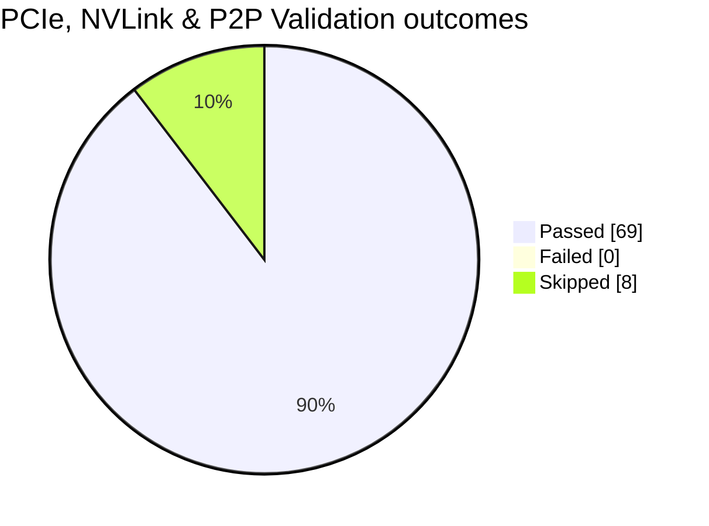
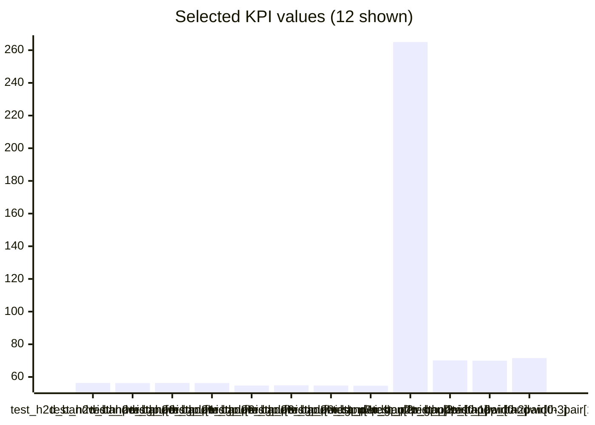

# PCIe, NVLink & P2P Validation

> **Test run:** 2026-08-17 | **Platform:** Linux, Python 3.12.13 | **Accelerators:** 4 x NVIDIA H100 PCIe

## Executive Dashboard

| Collected | Passed | Failed | Skipped | Warnings | Duration | Pass rate* |
|---:|---:|---:|---:|---:|---:|---:|
| 77 | 69 | 0 | 8 | 0 | 97.49s (0:01:37) | 100.0% |

*Pass rate excludes skipped tests.

## Result Visuals

## Key Findings

- **Result:** No test failures were recorded in this module.
- **Coverage note:** 8 test(s) were skipped because of topology, dependency, model, or environment constraints.

## Individual Test Results

| # | Test class | Test | Result | KPI records |
|---:|---|---|---|---:|
| 1 | `TestPCIeTopology` | `test_pcie_gen5_sysfs` | **PASS** | 0 |
| 2 | `TestPCIeTopology` | `test_gpu_pcie_devices_visible` | **PASS** | 0 |
| 3 | `TestH2DBandwidth` | `test_h2d_bandwidth_per_gpu[0]` | **PASS** | 1 |
| 4 | `TestH2DBandwidth` | `test_h2d_bandwidth_per_gpu[1]` | **PASS** | 1 |
| 5 | `TestH2DBandwidth` | `test_h2d_bandwidth_per_gpu[2]` | **PASS** | 1 |
| 6 | `TestH2DBandwidth` | `test_h2d_bandwidth_per_gpu[3]` | **PASS** | 1 |
| 7 | `TestD2HBandwidth` | `test_d2h_bandwidth_per_gpu[0]` | **PASS** | 1 |
| 8 | `TestD2HBandwidth` | `test_d2h_bandwidth_per_gpu[1]` | **PASS** | 1 |
| 9 | `TestD2HBandwidth` | `test_d2h_bandwidth_per_gpu[2]` | **PASS** | 1 |
| 10 | `TestD2HBandwidth` | `test_d2h_bandwidth_per_gpu[3]` | **PASS** | 1 |
| 11 | `TestBidirectionalPCIeBandwidth` | `test_bidir_pcie_bandwidth_per_gpu[0]` | **PASS** | 0 |
| 12 | `TestBidirectionalPCIeBandwidth` | `test_bidir_pcie_bandwidth_per_gpu[1]` | **PASS** | 0 |
| 13 | `TestBidirectionalPCIeBandwidth` | `test_bidir_pcie_bandwidth_per_gpu[2]` | **PASS** | 0 |
| 14 | `TestBidirectionalPCIeBandwidth` | `test_bidir_pcie_bandwidth_per_gpu[3]` | **PASS** | 0 |
| 15 | `TestAllGPUH2D` | `test_concurrent_h2d_all_gpus` | **PASS** | 0 |
| 16 | `TestNVLinkDetection` | `test_p2p_access_enabled` | **PASS** | 0 |
| 17 | `TestNVLinkDetection` | `test_nvlink_link_count_per_gpu` | **PASS** | 0 |
| 18 | `TestP2PBandwidth` | `test_p2p_bandwidth_pair[0-1]` | **PASS** | 1 |
| 19 | `TestP2PBandwidth` | `test_p2p_bandwidth_pair[0-2]` | **PASS** | 1 |
| 20 | `TestP2PBandwidth` | `test_p2p_bandwidth_pair[0-3]` | **PASS** | 1 |
| 21 | `TestP2PBandwidth` | `test_p2p_bandwidth_pair[1-2]` | **PASS** | 1 |
| 22 | `TestP2PBandwidth` | `test_p2p_bandwidth_pair[1-3]` | **PASS** | 1 |
| 23 | `TestP2PBandwidth` | `test_p2p_bandwidth_pair[2-3]` | **PASS** | 1 |
| 24 | `TestNVLinkAllToAll` | `test_all_to_all_aggregate_bandwidth` | **PASS** | 0 |
| 25 | `TestPCIeVsNVLink` | `test_nvlink_faster_than_pcie` | **PASS** | 0 |
| 26 | `TestUVAMemoryAccess` | `test_uva_p2p_read_write[0-1]` | **PASS** | 0 |
| 27 | `TestUVAMemoryAccess` | `test_uva_p2p_read_write[0-2]` | **SKIP** | 0 |
| 28 | `TestUVAMemoryAccess` | `test_uva_p2p_read_write[0-3]` | **SKIP** | 0 |
| 29 | `TestUVAMemoryAccess` | `test_uva_p2p_read_write[1-0]` | **PASS** | 0 |
| 30 | `TestUVAMemoryAccess` | `test_uva_p2p_read_write[1-2]` | **SKIP** | 0 |
| 31 | `TestUVAMemoryAccess` | `test_uva_p2p_read_write[1-3]` | **SKIP** | 0 |
| 32 | `TestUVAMemoryAccess` | `test_uva_p2p_read_write[2-0]` | **SKIP** | 0 |
| 33 | `TestUVAMemoryAccess` | `test_uva_p2p_read_write[2-1]` | **SKIP** | 0 |
| 34 | `TestUVAMemoryAccess` | `test_uva_p2p_read_write[2-3]` | **PASS** | 0 |
| 35 | `TestUVAMemoryAccess` | `test_uva_p2p_read_write[3-0]` | **SKIP** | 0 |
| 36 | `TestUVAMemoryAccess` | `test_uva_p2p_read_write[3-1]` | **SKIP** | 0 |
| 37 | `TestUVAMemoryAccess` | `test_uva_p2p_read_write[3-2]` | **PASS** | 0 |
| 38 | `TestCPUGPUPipelineOverlap` | `test_compute_transfer_overlap[0]` | **PASS** | 0 |
| 39 | `TestCPUGPUPipelineOverlap` | `test_compute_transfer_overlap[1]` | **PASS** | 0 |
| 40 | `TestCPUGPUPipelineOverlap` | `test_compute_transfer_overlap[2]` | **PASS** | 0 |
| 41 | `TestCPUGPUPipelineOverlap` | `test_compute_transfer_overlap[3]` | **PASS** | 0 |
| 42 | `TestDMAConsistency` | `test_large_h2d_data_integrity[64-0]` | **PASS** | 0 |
| 43 | `TestDMAConsistency` | `test_large_h2d_data_integrity[64-1]` | **PASS** | 0 |
| 44 | `TestDMAConsistency` | `test_large_h2d_data_integrity[64-2]` | **PASS** | 0 |
| 45 | `TestDMAConsistency` | `test_large_h2d_data_integrity[64-3]` | **PASS** | 0 |
| 46 | `TestDMAConsistency` | `test_large_h2d_data_integrity[256-0]` | **PASS** | 0 |
| 47 | `TestDMAConsistency` | `test_large_h2d_data_integrity[256-1]` | **PASS** | 0 |
| 48 | `TestDMAConsistency` | `test_large_h2d_data_integrity[256-2]` | **PASS** | 0 |
| 49 | `TestDMAConsistency` | `test_large_h2d_data_integrity[256-3]` | **PASS** | 0 |
| 50 | `TestDMAConsistency` | `test_large_h2d_data_integrity[512-0]` | **PASS** | 0 |
| 51 | `TestDMAConsistency` | `test_large_h2d_data_integrity[512-1]` | **PASS** | 0 |
| 52 | `TestDMAConsistency` | `test_large_h2d_data_integrity[512-2]` | **PASS** | 0 |
| 53 | `TestDMAConsistency` | `test_large_h2d_data_integrity[512-3]` | **PASS** | 0 |
| 54 | `TestDMAConsistency` | `test_large_h2d_data_integrity[1024-0]` | **PASS** | 0 |
| 55 | `TestDMAConsistency` | `test_large_h2d_data_integrity[1024-1]` | **PASS** | 0 |
| 56 | `TestDMAConsistency` | `test_large_h2d_data_integrity[1024-2]` | **PASS** | 0 |
| 57 | `TestDMAConsistency` | `test_large_h2d_data_integrity[1024-3]` | **PASS** | 0 |
| 58 | `TestMultiStreamParallelSweep` | `test_multistream_parallel_bidir_sweep[0]` | **PASS** | 0 |
| 59 | `TestMultiStreamParallelSweep` | `test_multistream_parallel_bidir_sweep[1]` | **PASS** | 0 |
| 60 | `TestMultiStreamParallelSweep` | `test_multistream_parallel_bidir_sweep[2]` | **PASS** | 0 |
| 61 | `TestMultiStreamParallelSweep` | `test_multistream_parallel_bidir_sweep[3]` | **PASS** | 0 |
| 62 | `TestMultiStreamH2DSweep` | `test_multistream_h2d_sweep[0]` | **PASS** | 0 |
| 63 | `TestMultiStreamH2DSweep` | `test_multistream_h2d_sweep[1]` | **PASS** | 0 |
| 64 | `TestMultiStreamH2DSweep` | `test_multistream_h2d_sweep[2]` | **PASS** | 0 |
| 65 | `TestMultiStreamH2DSweep` | `test_multistream_h2d_sweep[3]` | **PASS** | 0 |
| 66 | `TestMultiStreamD2HSweep` | `test_multistream_d2h_sweep[0]` | **PASS** | 0 |
| 67 | `TestMultiStreamD2HSweep` | `test_multistream_d2h_sweep[1]` | **PASS** | 0 |
| 68 | `TestMultiStreamD2HSweep` | `test_multistream_d2h_sweep[2]` | **PASS** | 0 |
| 69 | `TestMultiStreamD2HSweep` | `test_multistream_d2h_sweep[3]` | **PASS** | 0 |
| 70 | `TestMicroTransferLatency` | `test_h2d_latency_sweep[0]` | **PASS** | 0 |
| 71 | `TestMicroTransferLatency` | `test_h2d_latency_sweep[1]` | **PASS** | 0 |
| 72 | `TestMicroTransferLatency` | `test_h2d_latency_sweep[2]` | **PASS** | 0 |
| 73 | `TestMicroTransferLatency` | `test_h2d_latency_sweep[3]` | **PASS** | 0 |
| 74 | `TestMicroTransferLatency` | `test_d2h_latency_sweep[0]` | **PASS** | 0 |
| 75 | `TestMicroTransferLatency` | `test_d2h_latency_sweep[1]` | **PASS** | 0 |
| 76 | `TestMicroTransferLatency` | `test_d2h_latency_sweep[2]` | **PASS** | 0 |
| 77 | `TestMicroTransferLatency` | `test_d2h_latency_sweep[3]` | **PASS** | 0 |

## KPI & Measurement Details

### test_h2d_bandwidth_per_gpu[0]

**Result:** PASS

- `H2D PCIe BW GPU 0                                   measured=    56.325  theoretical=    63.000  efficiency= 89.41%  threshold=    65%`

**TC-IC-02_h2d_bandwidth_gpu0**

| KPI | Value |
|---|---:|
| `bandwidth_gbs` | 56.33 |
| `device_idx` | 0 |
| `theoretical_gbs` | 63.0 |

### test_h2d_bandwidth_per_gpu[1]

**Result:** PASS

- `H2D PCIe BW GPU 1                                   measured=    56.283  theoretical=    63.000  efficiency= 89.34%  threshold=    65%`

**TC-IC-02_h2d_bandwidth_gpu1**

| KPI | Value |
|---|---:|
| `bandwidth_gbs` | 56.28 |
| `device_idx` | 1 |
| `theoretical_gbs` | 63.0 |

### test_h2d_bandwidth_per_gpu[2]

**Result:** PASS

- `H2D PCIe BW GPU 2                                   measured=    56.315  theoretical=    63.000  efficiency= 89.39%  threshold=    65%`

**TC-IC-02_h2d_bandwidth_gpu2**

| KPI | Value |
|---|---:|
| `bandwidth_gbs` | 56.32 |
| `device_idx` | 2 |
| `theoretical_gbs` | 63.0 |

### test_h2d_bandwidth_per_gpu[3]

**Result:** PASS

- `H2D PCIe BW GPU 3                                   measured=    56.260  theoretical=    63.000  efficiency= 89.30%  threshold=    65%`

**TC-IC-02_h2d_bandwidth_gpu3**

| KPI | Value |
|---|---:|
| `bandwidth_gbs` | 56.26 |
| `device_idx` | 3 |
| `theoretical_gbs` | 63.0 |

### test_d2h_bandwidth_per_gpu[0]

**Result:** PASS

- `D2H PCIe BW GPU 0                                   measured=    54.735  theoretical=    63.000  efficiency= 86.88%  threshold=    65%`

**TC-IC-03_d2h_bandwidth_gpu0**

| KPI | Value |
|---|---:|
| `bandwidth_gbs` | 54.74 |
| `device_idx` | 0 |
| `theoretical_gbs` | 63.0 |

### test_d2h_bandwidth_per_gpu[1]

**Result:** PASS

- `D2H PCIe BW GPU 1                                   measured=    54.887  theoretical=    63.000  efficiency= 87.12%  threshold=    65%`

**TC-IC-03_d2h_bandwidth_gpu1**

| KPI | Value |
|---|---:|
| `bandwidth_gbs` | 54.89 |
| `device_idx` | 1 |
| `theoretical_gbs` | 63.0 |

### test_d2h_bandwidth_per_gpu[2]

**Result:** PASS

- `D2H PCIe BW GPU 2                                   measured=    54.765  theoretical=    63.000  efficiency= 86.93%  threshold=    65%`

**TC-IC-03_d2h_bandwidth_gpu2**

| KPI | Value |
|---|---:|
| `bandwidth_gbs` | 54.76 |
| `device_idx` | 2 |
| `theoretical_gbs` | 63.0 |

### test_d2h_bandwidth_per_gpu[3]

**Result:** PASS

- `D2H PCIe BW GPU 3                                   measured=    54.660  theoretical=    63.000  efficiency= 86.76%  threshold=    65%`

**TC-IC-03_d2h_bandwidth_gpu3**

| KPI | Value |
|---|---:|
| `bandwidth_gbs` | 54.66 |
| `device_idx` | 3 |
| `theoretical_gbs` | 63.0 |

### test_concurrent_h2d_all_gpus

**Result:** PASS

- `Concurrent H2D BW all 4 GPUs                        measured=   205.212  theoretical=   252.000  efficiency= 81.43%  threshold=    65%`

### test_p2p_bandwidth_pair[0-1]

**Result:** PASS

- `NVLink P2P BW GPU 0->1                              measured=   265.008  theoretical=   300.000  efficiency= 88.34%  threshold=    70%`

**TC-IC-07_p2p_bandwidth_gpu0_to_1**

| KPI | Value |
|---|---:|
| `bandwidth_gbs` | 265.01 |
| `dst` | 1 |
| `src` | 0 |
| `theoretical_gbs` | 300.0 |

### test_p2p_bandwidth_pair[0-2]

**Result:** PASS

- `PCIe P2P P2P BW GPU 0->2                            measured=    70.123  theoretical=    63.000  efficiency=111.31%  threshold=    50%`

**TC-IC-07_p2p_bandwidth_gpu0_to_2**

| KPI | Value |
|---|---:|
| `bandwidth_gbs` | 70.12 |
| `dst` | 2 |
| `src` | 0 |
| `theoretical_gbs` | 300.0 |

### test_p2p_bandwidth_pair[0-3]

**Result:** PASS

- `PCIe P2P P2P BW GPU 0->3                            measured=    69.968  theoretical=    63.000  efficiency=111.06%  threshold=    50%`

**TC-IC-07_p2p_bandwidth_gpu0_to_3**

| KPI | Value |
|---|---:|
| `bandwidth_gbs` | 69.97 |
| `dst` | 3 |
| `src` | 0 |
| `theoretical_gbs` | 300.0 |

### test_p2p_bandwidth_pair[1-2]

**Result:** PASS

- `PCIe P2P P2P BW GPU 1->2                            measured=    71.558  theoretical=    63.000  efficiency=113.58%  threshold=    50%`

**TC-IC-07_p2p_bandwidth_gpu1_to_2**

| KPI | Value |
|---|---:|
| `bandwidth_gbs` | 71.56 |
| `dst` | 2 |
| `src` | 1 |
| `theoretical_gbs` | 300.0 |

### test_p2p_bandwidth_pair[1-3]

**Result:** PASS

- `PCIe P2P P2P BW GPU 1->3                            measured=    71.503  theoretical=    63.000  efficiency=113.50%  threshold=    50%`

**TC-IC-07_p2p_bandwidth_gpu1_to_3**

| KPI | Value |
|---|---:|
| `bandwidth_gbs` | 71.5 |
| `dst` | 3 |
| `src` | 1 |
| `theoretical_gbs` | 300.0 |

### test_p2p_bandwidth_pair[2-3]

**Result:** PASS

- `NVLink P2P BW GPU 2->3                              measured=   265.198  theoretical=   300.000  efficiency= 88.40%  threshold=    70%`

**TC-IC-07_p2p_bandwidth_gpu2_to_3**

| KPI | Value |
|---|---:|
| `bandwidth_gbs` | 265.2 |
| `dst` | 3 |
| `src` | 2 |
| `theoretical_gbs` | 300.0 |

### test_all_to_all_aggregate_bandwidth

**Result:** PASS

- `All-to-all P2P aggregate BW                         measured=   525.998  theoretical=  1704.000  efficiency= 30.87%  threshold=    20%`

## Traceability

- Source log: `dmr_all_test-aug17.log`
- Pytest module: `tests/test_interconnect_validation.py`
- Results and KPI values are transcribed from the captured run; no missing values were estimated.
