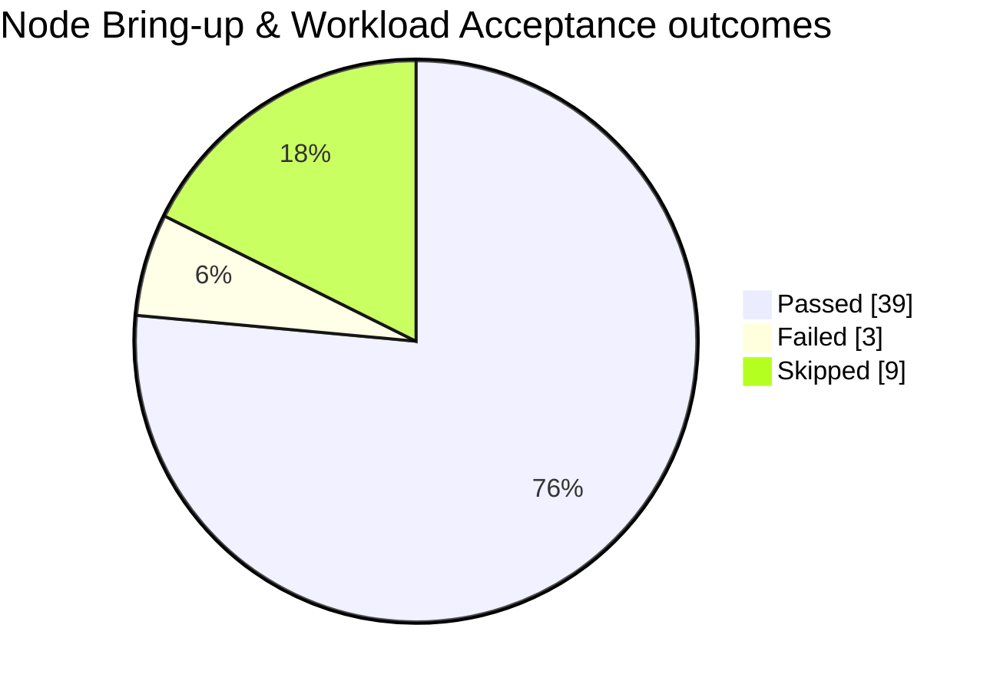
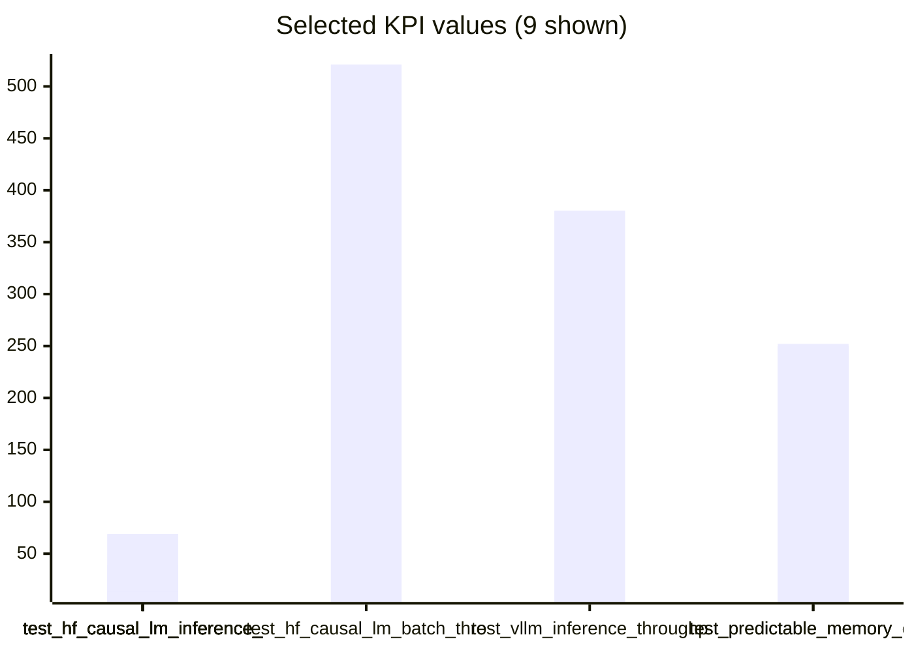

# Node Bring-up & Workload Acceptance

> **Test run:** 2026-08-17 | **Platform:** Linux, Python 3.12.13 | **Accelerators:** 4 x NVIDIA H100 PCIe

## Executive Dashboard

| Collected | Passed | Failed | Skipped | Warnings | Duration | Pass rate* |
|---:|---:|---:|---:|---:|---:|---:|
| 51 | 39 | 3 | 9 | 20 | 2331.58s (0:38:51) | 92.9% |

*Pass rate excludes skipped tests.

## Result Visuals

## Key Findings

- **Action required:** 3 test(s) failed; root causes are summarized below.
- **Coverage note:** 9 test(s) were skipped because of topology, dependency, model, or environment constraints.
- **Workload signal:** Core GPU, NCCL, LLM inference, Diffusers, and KV-offload checks passed; D2H GPU 0, vLLM utilization sampling, and YOLO workers failed.

## Individual Test Results

| # | Test class | Test | Result | KPI records |
|---:|---|---|---|---:|
| 1 | `TestGPUEnumerationAndTopology` | `test_gpu_enumeration` | **PASS** | 1 |
| 2 | `TestGPUEnumerationAndTopology` | `test_pcie_topology_discovery` | **PASS** | 1 |
| 3 | `TestGPUEnumerationAndTopology` | `test_topology_consistency` | **PASS** | 1 |
| 4 | `TestPCIeBandwidthDirect` | `test_h2d_bandwidth_all_gpus` | **PASS** | 1 |
| 5 | `TestPCIeBandwidthDirect` | `test_d2h_bandwidth_all_gpus` | **FAIL** | 1 |
| 6 | `TestNVBandwidthMemcpy` | `test_host_to_device_memcpy_ce` | **PASS** | 1 |
| 7 | `TestNVBandwidthMemcpy` | `test_device_to_host_memcpy_ce` | **PASS** | 1 |
| 8 | `TestNVBandwidthMemcpy` | `test_host_to_device_bidirectional_memcpy_ce` | **PASS** | 1 |
| 9 | `TestNVBandwidthMemcpy` | `test_device_to_host_bidirectional_memcpy_ce` | **PASS** | 1 |
| 10 | `TestNVBandwidthMemcpy` | `test_device_to_device_memcpy_read_ce` | **SKIP** | 0 |
| 11 | `TestNVBandwidthMemcpy` | `test_host_to_device_memcpy_sm` | **PASS** | 1 |
| 12 | `TestNVBandwidthMemcpy` | `test_device_to_host_memcpy_sm` | **PASS** | 1 |
| 13 | `TestNVBandwidthMemcpy` | `test_pcie_bw_p2p_latency_hugepages_2mb` | **PASS** | 1 |
| 14 | `TestGPUP2PBandwidth` | `test_p2p_bandwidth_latency_binary` | **SKIP** | 0 |
| 15 | `TestGPUP2PBandwidth` | `test_p2p_bandwidth_pytorch_fallback` | **PASS** | 1 |
| 16 | `TestGPUP2PBandwidth` | `test_p2p_multi_stream_bandwidth` | **PASS** | 1 |
| 17 | `TestCPUGPULaunchAndSyncOverhead` | `test_kernel_launch_latency_stats` | **PASS** | 2 |
| 18 | `TestCPUGPULaunchAndSyncOverhead` | `test_synchronize_overhead_stats` | **PASS** | 1 |
| 19 | `TestCPUGPUPowerAndThrottling` | `test_sustained_gpu_power_stability` | **PASS** | 1 |
| 20 | `TestCPUGPUPowerAndThrottling` | `test_gpu_write_performance_limiters` | **PASS** | 1 |
| 21 | `TestNCCLAndNVLinkValidation` | `test_nvlink_status` | **PASS** | 1 |
| 22 | `TestNCCLAndNVLinkValidation` | `test_nccl_availability` | **PASS** | 1 |
| 23 | `TestNCCLAndNVLinkValidation` | `test_nccl_all_reduce_perf` | **PASS** | 1 |
| 24 | `TestNCCLAndNVLinkValidation` | `test_nccl_all_gather_perf` | **PASS** | 1 |
| 25 | `TestNCCLAndNVLinkValidation` | `test_nccl_reduce_scatter_perf` | **PASS** | 1 |
| 26 | `TestNCCLAndNVLinkValidation` | `test_nccl_p2p_perf` | **PASS** | 1 |
| 27 | `TestNCCLAndNVLinkValidation` | `test_nccl_deterministic_init_variance` | **PASS** | 1 |
| 28 | `TestWorkloadAcceptanceHuggingFace` | `test_workload_preflight_requirements` | **PASS** | 0 |
| 29 | `TestWorkloadAcceptanceHuggingFace` | `test_hf_causal_lm_inference_latency` | **PASS** | 1 |
| 30 | `TestWorkloadAcceptanceHuggingFace` | `test_hf_causal_lm_inference_latency_enterprise_workloads[deepseek_r1_quantized-deepseek-ai/DeepSeek-R1-Distill-Qwen-7B-32-3000.0-True]` | **PASS** | 1 |
| 31 | `TestWorkloadAcceptanceHuggingFace` | `test_hf_causal_lm_inference_latency_enterprise_workloads[llama_7b-meta-llama/Meta-Llama-3.1-8B-Instruct-32-3000.0-False]` | **PASS** | 1 |
| 32 | `TestWorkloadAcceptanceHuggingFace` | `test_hf_causal_lm_inference_latency_enterprise_workloads[llama_70b-meta-llama/Meta-Llama-3.1-70B-Instruct-16-12000.0-True]` | **PASS** | 1 |
| 33 | `TestWorkloadAcceptanceHuggingFace` | `test_hf_causal_lm_inference_latency_enterprise_workloads[qwen_70b-Qwen/Qwen2.5-72B-Instruct-16-12000.0-True]` | **PASS** | 1 |
| 34 | `TestWorkloadAcceptanceHuggingFace` | `test_hf_causal_lm_batch_throughput` | **PASS** | 1 |
| 35 | `TestWorkloadAcceptanceHuggingFace` | `test_vllm_data_pipeline_saturation_inference_prefill` | **FAIL** | 1 |
| 36 | `TestWorkloadAcceptanceHuggingFace` | `test_vision_object_detection_yolo_fps` | **FAIL** | 0 |
| 37 | `TestWorkloadAcceptanceHuggingFace` | `test_vision_image_generation_diffusers_throughput` | **PASS** | 1 |
| 38 | `TestWorkloadAcceptanceHuggingFace` | `test_hf_encoder_training_throughput` | **PASS** | 1 |
| 39 | `TestWorkloadAcceptanceHuggingFace` | `test_vllm_inference_throughput` | **PASS** | 1 |
| 40 | `TestWorkloadAcceptanceHuggingFace` | `test_predictable_memory_orchestration_kv_cache_offload` | **PASS** | 1 |
| 41 | `TestWorkloadAcceptanceHuggingFace` | `test_single_core_gpudirect_rdma_flow` | **SKIP** | 0 |
| 42 | `TestWorkloadAcceptanceHuggingFace` | `test_mmio_write_read_validation` | **PASS** | 1 |
| 43 | `TestWorkloadAcceptanceHuggingFace` | `test_fence_validation_rdma_ordering` | **SKIP** | 0 |
| 44 | `TestWorkloadAcceptanceHuggingFace` | `test_one_dma_read_4kb_validation` | **PASS** | 1 |
| 45 | `TestWorkloadAcceptanceHuggingFace` | `test_looped_rdma_mmio_dma_stress_soak` | **PASS** | 1 |
| 46 | `TestWorkloadAcceptanceHuggingFace` | `test_llm_training_small_multigpu` | **SKIP** | 0 |
| 47 | `TestWorkloadAcceptanceHuggingFace` | `test_llm_training_large_multigpu` | **SKIP** | 0 |
| 48 | `TestWorkloadAcceptanceHuggingFace` | `test_multi_tenant_inference_tail_latency` | **SKIP** | 0 |
| 49 | `TestWorkloadAcceptanceHuggingFace` | `test_multi_model_inference_kv_cache_concurrent` | **SKIP** | 0 |
| 50 | `TestWorkloadAcceptanceHuggingFace` | `test_deepseek_r1_kv_cache_dram_offload` | **SKIP** | 0 |
| 51 | `TestWorkloadAcceptanceHuggingFace` | `test_vllm_training_kpi_status` | **PASS** | 1 |

## Failure Analysis

### test_d2h_bandwidth_all_gpus

**Result:** FAIL

**Observed failure:** GPU 0 D2H measured 38.99 GB/s, below the 40.95 GB/s threshold; the four-GPU mean was 50.81 GB/s.

### test_vllm_data_pipeline_saturation_inference_prefill

**Result:** FAIL

**Observed failure:** GPU utilization sampling reported 0.0% mean and a 0.00 sustained-utilization ratio versus the adjusted 0.50 target under shared-GPU contention.

### test_vision_object_detection_yolo_fps

**Result:** FAIL

**Observed failure:** The YOLO workload collected zero worker results from four processes.

## KPI & Measurement Details

### test_gpu_enumeration

**Result:** PASS

**test_gpu_enumeration**

| KPI | Value |
|---|---:|
| `gpu_count` | 4 |
| `gpus` | [{"driver_version": "595.45.04", "index": 0, "name": "NVIDIA H100 PCIe", "pci_bus_id": "00000000:61:00.0"}, {"driver_version": "595.45.04", "index": 1, "name": "NVIDIA H100 PCIe... |

### test_pcie_topology_discovery

**Result:** PASS

**test_pcie_topology_discovery**

| KPI | Value |
|---|---:|
| `downgraded_gpu_count` | 0 |
| `downgraded_gpus` | [] |
| `gpu_entries` | 4 |
| `matrix_error` | None |
| `nvlink_pair_count` | 0 |
| `pcie_pair_count` | 0 |

### test_topology_consistency

**Result:** PASS

**test_topology_consistency**

| KPI | Value |
|---|---:|
| `gpu_count` | 4 |
| `topology_count` | 4 |
| `valid` | True |

### test_h2d_bandwidth_all_gpus

**Result:** PASS

**test_h2d_bandwidth_all_gpus**

| KPI | Value |
|---|---:|
| `borderline_gpus` | [] |
| `boundary_gbs` | 2.0 |
| `failing_gpus` | [] |
| `gpu_count` | 4 |
| `mean_gbs` | 56.22 |
| `min_gbs` | 56.13 |
| `n_bytes` | 1073741824 |
| `n_iters` | 8 |
| `per_gpu_gbs` | [56.13, 56.29, 56.18, 56.28] |
| `threshold_gbs` | 40.95 |

### test_d2h_bandwidth_all_gpus

**Result:** FAIL

**test_d2h_bandwidth_all_gpus**

| KPI | Value |
|---|---:|
| `borderline_gpus` | [] |
| `boundary_gbs` | 1.0 |
| `failing_gpus` | ["GPU 0: 38.99 GB/s < 40.95 GB/s"] |
| `gpu_count` | 4 |
| `mean_gbs` | 50.81 |
| `min_gbs` | 38.99 |
| `n_bytes` | 1073741824 |
| `n_iters` | 8 |
| `per_gpu_gbs` | [38.99, 54.88, 54.74, 54.64] |
| `threshold_gbs` | 40.95 |

### test_host_to_device_memcpy_ce

**Result:** PASS

**test_nvbandwidth_host_to_device_memcpy_ce**

| KPI | Value |
|---|---:|
| `mean_bw_gbs` | 52.08 |
| `min_bw_gbs` | 40.06 |
| `num_values` | 4 |
| `testcase` | host_to_device_memcpy_ce |
| `threshold_gbs` | 40.0 |

### test_device_to_host_memcpy_ce

**Result:** PASS

**test_nvbandwidth_device_to_host_memcpy_ce**

| KPI | Value |
|---|---:|
| `mean_bw_gbs` | 55.35 |
| `min_bw_gbs` | 55.32 |
| `num_values` | 4 |
| `testcase` | device_to_host_memcpy_ce |
| `threshold_gbs` | 40.0 |

### test_host_to_device_bidirectional_memcpy_ce

**Result:** PASS

**test_nvbandwidth_host_to_device_bidirectional_memcpy_ce**

| KPI | Value |
|---|---:|
| `mean_bw_gbs` | 51.79 |
| `min_bw_gbs` | 51.75 |
| `num_values` | 4 |
| `testcase` | host_to_device_bidirectional_memcpy_ce |
| `threshold_gbs` | 40.0 |

### test_device_to_host_bidirectional_memcpy_ce

**Result:** PASS

**test_nvbandwidth_device_to_host_bidirectional_memcpy_ce**

| KPI | Value |
|---|---:|
| `mean_bw_gbs` | 49.8 |
| `min_bw_gbs` | 49.79 |
| `num_values` | 4 |
| `testcase` | device_to_host_bidirectional_memcpy_ce |
| `threshold_gbs` | 35.0 |

### test_host_to_device_memcpy_sm

**Result:** PASS

**test_nvbandwidth_host_to_device_memcpy_sm**

| KPI | Value |
|---|---:|
| `mean_bw_gbs` | 53.39 |
| `min_bw_gbs` | 53.38 |
| `num_values` | 4 |
| `testcase` | host_to_device_memcpy_sm |
| `threshold_gbs` | 30.0 |

### test_device_to_host_memcpy_sm

**Result:** PASS

**test_nvbandwidth_device_to_host_memcpy_sm**

| KPI | Value |
|---|---:|
| `mean_bw_gbs` | 45.4 |
| `min_bw_gbs` | 38.01 |
| `num_values` | 4 |
| `testcase` | device_to_host_memcpy_sm |
| `threshold_gbs` | 30.0 |

### test_pcie_bw_p2p_latency_hugepages_2mb

**Result:** PASS

**test_pcie_bw_p2p_latency_hugepages_2mb**

| KPI | Value |
|---|---:|
| `bw_results.device_to_host_memcpy_ce` | 55.27 |
| `bw_results.host_to_device_bidirectional_memcpy_ce` | 51.79 |
| `bw_results.host_to_device_memcpy_ce` | 55.93 |
| `bw_results.hugepages_active` | True |
| `bw_results.torch_D2H_gbs` | 54.99 |
| `bw_results.torch_H2D_gbs` | 55.86 |
| `hugepages_active` | True |
| `hugepages_before` | 0 |

### test_p2p_bandwidth_pytorch_fallback

**Result:** PASS

**test_p2p_bandwidth_pytorch_fallback**

| KPI | Value |
|---|---:|
| `attempted_pairs` | 12 |
| `failing_pairs` | 0 |
| `gpu_count` | 4 |
| `inaccessible_pairs` | 0 |
| `mean_gbs` | 134.31 |
| `measured_pairs` | 12 |
| `min_gbs` | 58.48 |
| `min_threshold_gbs` | 40.0 |
| `n_bytes` | 1073741824 |
| `n_iters` | 8 |

### test_p2p_multi_stream_bandwidth

**Result:** PASS

**test_p2p_multi_stream_bandwidth**

| KPI | Value |
|---|---:|
| `assertion_size_bytes` | 1073741824 |
| `assertion_size_label` | 1GiB |
| `directional_symmetry_stream_count` | 4 |
| `failing_pair_count` | 0 |
| `n_iters` | 5 |
| `observed_avg_scaling_ratio` | 1.002 |
| `observed_min_directional_symmetry` | 0.97 |
| `observed_min_scaling_ratio` | 1.0 |
| `required_min_directional_symmetry` | 0.75 |
| `required_min_stability_ratio` | 0.85 |
| `stream_counts` | [1, 2, 4, 8] |
| `tested_pair_count` | 12 |
| `transfer_sizes_bytes` | [4194304, 16777216, 26214400, 67108864, 268435456, 1073741824] |
| `transfer_sizes_labels` | ["4MiB", "16MiB", "25MiB", "64MiB", "256MiB", "1GiB"] |
| `worst_directional_pairs` | [{"directional_symmetry_ratio": 0.97, "forward_pair": "1->3", "reverse_pair": "3->1"}, {"directional_symmetry_ratio": 0.982, "forward_pair": "1->2", "reverse_pair": "2->1"}, {"d... |
| `worst_pairs` | [{"bw_1_stream_gbs": 70.29, "bw_4_stream_gbs": 70.3, "pair": "2->1", "ratio_4_over_1": 1.0}, {"bw_1_stream_gbs": 70.06, "bw_4_stream_gbs": 70.08, "pair": "0->3", "ratio_4_over_1... |

### test_kernel_launch_latency_stats

**Result:** PASS

**test_kernel_launch_latency_stats**

| KPI | Value |
|---|---:|
| `max_us` | 22.362 |
| `mean_us` | 19.018 |
| `min_us` | 17.88 |
| `p50_us` | 18.888 |
| `p95_us` | 20.573 |
| `p99_us` | 21.762 |
| `samples` | 200 |

**test_kernel_launch_latency_stats_extended**

| KPI | Value |
|---|---:|
| `cpu_compute_us` | 337.2129600029439 |
| `cpu_gpu_roundtrip_max_us` | 88.78903463482857 |
| `cpu_gpu_roundtrip_min_us` | 69.28504444658756 |
| `cpu_gpu_roundtrip_p50_us` | 71.56602805480361 |
| `cpu_gpu_roundtrip_p95_us` | 85.02138080075383 |
| `d2h_100kb_bw_gbs` | 7.191050541373446 |
| `d2h_100kb_us` | 14.625024050474167 |
| `d2h_100mb_bw_gbs` | 54.905073408787736 |
| `d2h_100mb_us` | 1910.5779938399792 |
| `d2h_10gb_bw_gbs` | 55.41572431979881 |
| `d2h_10gb_us` | 193764.86900728196 |
| `d2h_10kb_bw_gbs` | 0.8219649035358322 |
| `d2h_10kb_us` | 12.783100828528404 |
| `d2h_10mb_bw_gbs` | 51.42498498300902 |
| `d2h_10mb_us` | 204.03997041285038 |
| `d2h_1gb_bw_gbs` | 54.69676611849969 |
| `d2h_1gb_us` | 19631.80594611913 |
| `d2h_1mb_bw_gbs` | 31.39720667856829 |
| `d2h_1mb_us` | 33.5020013153553 |
| `gpu_compute_us` | 18.60568067058921 |
| `h2d_100kb_bw_gbs` | 5.527961929492206 |
| `h2d_100kb_us` | 18.615974113345146 |
| `h2d_100mb_bw_gbs` | 51.60919345697335 |
| `h2d_100mb_us` | 2054.7700114548206 |
| `h2d_10gb_bw_gbs` | 55.530736933487496 |
| `h2d_10gb_us` | 193875.38300361484 |
| `h2d_10kb_bw_gbs` | 0.6789990367986415 |
| `h2d_10kb_us` | 15.669967979192734 |
| `h2d_10mb_bw_gbs` | 46.41584656024801 |
| `h2d_10mb_us` | 240.89100770652294 |
| `h2d_1gb_bw_gbs` | 56.29007099162142 |
| `h2d_1gb_us` | 19164.543016813695 |
| `h2d_1mb_bw_gbs` | 25.133657916190415 |
| `h2d_1mb_us` | 44.18601747602224 |

### test_synchronize_overhead_stats

**Result:** PASS

**test_synchronize_overhead_stats**

| KPI | Value |
|---|---:|
| `max_us` | 11.849 |
| `mean_us` | 3.15 |
| `min_us` | 2.962 |
| `p50_us` | 3.087 |
| `p95_us` | 3.269 |
| `p99_us` | 3.429 |
| `samples` | 200 |

### test_sustained_gpu_power_stability

**Result:** PASS

**test_sustained_gpu_power_stability**

| KPI | Value |
|---|---:|
| `duration_sec` | 30 |
| `max_w` | 353.48 |
| `mean_w` | 279.46 |
| `min_w` | 89.29 |
| `samples` | 120 |
| `std_w` | 106.86 |

### test_gpu_write_performance_limiters

**Result:** PASS

**test_gpu_write_performance_limiters**

| KPI | Value |
|---|---:|
| `bw_by_size_gbs.16MB` | 2036.69 |
| `bw_by_size_gbs.1MB` | 235.69 |
| `bw_by_size_gbs.256MB` | 1984.03 |
| `bw_by_size_gbs.4KB` | 0.78 |
| `bw_by_size_gbs.512MB` | 2010.77 |
| `bw_by_size_gbs.64KB` | 13.42 |
| `device` | NVIDIA H100 PCIe |
| `n_iters` | 10 |
| `peak_write_bw_gbs` | 2036.69 |

### test_nvlink_status

**Result:** PASS

**test_nvlink_status**

| KPI | Value |
|---|---:|
| `available` | True |
| `status_excerpt` | GPU 0: NVIDIA H100 PCIe (UUID: GPU-79d3bce3-cbf4-fe07-3ac4-34d27bf961f2) 	 Link 0: 26.562 GB/s 	 Link 1: 26.562 GB/s 	 Link 2: 26.562 GB/s 	 Link 3: 26.562 GB/s 	 Link 4: <inactive> 	 Link 5: <inactive> 	 Link 6: 26.562 GB/s 	 Link 7: 26.562 GB/s 	 Link 8: 26.562 GB/s 	 Link 9: 26.562 GB/s 	 Link 10: <inactive> 	 Link 11: <inactive> 	 Link 12: 26.562 GB/s 	 Link 13: 26.562 GB/s 	 Link 14: 26.562 GB/s 	 Link 15: 26.562 GB/s 	 Link 16: <inactive> 	 Link 17: <inactive> GPU 1: NVIDIA H100 PCIe (UUID |

### test_nccl_availability

**Result:** PASS

**test_nccl_availability**

| KPI | Value |
|---|---:|
| `available` | True |
| `message` | NCCL available via torch.cuda.nccl (version tuple: (2, 28, 9)) |

### test_nccl_all_reduce_perf

**Result:** PASS

**test_nccl_all_reduce_perf**

| KPI | Value |
|---|---:|
| `gpu_count` | 4 |
| `iters` | 30 |
| `mean_busbw_gbs` | 50.35 |
| `peak_busbw_gbs` | 95.21 |
| `samples` | 6 |
| `threshold_gbs` | 30.0 |

### test_nccl_all_gather_perf

**Result:** PASS

**test_nccl_all_gather_perf**

| KPI | Value |
|---|---:|
| `gpu_count` | 4 |
| `iters` | 30 |
| `mean_busbw_gbs` | 45.45 |
| `peak_busbw_gbs` | 60.39 |
| `samples` | 5 |

### test_nccl_reduce_scatter_perf

**Result:** PASS

**test_nccl_reduce_scatter_perf**

| KPI | Value |
|---|---:|
| `gpu_count` | 4 |
| `iters` | 30 |
| `mean_busbw_gbs` | 38.83 |
| `peak_busbw_gbs` | 56.03 |
| `samples` | 5 |

### test_nccl_p2p_perf

**Result:** PASS

**test_nccl_p2p_perf**

| KPI | Value |
|---|---:|
| `gpu_count` | 4 |
| `iters` | 30 |
| `mean_busbw_gbs` | 24.93 |
| `peak_busbw_gbs` | 26.48 |
| `samples` | 5 |

### test_nccl_deterministic_init_variance

**Result:** PASS

**test_nccl_deterministic_init_variance**

| KPI | Value |
|---|---:|
| `gpu_count` | 4 |
| `iterations` | 50 |
| `mean_algbw_gbs` | 0.0 |
| `samples` | 1 |

### test_hf_causal_lm_inference_latency

**Result:** PASS

**test_hf_causal_lm_inference_latency**

| KPI | Value |
|---|---:|
| `completion_time_sec` | 307.11 |
| `max_new_tokens` | 32 |
| `mean_latency_ms` | 465.18 |
| `model` | meta-llama/Meta-Llama-3.1-8B-Instruct |
| `p95_latency_ms` | 558.69 |
| `runtime_sec` | 300.04 |
| `samples` | 645 |
| `throughput_tokens_per_sec` | 68.79 |

### test_hf_causal_lm_inference_latency_enterprise_workloads[deepseek_r1_quantized-deepseek-ai/DeepSeek-R1-Distill-Qwen-7B-32-3000.0-True]

**Result:** PASS

**test_hf_causal_lm_inference_latency_enterprise_workloads_deepseek_r1_quantized**

| KPI | Value |
|---|---:|
| `completion_time_sec` | 318.39 |
| `max_new_tokens` | 32 |
| `mean_latency_ms` | 813.87 |
| `model` | deepseek-ai/DeepSeek-R1-Distill-Qwen-7B |
| `p95_latency_ms` | 920.75 |
| `runtime_sec` | 300.32 |
| `samples` | 369 |
| `throughput_tokens_per_sec` | 39.32 |
| `used_4bit_quant` | True |

### test_hf_causal_lm_inference_latency_enterprise_workloads[llama_7b-meta-llama/Meta-Llama-3.1-8B-Instruct-32-3000.0-False]

**Result:** PASS

**test_hf_causal_lm_inference_latency_enterprise_workloads_llama_7b**

| KPI | Value |
|---|---:|
| `completion_time_sec` | 303.53 |
| `max_new_tokens` | 32 |
| `mean_latency_ms` | 463.35 |
| `model` | meta-llama/Meta-Llama-3.1-8B-Instruct |
| `p95_latency_ms` | 558.66 |
| `runtime_sec` | 300.25 |
| `samples` | 648 |
| `throughput_tokens_per_sec` | 69.06 |
| `used_4bit_quant` | False |

### test_hf_causal_lm_inference_latency_enterprise_workloads[llama_70b-meta-llama/Meta-Llama-3.1-70B-Instruct-16-12000.0-True]

**Result:** PASS

**test_hf_causal_lm_inference_latency_enterprise_workloads_llama_70b**

| KPI | Value |
|---|---:|
| `completion_time_sec` | 319.39 |
| `max_new_tokens` | 16 |
| `mean_latency_ms` | 1191.74 |
| `model` | meta-llama/Meta-Llama-3.1-70B-Instruct |
| `p95_latency_ms` | 1290.74 |
| `runtime_sec` | 300.32 |
| `samples` | 252 |
| `throughput_tokens_per_sec` | 13.43 |
| `used_4bit_quant` | True |

### test_hf_causal_lm_inference_latency_enterprise_workloads[qwen_70b-Qwen/Qwen2.5-72B-Instruct-16-12000.0-True]

**Result:** PASS

**test_hf_causal_lm_inference_latency_enterprise_workloads_qwen_70b**

| KPI | Value |
|---|---:|
| `completion_time_sec` | 423.93 |
| `max_new_tokens` | 16 |
| `mean_latency_ms` | 1192.41 |
| `model` | Qwen/Qwen2.5-72B-Instruct |
| `p95_latency_ms` | 1278.13 |
| `runtime_sec` | 300.49 |
| `samples` | 252 |
| `throughput_tokens_per_sec` | 13.42 |
| `used_4bit_quant` | True |

### test_hf_causal_lm_batch_throughput

**Result:** PASS

**test_hf_causal_lm_batch_throughput**

| KPI | Value |
|---|---:|
| `batch_size` | 8 |
| `completion_time_sec` | 9.61 |
| `elapsed_sec` | 4.91 |
| `iterations` | 5 |
| `max_new_tokens` | 64 |
| `model` | meta-llama/Meta-Llama-3.1-8B-Instruct |
| `throughput_tokens_per_sec` | 521.16 |

### test_vllm_data_pipeline_saturation_inference_prefill

**Result:** FAIL

**test_vllm_data_pipeline_saturation_inference_prefill**

| KPI | Value |
|---|---:|
| `baseline_active_compute_processes` | 1 |
| `benchmark_mode` | vllm_cli_serve_bench |
| `contention_detected` | True |
| `cpu_mean_util_pct` | 0.26 |
| `cpu_p95_util_pct` | 0.5 |
| `cpu_under_70_ratio` | 1.0 |
| `cpu_under_70_ratio_target` | 0.8 |
| `gpu_mean_util_pct` | 0.0 |
| `gpu_over_90_ratio` | 0.0 |
| `gpu_over_90_ratio_target` | 0.5 |
| `input_len_mean` | 1024 |
| `max_active_compute_processes` | 2 |
| `model` | meta-llama/Meta-Llama-3.1-8B-Instruct |
| `p50_ms` | None |
| `p95_ms` | None |
| `p99_ms` | None |
| `request_rate` | 100 |
| `runtime_sec` | 240.24 |
| `vllm_version` | 0.23.0 |

### test_vision_image_generation_diffusers_throughput

**Result:** PASS

**test_vision_image_generation_diffusers_throughput**

| KPI | Value |
|---|---:|
| `guidance_scale` | 0.0 |
| `height` | 512 |
| `images_per_gpu` | 32 |
| `makespan_sec` | 2.445 |
| `model` | stabilityai/sd-turbo |
| `per_rank_mean_img_per_sec` | 13.09 |
| `per_rank_min_img_per_sec` | 13.09 |
| `steps` | 1 |
| `throughput_img_per_sec` | 52.359 |
| `throughput_target_img_per_sec` | 10.0 |
| `total_images` | 128 |
| `warmup` | 2 |
| `width` | 512 |
| `world_size` | 4 |

### test_hf_encoder_training_throughput

**Result:** PASS

**test_hf_encoder_training_throughput**

| KPI | Value |
|---|---:|
| `batch_size` | 16 |
| `completion_time_sec` | 1.35 |
| `elapsed_sec` | 0.5628 |
| `model` | bert-base-uncased |
| `samples_per_sec` | 284.27 |
| `seq_len` | 128 |
| `steps` | 10 |

### test_vllm_inference_throughput

**Result:** PASS

**test_vllm_inference_throughput**

| KPI | Value |
|---|---:|
| `completion_time_sec` | 21.81 |
| `elapsed_sec` | 0.673 |
| `max_tokens_per_prompt` | 64 |
| `model` | meta-llama/Meta-Llama-3.1-8B-Instruct |
| `prompts` | 4 |
| `throughput_tokens_per_sec` | 380.38 |
| `total_tokens` | 256 |

### test_predictable_memory_orchestration_kv_cache_offload

**Result:** PASS

**test_predictable_memory_orchestration_kv_cache_offload**

| KPI | Value |
|---|---:|
| `baseline_mean_latency_ms` | 6831.5342 |
| `baseline_p50_latency_ms` | 6824.2287 |
| `baseline_p95_latency_ms` | 6890.6732 |
| `baseline_p99_latency_ms` | 6896.5794 |
| `baseline_page_faults_per_sec` | 0.0 |
| `baseline_throughput_tokens_per_sec` | 249.82 |
| `batch_size` | 4 |
| `effective_context_length` | 8192 |
| `estimated_kv_volume_gb` | 0.0 |
| `estimated_pcie_utilization_percent` | 0.0 |
| `latency_increase_percent` | -0.9 |
| `max_tokens_per_prompt` | 512 |
| `model` | meta-llama/Meta-Llama-3.1-8B-Instruct |
| `num_prompts` | 10 |
| `offload_mean_latency_ms` | 6771.6731 |
| `offload_p50_latency_ms` | 6830.0275 |
| `offload_p95_latency_ms` | 6872.3966 |
| `offload_p99_latency_ms` | 6876.1627 |
| `offload_page_faults_per_sec` | 0.0 |
| `offload_throughput_tokens_per_sec` | 252.02 |
| `pcie_bandwidth_gb_per_sec` | 16.0 |
| `requested_context_length` | 8192 |
| `throughput_degradation_percent` | -0.9 |

### test_mmio_write_read_validation

**Result:** PASS

**test_mmio_write_read_validation**

| KPI | Value |
|---|---:|
| `command_reg_read_1` | 0546 |
| `command_reg_read_2` | 0546 |
| `mode` | setpci_fallback |
| `nic_bdf` | 0000:11:00.0 |
| `write_attempted` | False |

### test_one_dma_read_4kb_validation

**Result:** PASS

**test_one_dma_read_4kb_validation**

| KPI | Value |
|---|---:|
| `completion_status` | success |
| `data_compare_pass` | True |
| `elapsed_ms` | 0.1646 |
| `transfer_bytes` | 4096 |

### test_looped_rdma_mmio_dma_stress_soak

**Result:** PASS

**test_looped_rdma_mmio_dma_stress_soak**

| KPI | Value |
|---|---:|
| `avg_latency_us` | 12.71 |
| `bandwidth_gbps` | 0.6 |
| `data_mismatch_count` | 0 |
| `loops` | 1000 |
| `p95_latency_us` | 13.08 |
| `transfer_bytes` | 4096 |

### test_vllm_training_kpi_status

**Result:** PASS

**test_vllm_training_kpi_status**

| KPI | Value |
|---|---:|
| `component` | vllm |
| `note` | vLLM is inference-serving runtime; use PyTorch/DeepSpeed for training KPIs |
| `status` | not_applicable |
| `training_supported` | False |

## Traceability

- Source log: `dmr_all_test-aug17.log`
- Pytest module: `tests/test_node_validation.py`
- Results and KPI values are transcribed from the captured run; no missing values were estimated.
