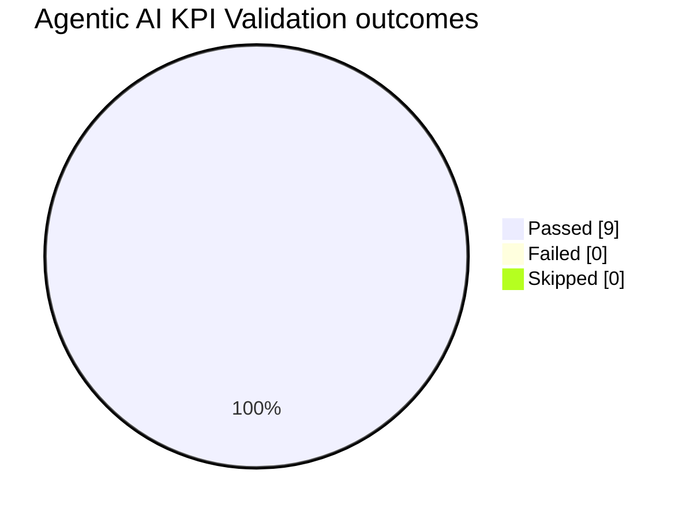

# Agentic AI KPI Validation

> **Test run:** 2026-08-17 | **Platform:** Linux, Python 3.12.13 | **Accelerators:** 4 x NVIDIA H100 PCIe

## Executive Dashboard

| Collected | Passed | Failed | Skipped | Warnings | Duration | Pass rate* |
|---:|---:|---:|---:|---:|---:|---:|
| 9 | 9 | 0 | 0 | 2 | 21.08s | 100.0% |

*Pass rate excludes skipped tests.

## Result Visuals

## Key Findings

- **Result:** No test failures were recorded in this module.

## Individual Test Results

| # | Test class | Test | Result | KPI records |
|---:|---|---|---|---:|
| 1 | `TestToolInvocationOverhead` | `test_single_tool_dispatch_latency` | **PASS** | 1 |
| 2 | `TestToolInvocationOverhead` | `test_parallel_tool_dispatch_scalability` | **PASS** | 1 |
| 3 | `TestReasoningPhaseLatency` | `test_reasoning_latency_by_token_count` | **PASS** | 1 |
| 4 | `TestCPUGPUSynchronization` | `test_cpu_gpu_sync_latency` | **PASS** | 1 |
| 5 | `TestToolExecutionParallelization` | `test_sequential_vs_parallel_tool_execution` | **PASS** | 1 |
| 6 | `TestMultiTurnConversation` | `test_multi_turn_session_latency` | **PASS** | 1 |
| 7 | `TestCPUMemoryDuringToolExecution` | `test_memory_usage_scaling_with_tools` | **PASS** | 1 |
| 8 | `TestAgentStateManagement` | `test_agent_state_serialization_overhead` | **PASS** | 1 |
| 9 | `TestLatencyPercentiles` | `test_agent_latency_percentiles` | **PASS** | 1 |

## KPI & Measurement Details

### test_single_tool_dispatch_latency

**Result:** PASS

**TC-AGENT-01a: Single tool dispatch**

| KPI | Value |
|---|---:|
| `avg_dispatch_latency_ms` | 0.0009369000000000001 |
| `iterations` | 10 |
| `max_dispatch_latency_ms` | 0.003177 |
| `min_dispatch_latency_ms` | 0.000398 |

### test_parallel_tool_dispatch_scalability

**Result:** PASS

**TC-AGENT-01b: Parallel tool dispatch scalability**

| KPI | Value |
|---|---:|
| `all_results.1` | 0.0011803 |
| `all_results.4` | 0.0023788 |
| `all_results.8` | 0.004255699999999999 |
| `all_results.16` | 0.0075984 |
| `latency_16_tools_ms` | 0.0075984 |
| `latency_1_tool_ms` | 0.0011803 |
| `scaling_ratio` | 6.437685334237059 |

### test_reasoning_latency_by_token_count

**Result:** PASS

**TC-AGENT-02: Reasoning phase latency**

| KPI | Value |
|---|---:|
| `device` | GPU |
| `reasoning_latencies_by_tokens.64` | 1.345148729160428 |
| `reasoning_latencies_by_tokens.128` | 2.5956051074899733 |
| `reasoning_latencies_by_tokens.256` | 5.094846186693758 |
| `reasoning_latencies_by_tokens.512` | 10.187741392292082 |

### test_cpu_gpu_sync_latency

**Result:** PASS

**TC-AGENT-03: CPU-GPU sync overhead**

| KPI | Value |
|---|---:|
| `avg_sync_latency_us` | 36.9741 |
| `iterations` | 10 |
| `max_sync_latency_us` | 37.842 |
| `min_sync_latency_us` | 36.35 |

### test_sequential_vs_parallel_tool_execution

**Result:** PASS

**TC-AGENT-04: Tool execution parallelization**

| KPI | Value |
|---|---:|
| `iterations` | 10 |
| `num_tools` | 8 |
| `parallel_time_s` | 2.068382589961402 |
| `sequential_time_s` | 4.084378265077248 |
| `speedup` | 1.9746725218536414 |

### test_multi_turn_session_latency

**Result:** PASS

**TC-AGENT-05: Multi-turn conversation**

| KPI | Value |
|---|---:|
| `avg_reasoning_latency_ms` | 5.216626380570233 |
| `avg_tool_latency_ms` | 200.3944344 |
| `num_turns` | 5 |
| `per_turn_latencies_ms` | [207.20966102089733, 205.28027799446136, 205.19127091392875, 205.23107494227588, 205.17722598742694] |
| `total_session_latency_ms` | 1028.0895108589903 |

### test_memory_usage_scaling_with_tools

**Result:** PASS

**TC-AGENT-06: CPU memory during tool execution**

| KPI | Value |
|---|---:|
| `memory_baseline_mb` | 860.875 |
| `memory_deltas_by_tool_count.1` | 0.0 |
| `memory_deltas_by_tool_count.4` | 0.0 |
| `memory_deltas_by_tool_count.8` | 0.00390625 |

### test_agent_state_serialization_overhead

**Result:** PASS

**TC-AGENT-07: Agent state serialization**

| KPI | Value |
|---|---:|
| `avg_serialization_ms` | 7.9069227 |
| `num_tools_per_turn` | 4 |
| `num_turns` | 5 |
| `serialization_rate_mbps` | 56.71750623033156 |
| `state_size_kb` | 448.4609375 |

### test_agent_latency_percentiles

**Result:** PASS

**TC-AGENT-08: Latency percentiles**

| KPI | Value |
|---|---:|
| `avg_latency_ms` | 59.45304978522472 |
| `max_latency_ms` | 107.45842300821096 |
| `min_latency_ms` | 55.099834920838475 |
| `p50_latency_ms` | 55.1901669241488 |
| `p95_latency_ms` | 107.45842300821096 |
| `p99_latency_ms` | 107.45842300821096 |
| `samples` | 20 |

## Traceability

- Source log: `dmr_all_test-aug17.log`
- Pytest module: `tests/test_agentic_ai_validation.py`
- Results and KPI values are transcribed from the captured run; no missing values were estimated.
