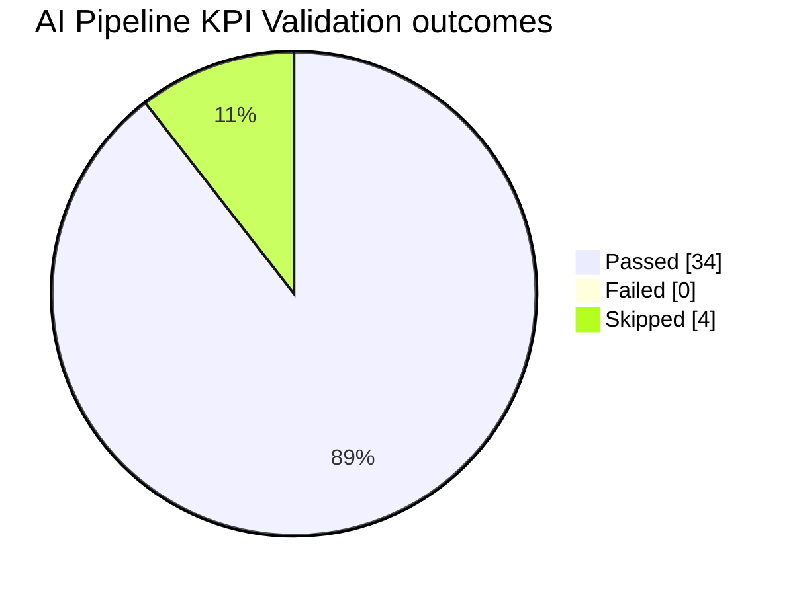
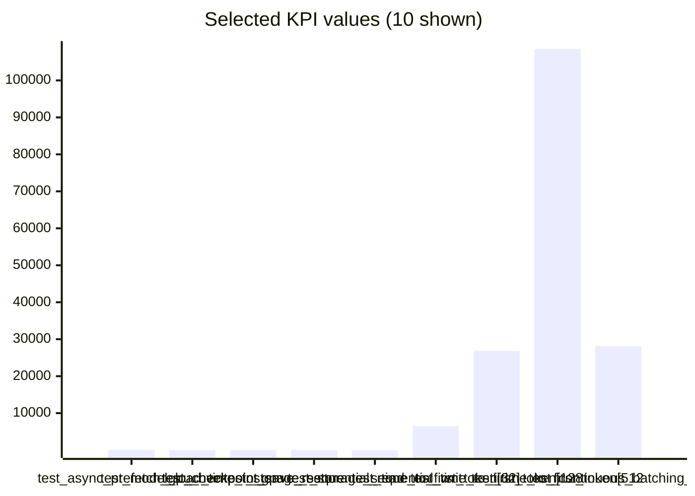

# AI Pipeline KPI Validation

> **Test run:** 2026-08-17 | **Platform:** Linux, Python 3.12.13 | **Accelerators:** 4 x NVIDIA H100 PCIe

## Executive Dashboard

| Collected | Passed | Failed | Skipped | Warnings | Duration | Pass rate* |
|---:|---:|---:|---:|---:|---:|---:|
| 38 | 34 | 0 | 4 | 16 | 88.98s (0:01:28) | 100.0% |

*Pass rate excludes skipped tests.

## Result Visuals

## Key Findings

- **Result:** No test failures were recorded in this module.
- **Coverage note:** 4 test(s) were skipped because of topology, dependency, model, or environment constraints.

## Individual Test Results

| # | Test class | Test | Result | KPI records |
|---:|---|---|---|---:|
| 1 | `TestDataLoadingAndPreprocessing` | `test_tokenizer_throughput_by_seq_len[32]` | **PASS** | 1 |
| 2 | `TestDataLoadingAndPreprocessing` | `test_tokenizer_throughput_by_seq_len[128]` | **PASS** | 1 |
| 3 | `TestDataLoadingAndPreprocessing` | `test_tokenizer_throughput_by_seq_len[512]` | **PASS** | 1 |
| 4 | `TestDataLoadingAndPreprocessing` | `test_tokenizer_throughput_by_seq_len[2048]` | **PASS** | 1 |
| 5 | `TestDataLoadingAndPreprocessing` | `test_tokenizer_multi_thread_scaling` | **PASS** | 1 |
| 6 | `TestDataLoadingAndPreprocessing` | `test_dataloader_cpu_to_pinned_throughput[0]` | **PASS** | 1 |
| 7 | `TestDataLoadingAndPreprocessing` | `test_dataloader_cpu_to_pinned_throughput[2]` | **PASS** | 1 |
| 8 | `TestDataLoadingAndPreprocessing` | `test_dataloader_cpu_to_pinned_throughput[4]` | **PASS** | 1 |
| 9 | `TestDataLoadingAndPreprocessing` | `test_async_prefetch_gpu_overlap_efficiency` | **PASS** | 1 |
| 10 | `TestDataLoadingAndPreprocessing` | `test_cpu_preprocessing_pipeline_throughput` | **PASS** | 1 |
| 11 | `TestModelOrchestration` | `test_model_load_time_to_gpu` | **PASS** | 1 |
| 12 | `TestModelOrchestration` | `test_checkpoint_save_restore_throughput` | **PASS** | 1 |
| 13 | `TestModelOrchestration` | `test_kv_cache_memory_allocation_efficiency` | **PASS** | 1 |
| 14 | `TestModelOrchestration` | `test_tensor_parallel_allreduce_overhead_fraction` | **SKIP** | 0 |
| 15 | `TestModelOrchestration` | `test_batch_assembly_gpu_latency[1]` | **PASS** | 1 |
| 16 | `TestModelOrchestration` | `test_batch_assembly_gpu_latency[4]` | **PASS** | 1 |
| 17 | `TestModelOrchestration` | `test_batch_assembly_gpu_latency[16]` | **PASS** | 1 |
| 18 | `TestNetworkingAndStorageIO` | `test_storage_sequential_read_throughput` | **PASS** | 1 |
| 19 | `TestNetworkingAndStorageIO` | `test_storage_sequential_write_throughput` | **PASS** | 1 |
| 20 | `TestNetworkingAndStorageIO` | `test_storage_random_4k_read_iops` | **PASS** | 1 |
| 21 | `TestNetworkingAndStorageIO` | `test_tcp_loopback_throughput` | **PASS** | 1 |
| 22 | `TestNetworkingAndStorageIO` | `test_model_weight_load_pipeline_bandwidth` | **PASS** | 1 |
| 23 | `TestInferencePipelineKPIs` | `test_time_to_first_token[32]` | **PASS** | 1 |
| 24 | `TestInferencePipelineKPIs` | `test_time_to_first_token[128]` | **PASS** | 1 |
| 25 | `TestInferencePipelineKPIs` | `test_time_to_first_token[512]` | **PASS** | 1 |
| 26 | `TestInferencePipelineKPIs` | `test_time_to_first_token[2048]` | **SKIP** | 0 |
| 27 | `TestInferencePipelineKPIs` | `test_inter_token_latency` | **PASS** | 1 |
| 28 | `TestInferencePipelineKPIs` | `test_prefill_vs_decode_throughput_ratio` | **PASS** | 1 |
| 29 | `TestInferencePipelineKPIs` | `test_batched_inference_throughput[1]` | **PASS** | 1 |
| 30 | `TestInferencePipelineKPIs` | `test_batched_inference_throughput[4]` | **PASS** | 1 |
| 31 | `TestInferencePipelineKPIs` | `test_batched_inference_throughput[8]` | **PASS** | 1 |
| 32 | `TestInferencePipelineKPIs` | `test_batched_inference_throughput[16]` | **PASS** | 1 |
| 33 | `TestInferencePipelineKPIs` | `test_gpu_utilisation_during_inference` | **PASS** | 1 |
| 34 | `TestInferencePipelineKPIs` | `test_hbm_bandwidth_utilisation_during_decode` | **SKIP** | 0 |
| 35 | `TestInferencePipelineKPIs` | `test_continuous_batching_throughput_vllm` | **PASS** | 1 |
| 36 | `TestInferencePipelineKPIs` | `test_latency_throughput_tradeoff_curve` | **PASS** | 1 |
| 37 | `TestInferencePipelineKPIs` | `test_inference_pipeline_latency_breakdown` | **PASS** | 1 |
| 38 | `TestInferencePipelineKPIs` | `test_multi_gpu_inference_throughput_scaling` | **SKIP** | 0 |

## KPI & Measurement Details

### test_tokenizer_throughput_by_seq_len[32]

**Result:** PASS

**test_tokenizer_throughput_by_seq_len**

| KPI | Value |
|---|---:|
| `batch_size` | 64 |
| `elapsed_sec` | 0.048 |
| `iterations` | 10 |
| `seq_len` | 32 |
| `sequences_per_sec` | 13452.7 |
| `threshold_tokens_per_sec` | 50000 |
| `tokens_per_sec` | 430485.7 |

### test_tokenizer_throughput_by_seq_len[128]

**Result:** PASS

**test_tokenizer_throughput_by_seq_len**

| KPI | Value |
|---|---:|
| `batch_size` | 64 |
| `elapsed_sec` | 0.097 |
| `iterations` | 10 |
| `seq_len` | 128 |
| `sequences_per_sec` | 6574.0 |
| `threshold_tokens_per_sec` | 50000 |
| `tokens_per_sec` | 841468.8 |

### test_tokenizer_throughput_by_seq_len[512]

**Result:** PASS

**test_tokenizer_throughput_by_seq_len**

| KPI | Value |
|---|---:|
| `batch_size` | 64 |
| `elapsed_sec` | 0.224 |
| `iterations` | 10 |
| `seq_len` | 512 |
| `sequences_per_sec` | 2855.8 |
| `threshold_tokens_per_sec` | 50000 |
| `tokens_per_sec` | 1462158.0 |

### test_tokenizer_throughput_by_seq_len[2048]

**Result:** PASS

**test_tokenizer_throughput_by_seq_len**

| KPI | Value |
|---|---:|
| `batch_size` | 64 |
| `elapsed_sec` | 0.759 |
| `iterations` | 10 |
| `seq_len` | 2048 |
| `sequences_per_sec` | 843.1 |
| `threshold_tokens_per_sec` | 20000 |
| `tokens_per_sec` | 1726694.3 |

### test_tokenizer_multi_thread_scaling

**Result:** PASS

**test_tokenizer_multi_thread_scaling**

| KPI | Value |
|---|---:|
| `scaling_ratio` | 1.835 |
| `threads_1_tokens_per_sec` | 1002376.3 |
| `threads_4_tokens_per_sec` | 1838983.4 |
| `threshold_scaling_ratio` | 1.03 |

### test_dataloader_cpu_to_pinned_throughput[0]

**Result:** PASS

**test_dataloader_cpu_to_pinned_throughput**

| KPI | Value |
|---|---:|
| `batch_size` | 32 |
| `elapsed_sec` | 0.006 |
| `n_samples` | 2000 |
| `num_workers` | 0 |
| `samples_per_sec` | 334867.8 |
| `seq_len` | 128 |
| `threshold_samples_per_sec` | 1000 |

### test_dataloader_cpu_to_pinned_throughput[2]

**Result:** PASS

**test_dataloader_cpu_to_pinned_throughput**

| KPI | Value |
|---|---:|
| `batch_size` | 32 |
| `elapsed_sec` | 0.044 |
| `n_samples` | 2000 |
| `num_workers` | 2 |
| `samples_per_sec` | 44952.8 |
| `seq_len` | 128 |
| `threshold_samples_per_sec` | 1000 |

### test_dataloader_cpu_to_pinned_throughput[4]

**Result:** PASS

**test_dataloader_cpu_to_pinned_throughput**

| KPI | Value |
|---|---:|
| `batch_size` | 32 |
| `elapsed_sec` | 0.044 |
| `n_samples` | 2000 |
| `num_workers` | 4 |
| `samples_per_sec` | 45589.1 |
| `seq_len` | 128 |
| `threshold_samples_per_sec` | 1000 |

### test_async_prefetch_gpu_overlap_efficiency

**Result:** PASS

**test_async_prefetch_gpu_overlap_efficiency**

| KPI | Value |
|---|---:|
| `best_possible_overlap_pct` | 100.0 |
| `compute_only_sec` | 0.0251 |
| `compute_repeats` | 4 |
| `iterations` | 20 |
| `matrix_size` | 4096 |
| `overlap_efficiency_pct` | 99.5 |
| `pipelined_sec` | 0.0252 |
| `threshold_overlap_pct` | 60.0 |
| `transfer_only_sec` | 0.012 |

### test_cpu_preprocessing_pipeline_throughput

**Result:** PASS

**test_cpu_preprocessing_pipeline_throughput**

| KPI | Value |
|---|---:|
| `batch_size` | 64 |
| `batches_per_sec` | 91.1 |
| `elapsed_sec` | 0.22 |
| `n_batches` | 20 |
| `seq_len` | 128 |
| `threshold_tokens_per_sec` | 200000 |
| `total_tokens_per_sec` | 746252.0 |

### test_model_load_time_to_gpu

**Result:** PASS

**test_model_load_time_to_gpu**

| KPI | Value |
|---|---:|
| `load_bandwidth_gbs` | 1.073 |
| `load_time_sec` | 0.216 |
| `model_id` | openai-community/gpt2 |
| `model_size_gb` | 0.232 |
| `threshold_gbs` | 0.25 |

### test_checkpoint_save_restore_throughput

**Result:** PASS

**test_checkpoint_save_restore_throughput**

| KPI | Value |
|---|---:|
| `checkpoint_size_gb` | 0.156 |
| `restore_bandwidth_gbs` | 6.019 |
| `restore_time_sec` | 0.026 |
| `save_bandwidth_gbs` | 1.757 |
| `save_time_sec` | 0.089 |
| `threshold_restore_gbs` | 0.6 |
| `threshold_save_gbs` | 0.5 |

### test_kv_cache_memory_allocation_efficiency

**Result:** PASS

**test_kv_cache_memory_allocation_efficiency**

| KPI | Value |
|---|---:|
| `alloc_latency_us_per_block` | 9.318 |
| `alloc_time_sec` | 0.0093 |
| `block_bytes` | 8388608 |
| `block_size_tokens` | 16 |
| `blocks_per_sec` | 107318.0 |
| `head_dim` | 128 |
| `n_blocks` | 1000 |
| `n_heads` | 32 |
| `n_layers` | 32 |
| `threshold_blocks_per_sec` | 10000 |
| `total_kv_gb` | 7.812 |

### test_batch_assembly_gpu_latency[1]

**Result:** PASS

**test_batch_assembly_gpu_latency**

| KPI | Value |
|---|---:|
| `assemble_us_per_batch` | 17.951 |
| `batch_size` | 1 |
| `iterations` | 50 |
| `seq_len` | 512 |
| `threshold_us_per_batch` | 500.0 |
| `throughput_batches_per_sec` | 55707.1 |

### test_batch_assembly_gpu_latency[4]

**Result:** PASS

**test_batch_assembly_gpu_latency**

| KPI | Value |
|---|---:|
| `assemble_us_per_batch` | 17.372 |
| `batch_size` | 4 |
| `iterations` | 50 |
| `seq_len` | 512 |
| `threshold_us_per_batch` | 500.0 |
| `throughput_batches_per_sec` | 57564.9 |

### test_batch_assembly_gpu_latency[16]

**Result:** PASS

**test_batch_assembly_gpu_latency**

| KPI | Value |
|---|---:|
| `assemble_us_per_batch` | 18.018 |
| `batch_size` | 16 |
| `iterations` | 50 |
| `seq_len` | 512 |
| `threshold_us_per_batch` | 500.0 |
| `throughput_batches_per_sec` | 55499.4 |

### test_storage_sequential_read_throughput

**Result:** PASS

**test_storage_sequential_read_throughput**

| KPI | Value |
|---|---:|
| `file_size_gb` | 2.0 |
| `read_bandwidth_gbs` | 1.401 |
| `read_time_sec` | 1.428 |
| `storage_path` | /tmp |
| `threshold_gbs` | 1.0 |

### test_storage_sequential_write_throughput

**Result:** PASS

**test_storage_sequential_write_throughput**

| KPI | Value |
|---|---:|
| `file_size_gb` | 2.0 |
| `storage_path` | /tmp |
| `threshold_gbs` | 0.5 |
| `write_bandwidth_gbs` | 1.171 |
| `write_time_sec` | 1.708 |

### test_storage_random_4k_read_iops

**Result:** PASS

**test_storage_random_4k_read_iops**

| KPI | Value |
|---|---:|
| `avg_latency_us` | 93.3 |
| `block_size_bytes` | 4096 |
| `elapsed_sec` | 0.466 |
| `iops` | 10723.0 |
| `n_reads` | 5000 |
| `storage_path` | /tmp |
| `threshold_iops` | 5000 |

### test_tcp_loopback_throughput

**Result:** PASS

**test_tcp_loopback_throughput**

| KPI | Value |
|---|---:|
| `elapsed_sec` | 0.043 |
| `threshold_gbps` | 5.0 |
| `throughput_gbps` | 99.797 |
| `total_bytes_mb` | 512.0 |

### test_model_weight_load_pipeline_bandwidth

**Result:** PASS

**test_model_weight_load_pipeline_bandwidth**

| KPI | Value |
|---|---:|
| `end_to_end_gbs` | 4.456 |
| `shard_size_gb` | 2.0 |
| `threshold_gbs` | 1.0 |
| `total_load_time_sec` | 0.449 |
| `trial_load_times_sec` | [0.449, 1.118, 0.481] |

### test_time_to_first_token[32]

**Result:** PASS

**test_time_to_first_token**

| KPI | Value |
|---|---:|
| `input_len` | 32 |
| `model_id` | openai-community/gpt2 |
| `prefill_throughput_tokens_per_sec` | 6475.4 |
| `samples` | [5.0785469356924295, 5.005544982850552, 4.935986013151705, 4.941805964335799, 4.931667004711926] |
| `threshold_ms` | 200 |
| `ttft_median_ms` | 4.94 |
| `ttft_p95_ms` | 5.06 |

### test_time_to_first_token[128]

**Result:** PASS

**test_time_to_first_token**

| KPI | Value |
|---|---:|
| `input_len` | 128 |
| `model_id` | openai-community/gpt2 |
| `prefill_throughput_tokens_per_sec` | 26852.4 |
| `samples` | [4.8441290855407715, 4.766794038005173, 4.7646439634263515, 4.771596984937787, 4.7588590532541275] |
| `threshold_ms` | 200 |
| `ttft_median_ms` | 4.77 |
| `ttft_p95_ms` | 4.83 |

### test_time_to_first_token[512]

**Result:** PASS

**test_time_to_first_token**

| KPI | Value |
|---|---:|
| `input_len` | 512 |
| `model_id` | openai-community/gpt2 |
| `prefill_throughput_tokens_per_sec` | 108489.5 |
| `samples` | [4.6957050217315555, 4.719352000392973, 4.695506999269128, 4.744146950542927, 4.7195120714604855] |
| `threshold_ms` | 500 |
| `ttft_median_ms` | 4.72 |
| `ttft_p95_ms` | 4.74 |

### test_inter_token_latency

**Result:** PASS

**test_inter_token_latency**

| KPI | Value |
|---|---:|
| `all_itl_ms` | [30.82, 25.964, 26.102, 26.032, 26.823, 27.107, 27.017, 27.278, 26.919, 26.892, 27.598, 27.235, 27.186, 26.913, 27.01, 27.144, 27.112, 27.167, 90.576, 27.163, 27.171, 27.474, 28... |
| `decode_tokens_per_sec` | 36.86 |
| `itl_median_ms` | 27.133 |
| `itl_p95_ms` | 57.595 |
| `model_id` | openai-community/gpt2 |
| `n_decode_steps` | 32 |
| `threshold_itl_p95_ms` | 100.0 |

### test_prefill_vs_decode_throughput_ratio

**Result:** PASS

**test_prefill_vs_decode_throughput_ratio**

| KPI | Value |
|---|---:|
| `decode_samples` | 32 |
| `decode_tps` | 34.6 |
| `model_id` | openai-community/gpt2 |
| `prefill_input_tokens` | 66 |
| `prefill_to_decode_ratio` | 503.75 |
| `prefill_tps` | 17415.1 |
| `threshold_ratio` | 5.0 |

### test_batched_inference_throughput[1]

**Result:** PASS

**test_batched_inference_throughput**

| KPI | Value |
|---|---:|
| `batch_size` | 1 |
| `iterations` | 5 |
| `latency_median_sec` | 0.1277 |
| `latency_ms` | 127.75 |
| `latency_p95_sec` | 0.1907 |
| `model_id` | openai-community/gpt2 |
| `n_gen_tokens` | 32 |
| `seq_len` | 128 |
| `tokens_per_sec` | 250.5 |

### test_batched_inference_throughput[4]

**Result:** PASS

**test_batched_inference_throughput**

| KPI | Value |
|---|---:|
| `batch_size` | 4 |
| `iterations` | 5 |
| `latency_median_sec` | 0.1297 |
| `latency_ms` | 129.73 |
| `latency_p95_sec` | 0.1421 |
| `model_id` | openai-community/gpt2 |
| `n_gen_tokens` | 32 |
| `seq_len` | 128 |
| `tokens_per_sec` | 986.7 |

### test_batched_inference_throughput[8]

**Result:** PASS

**test_batched_inference_throughput**

| KPI | Value |
|---|---:|
| `batch_size` | 8 |
| `iterations` | 5 |
| `latency_median_sec` | 0.1274 |
| `latency_ms` | 127.41 |
| `latency_p95_sec` | 0.1276 |
| `model_id` | openai-community/gpt2 |
| `n_gen_tokens` | 32 |
| `seq_len` | 128 |
| `tokens_per_sec` | 2009.2 |

### test_batched_inference_throughput[16]

**Result:** PASS

**test_batched_inference_throughput**

| KPI | Value |
|---|---:|
| `batch_size` | 16 |
| `iterations` | 5 |
| `latency_median_sec` | 0.1334 |
| `latency_ms` | 133.41 |
| `latency_p95_sec` | 0.1926 |
| `model_id` | openai-community/gpt2 |
| `n_gen_tokens` | 32 |
| `seq_len` | 128 |
| `tokens_per_sec` | 3837.7 |

### test_gpu_utilisation_during_inference

**Result:** PASS

**test_gpu_utilisation_during_inference**

| KPI | Value |
|---|---:|
| `batch_size` | 8 |
| `mean_gpu_util_pct` | 43.15 |
| `mean_mem_util_pct` | 5.31 |
| `model_id` | openai-community/gpt2 |
| `n_gen_tokens` | 64 |
| `n_samples` | 13 |
| `peak_gpu_util_pct` | 44.0 |
| `threshold_mean_util_pct` | 10.0 |

### test_continuous_batching_throughput_vllm

**Result:** PASS

**test_continuous_batching_throughput_vllm**

| KPI | Value |
|---|---:|
| `elapsed_sec` | 0.114 |
| `max_tokens` | 64 |
| `model_id` | openai-community/gpt2 |
| `n_prompts` | 50 |
| `requests_per_sec` | 439.51 |
| `threshold_tps` | 200.0 |
| `throughput_tokens_per_sec` | 28128.4 |
| `total_tokens_generated` | 3200 |

### test_latency_throughput_tradeoff_curve

**Result:** PASS

**test_latency_throughput_tradeoff_curve**

| KPI | Value |
|---|---:|
| `curve.1.latency_ms` | 64.53 |
| `curve.1.tokens_per_sec` | 247.9 |
| `curve.4.latency_ms` | 69.4 |
| `curve.4.tokens_per_sec` | 922.2 |
| `curve.8.latency_ms` | 69.3 |
| `curve.8.tokens_per_sec` | 1847.2 |
| `curve.16.latency_ms` | 68.97 |
| `curve.16.tokens_per_sec` | 3711.6 |
| `model_id` | openai-community/gpt2 |
| `n_gen_tokens` | 16 |
| `seq_len` | 64 |

### test_inference_pipeline_latency_breakdown

**Result:** PASS

**test_inference_pipeline_latency_breakdown**

| KPI | Value |
|---|---:|
| `decode_ms_per_token` | 2.987 |
| `decode_pct` | 92.42 |
| `decode_total_ms` | 47.797 |
| `model_id` | openai-community/gpt2 |
| `n_gen_tokens` | 16 |
| `preprocess_ms` | 0.324 |
| `preprocess_pct` | 0.63 |
| `threshold_preprocess_pct` | 10.0 |
| `total_ms` | 51.72 |
| `ttft_ms` | 3.598 |
| `ttft_pct` | 6.96 |

## Traceability

- Source log: `dmr_all_test-aug17.log`
- Pytest module: `tests/test_ai_pipeline_kpis.py`
- Results and KPI values are transcribed from the captured run; no missing values were estimated.
