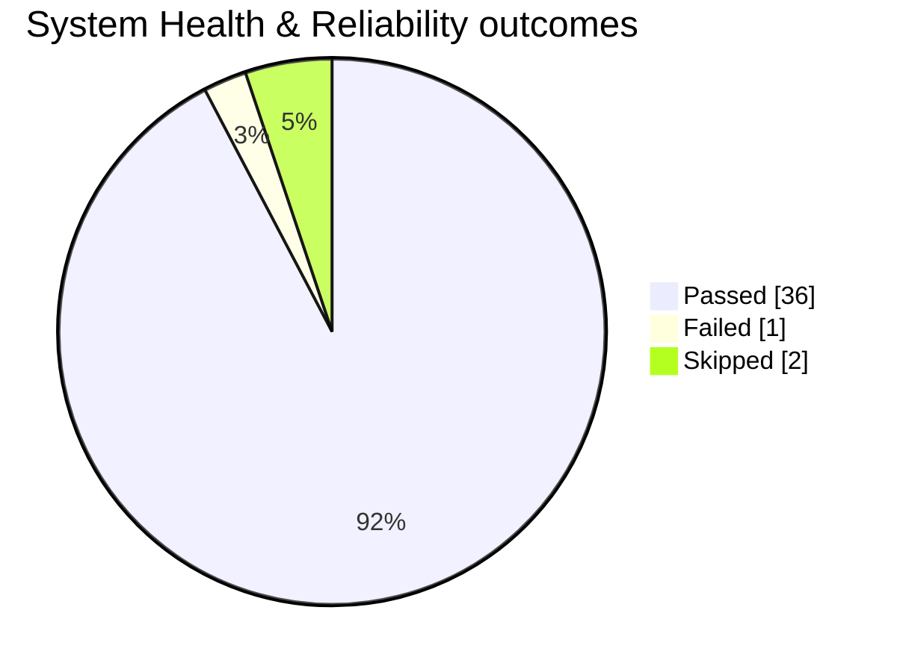
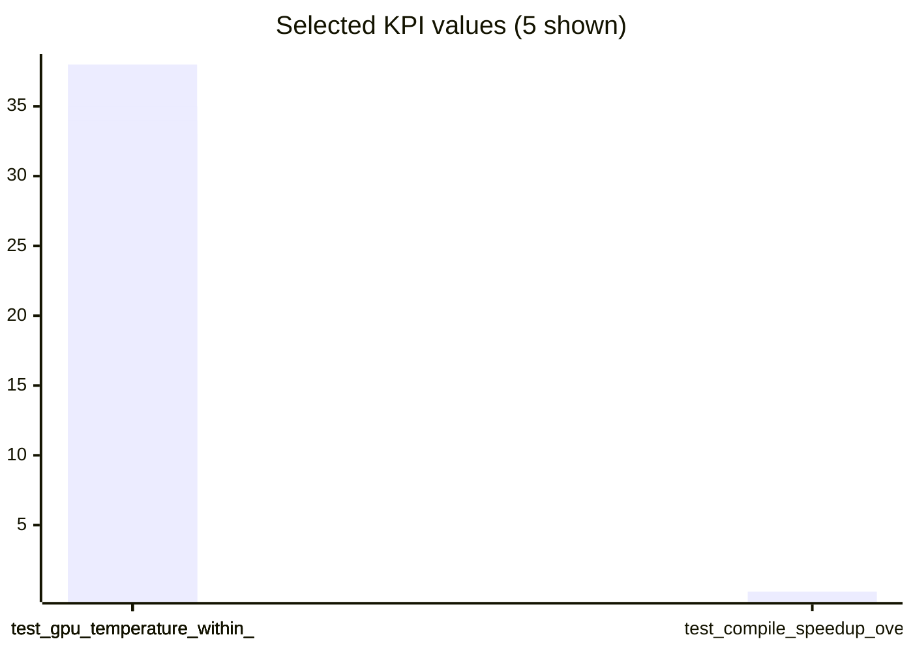

# System Health & Reliability

> **Test run:** 2026-08-17 | **Platform:** Linux, Python 3.12.13 | **Accelerators:** 4 x NVIDIA H100 PCIe

## Executive Dashboard

| Collected | Passed | Failed | Skipped | Warnings | Duration | Pass rate* |
|---:|---:|---:|---:|---:|---:|---:|
| 39 | 36 | 1 | 2 | 15 | 61.60s (0:01:01) | 97.3% |

*Pass rate excludes skipped tests.

## Result Visuals

## Key Findings

- **Action required:** 1 test(s) failed; root causes are summarized below.
- **Coverage note:** 2 test(s) were skipped because of topology, dependency, model, or environment constraints.
- **Failure signal:** `torch.compile` achieved 0.231x eager performance versus the effective 0.75x floor; correctness remained intact.

## Individual Test Results

| # | Test class | Test | Result | KPI records |
|---:|---|---|---|---:|
| 1 | `TestGPUThermalAndClockStability` | `test_gpu_temperature_within_safe_limits[0]` | **PASS** | 1 |
| 2 | `TestGPUThermalAndClockStability` | `test_gpu_temperature_within_safe_limits[1]` | **PASS** | 1 |
| 3 | `TestGPUThermalAndClockStability` | `test_gpu_temperature_within_safe_limits[2]` | **PASS** | 1 |
| 4 | `TestGPUThermalAndClockStability` | `test_gpu_temperature_within_safe_limits[3]` | **PASS** | 1 |
| 5 | `TestGPUThermalAndClockStability` | `test_gpu_clock_boost_ratio[0]` | **PASS** | 1 |
| 6 | `TestGPUThermalAndClockStability` | `test_gpu_clock_boost_ratio[1]` | **PASS** | 1 |
| 7 | `TestGPUThermalAndClockStability` | `test_gpu_clock_boost_ratio[2]` | **PASS** | 1 |
| 8 | `TestGPUThermalAndClockStability` | `test_gpu_clock_boost_ratio[3]` | **PASS** | 1 |
| 9 | `TestGPUThermalAndClockStability` | `test_sustained_compute_no_thermal_throttle` | **PASS** | 1 |
| 10 | `TestGPUThermalAndClockStability` | `test_gpu_power_limit_headroom` | **PASS** | 1 |
| 11 | `TestGPUECCAndPCIeLinkHealth` | `test_hbm_ecc_uncorrected_errors_zero[0]` | **PASS** | 1 |
| 12 | `TestGPUECCAndPCIeLinkHealth` | `test_hbm_ecc_uncorrected_errors_zero[1]` | **PASS** | 1 |
| 13 | `TestGPUECCAndPCIeLinkHealth` | `test_hbm_ecc_uncorrected_errors_zero[2]` | **PASS** | 1 |
| 14 | `TestGPUECCAndPCIeLinkHealth` | `test_hbm_ecc_uncorrected_errors_zero[3]` | **PASS** | 1 |
| 15 | `TestGPUECCAndPCIeLinkHealth` | `test_hbm_ecc_corrected_errors_below_threshold[0]` | **PASS** | 1 |
| 16 | `TestGPUECCAndPCIeLinkHealth` | `test_hbm_ecc_corrected_errors_below_threshold[1]` | **PASS** | 1 |
| 17 | `TestGPUECCAndPCIeLinkHealth` | `test_hbm_ecc_corrected_errors_below_threshold[2]` | **PASS** | 1 |
| 18 | `TestGPUECCAndPCIeLinkHealth` | `test_hbm_ecc_corrected_errors_below_threshold[3]` | **PASS** | 1 |
| 19 | `TestGPUECCAndPCIeLinkHealth` | `test_pcie_link_error_counters_zero` | **PASS** | 1 |
| 20 | `TestGPUECCAndPCIeLinkHealth` | `test_gpu_nvml_health_flags_clean` | **PASS** | 1 |
| 21 | `TestEnergyEfficiency` | `test_fp16_gflops_per_watt[0]` | **PASS** | 1 |
| 22 | `TestEnergyEfficiency` | `test_fp16_gflops_per_watt[1]` | **PASS** | 1 |
| 23 | `TestEnergyEfficiency` | `test_fp16_gflops_per_watt[2]` | **PASS** | 1 |
| 24 | `TestEnergyEfficiency` | `test_fp16_gflops_per_watt[3]` | **PASS** | 1 |
| 25 | `TestEnergyEfficiency` | `test_aggregate_4gpu_fp16_tflops_per_watt` | **PASS** | 1 |
| 26 | `TestQuantizationNumericalCorrectness` | `test_int8_matmul_error_vs_fp16` | **PASS** | 1 |
| 27 | `TestQuantizationNumericalCorrectness` | `test_fp8_e4m3_matmul_error_vs_fp16` | **PASS** | 1 |
| 28 | `TestQuantizationNumericalCorrectness` | `test_bf16_vs_fp16_matmul_equivalence` | **PASS** | 1 |
| 29 | `TestQuantizationNumericalCorrectness` | `test_quantised_softmax_output_matches_fp16` | **PASS** | 1 |
| 30 | `TestDDPGradientSynchronizationCorrectness` | `test_nccl_allreduce_mean_correctness` | **SKIP** | 1 |
| 31 | `TestDDPGradientSynchronizationCorrectness` | `test_ddp_gradient_sync_matches_single_gpu` | **PASS** | 1 |
| 32 | `TestDDPGradientSynchronizationCorrectness` | `test_multi_gpu_parameter_consistency_after_allreduce` | **PASS** | 1 |
| 33 | `TestTorchCompileCorrectnessAndSpeedup` | `test_compile_output_matches_eager` | **PASS** | 1 |
| 34 | `TestTorchCompileCorrectnessAndSpeedup` | `test_compile_speedup_over_eager` | **FAIL** | 1 |
| 35 | `TestCUDAStreamOrderingCorrectness` | `test_event_wait_enforces_ordering` | **PASS** | 1 |
| 36 | `TestCUDAStreamOrderingCorrectness` | `test_multi_stream_no_race_on_shared_tensor` | **PASS** | 1 |
| 37 | `TestCUDAStreamOrderingCorrectness` | `test_cuda_event_elapsed_time_positive` | **PASS** | 1 |
| 38 | `TestCUDAStreamOrderingCorrectness` | `test_stream_callback_executes_on_host` | **SKIP** | 0 |
| 39 | `TestCUDAStreamOrderingCorrectness` | `test_concurrent_stream_throughput_vs_sequential` | **PASS** | 1 |

## Failure Analysis

### test_compile_speedup_over_eager

**Result:** FAIL

**Observed failure:** torch.compile achieved 0.231x eager performance, below the effective 0.75x floor (0.0294 s compiled versus 0.0068 s eager).

## KPI & Measurement Details

### test_gpu_temperature_within_safe_limits[0]

**Result:** PASS

**test_gpu_temperature_within_safe_limits[0]**

| KPI | Value |
|---|---:|
| `device_idx` | 0 |
| `temperature_c` | 38 |
| `threshold_c` | 83 |

### test_gpu_temperature_within_safe_limits[1]

**Result:** PASS

**test_gpu_temperature_within_safe_limits[1]**

| KPI | Value |
|---|---:|
| `device_idx` | 1 |
| `temperature_c` | 35 |
| `threshold_c` | 83 |

### test_gpu_temperature_within_safe_limits[2]

**Result:** PASS

**test_gpu_temperature_within_safe_limits[2]**

| KPI | Value |
|---|---:|
| `device_idx` | 2 |
| `temperature_c` | 34 |
| `threshold_c` | 83 |

### test_gpu_temperature_within_safe_limits[3]

**Result:** PASS

**test_gpu_temperature_within_safe_limits[3]**

| KPI | Value |
|---|---:|
| `device_idx` | 3 |
| `temperature_c` | 33 |
| `threshold_c` | 83 |

### test_gpu_clock_boost_ratio[0]

**Result:** PASS

**test_gpu_clock_boost_ratio[0]**

| KPI | Value |
|---|---:|
| `device_idx` | 0 |
| `idle_clock_mhz` | 345 |
| `peak_observed_clock_mhz` | 1755 |
| `max_clock_mhz` | 1755 |
| `clock_ratio` | 1.0 |
| `min_ratio` | 0.7 |
| `sample_sec` | 1.5 |
| `retries` | 2 |

### test_gpu_clock_boost_ratio[1]

**Result:** PASS

**test_gpu_clock_boost_ratio[1]**

| KPI | Value |
|---|---:|
| `device_idx` | 1 |
| `idle_clock_mhz` | 345 |
| `peak_observed_clock_mhz` | 1755 |
| `max_clock_mhz` | 1755 |
| `clock_ratio` | 1.0 |
| `min_ratio` | 0.7 |
| `sample_sec` | 1.5 |
| `retries` | 2 |

### test_gpu_clock_boost_ratio[2]

**Result:** PASS

**test_gpu_clock_boost_ratio[2]**

| KPI | Value |
|---|---:|
| `device_idx` | 2 |
| `idle_clock_mhz` | 345 |
| `peak_observed_clock_mhz` | 1665 |
| `max_clock_mhz` | 1755 |
| `clock_ratio` | 0.9487 |
| `min_ratio` | 0.7 |
| `sample_sec` | 1.5 |
| `retries` | 2 |

### test_gpu_clock_boost_ratio[3]

**Result:** PASS

**test_gpu_clock_boost_ratio[3]**

| KPI | Value |
|---|---:|
| `device_idx` | 3 |
| `idle_clock_mhz` | 345 |
| `peak_observed_clock_mhz` | 1605 |
| `max_clock_mhz` | 1755 |
| `clock_ratio` | 0.9145 |
| `min_ratio` | 0.7 |
| `sample_sec` | 1.5 |
| `retries` | 2 |

### test_sustained_compute_no_thermal_throttle

**Result:** PASS

**test_sustained_compute_no_thermal_throttle**

| KPI | Value |
|---|---:|
| `initial_clock_mhz` | 1755 |
| `min_clock_mhz` | 915 |
| `clock_drop_ratio` | 0.4786 |
| `max_temp_c` | 59 |
| `duration_sec` | 30 |
| `max_allowed_drop` | 0.55 |

### test_gpu_power_limit_headroom

**Result:** PASS

**test_gpu_power_limit_headroom**

| KPI | Value |
|---|---:|
| `gpu0_power_w` | 252.84 |
| `gpu1_power_w` | 92.008 |
| `gpu2_power_w` | 87.918 |
| `gpu3_power_w` | 85.823 |
| `gpu0_limit_w` | 350.0 |
| `gpu1_limit_w` | 350.0 |
| `gpu2_limit_w` | 350.0 |
| `gpu3_limit_w` | 350.0 |
| `gpu0_ratio` | 0.7224 |
| `gpu1_ratio` | 0.2629 |
| `gpu2_ratio` | 0.2512 |
| `gpu3_ratio` | 0.2452 |

### test_hbm_ecc_uncorrected_errors_zero[0]

**Result:** PASS

**test_hbm_ecc_uncorrected_errors_zero[0]**

| KPI | Value |
|---|---:|
| `device_idx` | 0 |
| `uncorrected_ecc_errors` | 0 |

### test_hbm_ecc_uncorrected_errors_zero[1]

**Result:** PASS

**test_hbm_ecc_uncorrected_errors_zero[1]**

| KPI | Value |
|---|---:|
| `device_idx` | 1 |
| `uncorrected_ecc_errors` | 0 |

### test_hbm_ecc_uncorrected_errors_zero[2]

**Result:** PASS

**test_hbm_ecc_uncorrected_errors_zero[2]**

| KPI | Value |
|---|---:|
| `device_idx` | 2 |
| `uncorrected_ecc_errors` | 0 |

### test_hbm_ecc_uncorrected_errors_zero[3]

**Result:** PASS

**test_hbm_ecc_uncorrected_errors_zero[3]**

| KPI | Value |
|---|---:|
| `device_idx` | 3 |
| `uncorrected_ecc_errors` | 0 |

### test_hbm_ecc_corrected_errors_below_threshold[0]

**Result:** PASS

**test_hbm_ecc_corrected_errors_below_threshold[0]**

| KPI | Value |
|---|---:|
| `device_idx` | 0 |
| `corrected_ecc_errors` | 0 |
| `threshold` | 100 |

### test_hbm_ecc_corrected_errors_below_threshold[1]

**Result:** PASS

**test_hbm_ecc_corrected_errors_below_threshold[1]**

| KPI | Value |
|---|---:|
| `device_idx` | 1 |
| `corrected_ecc_errors` | 0 |
| `threshold` | 100 |

### test_hbm_ecc_corrected_errors_below_threshold[2]

**Result:** PASS

**test_hbm_ecc_corrected_errors_below_threshold[2]**

| KPI | Value |
|---|---:|
| `device_idx` | 2 |
| `corrected_ecc_errors` | 0 |
| `threshold` | 100 |

### test_hbm_ecc_corrected_errors_below_threshold[3]

**Result:** PASS

**test_hbm_ecc_corrected_errors_below_threshold[3]**

| KPI | Value |
|---|---:|
| `device_idx` | 3 |
| `corrected_ecc_errors` | 0 |
| `threshold` | 100 |

### test_pcie_link_error_counters_zero

**Result:** PASS

**test_pcie_link_error_counters_zero**

| KPI | Value |
|---|---:|
| `gpu0_pcie_replay_count` | 0 |
| `gpu1_pcie_replay_count` | 0 |
| `gpu2_pcie_replay_count` | 0 |
| `gpu3_pcie_replay_count` | 0 |

### test_gpu_nvml_health_flags_clean

**Result:** PASS

**test_gpu_nvml_health_flags_clean**

| KPI | Value |
|---|---:|
| `gpu0_retired_pages_dbe` | 0 |
| `gpu1_retired_pages_dbe` | 0 |
| `gpu2_retired_pages_dbe` | 0 |
| `gpu3_retired_pages_dbe` | 0 |

### test_fp16_gflops_per_watt[0]

**Result:** PASS

**test_fp16_gflops_per_watt[0]**

| KPI | Value |
|---|---:|
| `device_idx` | 0 |
| `fp16_tflops` | 462.1 |
| `mean_power_w` | 89.4 |
| `tflops_per_watt` | 5.168 |
| `min_tflops_per_watt` | 1.0 |
| `soft_min_tflops_per_watt` | 0.8 |
| `retried` | False |

### test_fp16_gflops_per_watt[1]

**Result:** PASS

**test_fp16_gflops_per_watt[1]**

| KPI | Value |
|---|---:|
| `device_idx` | 1 |
| `fp16_tflops` | 460.25 |
| `mean_power_w` | 92.1 |
| `tflops_per_watt` | 4.998 |
| `min_tflops_per_watt` | 1.0 |
| `soft_min_tflops_per_watt` | 0.8 |
| `retried` | False |

### test_fp16_gflops_per_watt[2]

**Result:** PASS

**test_fp16_gflops_per_watt[2]**

| KPI | Value |
|---|---:|
| `device_idx` | 2 |
| `fp16_tflops` | 478.31 |
| `mean_power_w` | 87.8 |
| `tflops_per_watt` | 5.445 |
| `min_tflops_per_watt` | 1.0 |
| `soft_min_tflops_per_watt` | 0.8 |
| `retried` | False |

### test_fp16_gflops_per_watt[3]

**Result:** PASS

**test_fp16_gflops_per_watt[3]**

| KPI | Value |
|---|---:|
| `device_idx` | 3 |
| `fp16_tflops` | 479.35 |
| `mean_power_w` | 85.8 |
| `tflops_per_watt` | 5.586 |
| `min_tflops_per_watt` | 1.0 |
| `soft_min_tflops_per_watt` | 0.8 |
| `retried` | False |

### test_aggregate_4gpu_fp16_tflops_per_watt

**Result:** PASS

**test_aggregate_4gpu_fp16_tflops_per_watt**

| KPI | Value |
|---|---:|
| `total_fp16_tflops` | 1828.14 |
| `total_power_w` | 373.2 |
| `tflops_per_watt` | 4.898 |
| `min_tflops_per_watt` | 1.0 |

### test_int8_matmul_error_vs_fp16

**Result:** PASS

**test_int8_matmul_error_vs_fp16**

| KPI | Value |
|---|---:|
| `int8_vs_fp16_mean_rel_error` | 0.015343 |
| `threshold_rel_error` | 0.05 |

### test_fp8_e4m3_matmul_error_vs_fp16

**Result:** PASS

**test_fp8_e4m3_matmul_error_vs_fp16**

| KPI | Value |
|---|---:|
| `fp8_vs_fp16_mean_rel_error` | 0.037445 |
| `threshold_rel_error` | 0.15000000000000002 |

### test_bf16_vs_fp16_matmul_equivalence

**Result:** PASS

**test_bf16_vs_fp16_matmul_equivalence**

| KPI | Value |
|---|---:|
| `bf16_vs_fp16_mean_rel_error` | 0.002869 |
| `threshold_rel_error` | 0.1 |

### test_quantised_softmax_output_matches_fp16

**Result:** PASS

**test_quantised_softmax_output_matches_fp16**

| KPI | Value |
|---|---:|
| `softmax_max_abs_error` | 0.00256348 |
| `threshold` | 0.003 |

### test_nccl_allreduce_mean_correctness

**Result:** SKIP

**test_nccl_allreduce_mean_correctness_skip**

| KPI | Value |
|---|---:|
| `reason` | ddp_worker_error |
| `world_size` | 4 |
| `errors.rank_2.type` | RuntimeError |
| `errors.rank_2.message` | Expected a 'cuda' device type for generator but found 'cpu' |
| `errors.rank_2.traceback` | Traceback (most recent call last):   File "/home/workspace/AIHeadNode1/AIHeadNode/tests/test_system_health_and_reliability.py", line 126, in _ddp_allreduce_worker     local = torch.randn(256, 256, generator=rng, device=f"cuda:{rank}")             ^^^^^^^^^^^^^^^^^^^^^^^^^^^^^^^^^^^^^^^^^^^^^^^^^^^^^^^^^^^ RuntimeError: Expected a 'cuda' device type for generator but found 'cpu'  |
| `errors.rank_1.type` | RuntimeError |
| `errors.rank_1.message` | Expected a 'cuda' device type for generator but found 'cpu' |
| `errors.rank_1.traceback` | Traceback (most recent call last):   File "/home/workspace/AIHeadNode1/AIHeadNode/tests/test_system_health_and_reliability.py", line 126, in _ddp_allreduce_worker     local = torch.randn(256, 256, generator=rng, device=f"cuda:{rank}")             ^^^^^^^^^^^^^^^^^^^^^^^^^^^^^^^^^^^^^^^^^^^^^^^^^^^^^^^^^^^ RuntimeError: Expected a 'cuda' device type for generator but found 'cpu'  |
| `errors.rank_3.type` | RuntimeError |
| `errors.rank_3.message` | Expected a 'cuda' device type for generator but found 'cpu' |
| `errors.rank_3.traceback` | Traceback (most recent call last):   File "/home/workspace/AIHeadNode1/AIHeadNode/tests/test_system_health_and_reliability.py", line 126, in _ddp_allreduce_worker     local = torch.randn(256, 256, generator=rng, device=f"cuda:{rank}")             ^^^^^^^^^^^^^^^^^^^^^^^^^^^^^^^^^^^^^^^^^^^^^^^^^^^^^^^^^^^ RuntimeError: Expected a 'cuda' device type for generator but found 'cpu'  |
| `errors.rank_0.type` | RuntimeError |
| `errors.rank_0.message` | Expected a 'cuda' device type for generator but found 'cpu' |
| `errors.rank_0.traceback` | Traceback (most recent call last):   File "/home/workspace/AIHeadNode1/AIHeadNode/tests/test_system_health_and_reliability.py", line 126, in _ddp_allreduce_worker     local = torch.randn(256, 256, generator=rng, device=f"cuda:{rank}")             ^^^^^^^^^^^^^^^^^^^^^^^^^^^^^^^^^^^^^^^^^^^^^^^^^^^^^^^^^^^ RuntimeError: Expected a 'cuda' device type for generator but found 'cpu'  |

### test_ddp_gradient_sync_matches_single_gpu

**Result:** PASS

**test_ddp_gradient_sync_matches_single_gpu**

| KPI | Value |
|---|---:|
| `grad_max_rel_error` | 0.0 |
| `tolerance` | 0.001 |

### test_multi_gpu_parameter_consistency_after_allreduce

**Result:** PASS

**test_multi_gpu_parameter_consistency_after_allreduce**

| KPI | Value |
|---|---:|
| `n_gpu` | 4 |
| `max_diff` | 0.0 |

### test_compile_output_matches_eager

**Result:** PASS

**test_compile_output_matches_eager**

| KPI | Value |
|---|---:|
| `max_abs_error` | 0.0 |
| `tolerance` | 0.01 |

### test_compile_speedup_over_eager

**Result:** FAIL

**test_compile_speedup_over_eager**

| KPI | Value |
|---|---:|
| `eager_time_s` | 0.0068 |
| `compiled_time_s` | 0.0294 |
| `speedup_ratio` | 0.231 |
| `floor_ratio` | 1.05 |
| `effective_floor_ratio` | 0.75 |

### test_event_wait_enforces_ordering

**Result:** PASS

**test_event_wait_enforces_ordering**

| KPI | Value |
|---|---:|
| `expected_sum` | 16777216.0 |
| `actual_sum` | 16777216.0 |
| `correct` | True |

### test_multi_stream_no_race_on_shared_tensor

**Result:** PASS

**test_multi_stream_no_race_on_shared_tensor**

| KPI | Value |
|---|---:|
| `initial_val` | 1.0 |
| `final_val` | 4.0 |
| `expected` | 4.0 |

### test_cuda_event_elapsed_time_positive

**Result:** PASS

**test_cuda_event_elapsed_time_positive**

| KPI | Value |
|---|---:|
| `gemm_elapsed_ms` | 0.3003 |

### test_concurrent_stream_throughput_vs_sequential

**Result:** PASS

**test_concurrent_stream_throughput_vs_sequential**

| KPI | Value |
|---|---:|
| `sequential_time_s` | 0.0014 |
| `concurrent_time_s` | 0.0014 |
| `concurrent_vs_sequential_ratio` | 1.0497 |
| `max_allowed_ratio` | 1.5 |

## Traceability

- Source log: `dmr_all_test-aug17.log`
- Pytest module: `tests/test_system_health_and_reliability.py`
- Results and KPI values are transcribed from the captured run; no missing values were estimated.
