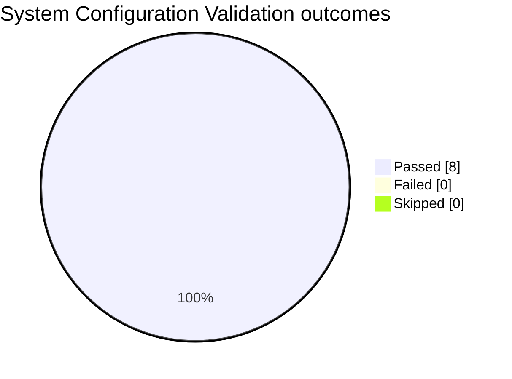

# System Configuration Validation

> **Test run:** 2026-08-17 | **Platform:** Linux, Python 3.12.13 | **Accelerators:** 4 x NVIDIA H100 PCIe

## Executive Dashboard

| Collected | Passed | Failed | Skipped | Warnings | Duration | Pass rate* |
|---:|---:|---:|---:|---:|---:|---:|
| 8 | 8 | 0 | 0 | 0 | 6.24s | 100.0% |

*Pass rate excludes skipped tests.

## Result Visuals

## Key Findings

- **Result:** No test failures were recorded in this module.

## Individual Test Results

| # | Test class | Test | Result | KPI records |
|---:|---|---|---|---:|
| 1 | `TestCPUConfigReport` | `test_collect_and_print_cpu_config` | **PASS** | 0 |
| 2 | `TestCPUConfigReport` | `test_cpu_spec_conforms_to_theoretical` | **PASS** | 0 |
| 3 | `TestGPUConfigReport` | `test_collect_and_print_gpu_config` | **PASS** | 0 |
| 4 | `TestGPUConfigReport` | `test_gpu_model_names_in_report` | **PASS** | 0 |
| 5 | `TestGPUConfigReport` | `test_total_gpu_memory_in_report` | **PASS** | 0 |
| 6 | `TestPCIeTopologyReport` | `test_pcie_topology_present_in_report` | **PASS** | 0 |
| 7 | `TestPCIeTopologyReport` | `test_pcie_links_healthy_in_report` | **PASS** | 0 |
| 8 | `TestCombinedConfigReport` | `test_generate_and_save_combined_report` | **PASS** | 0 |

## KPI & Measurement Details

No numeric KPI payloads were emitted; validation is represented by the individual test status table.
## Traceability

- Source log: `dmr_all_test-aug17.log`
- Pytest module: `tests/test_system_config_report.py`
- Results and KPI values are transcribed from the captured run; no missing values were estimated.
