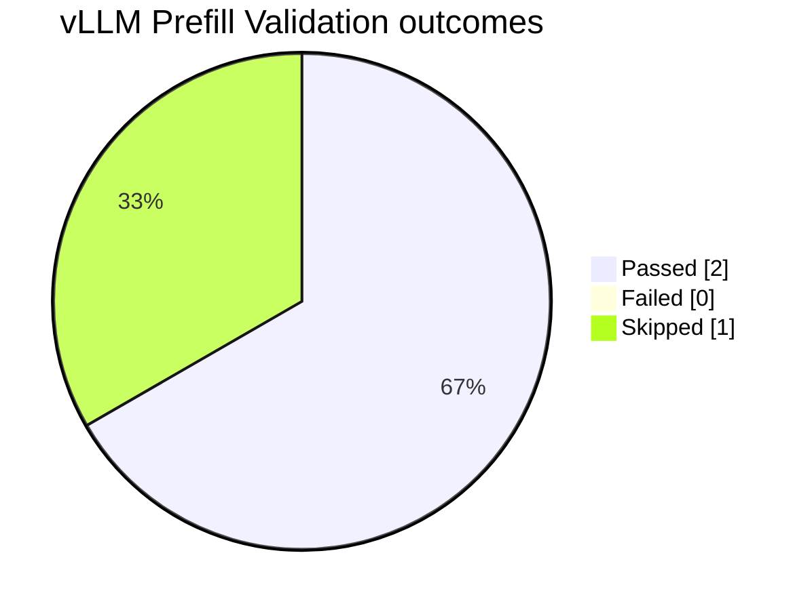

# vLLM Prefill Validation

> **Test run:** 2026-08-17 | **Platform:** Linux, Python 3.12.13 | **Accelerators:** 4 x NVIDIA H100 PCIe

## Executive Dashboard

| Collected | Passed | Failed | Skipped | Warnings | Duration | Pass rate* |
|---:|---:|---:|---:|---:|---:|---:|
| 3 | 2 | 0 | 1 | 0 | 267.14s (0:04:27) | 100.0% |

*Pass rate excludes skipped tests.

## Result Visuals

## Key Findings

- **Result:** No test failures were recorded in this module.
- **Coverage note:** 1 test(s) were skipped because of topology, dependency, model, or environment constraints.

## Individual Test Results

| # | Test class | Test | Result | KPI records |
|---:|---|---|---|---:|
| 1 | `TestVLLMPrefillValidation` | `test_vllm_4h100_prefill_validation` | **PASS** | 0 |
| 2 | `TestVLLMPrefillValidation` | `test_vllm_prefill_with_custom_model` | **SKIP** | 0 |
| 3 | `TestVLLMPrefillValidation` | `test_vllm_prefill_quick` | **PASS** | 0 |

## KPI & Measurement Details

No numeric KPI payloads were emitted; validation is represented by the individual test status table.
## Traceability

- Source log: `dmr_all_test-aug17.log`
- Pytest module: `tests/test_vllm_prefill_validation.py`
- Results and KPI values are transcribed from the captured run; no missing values were estimated.
