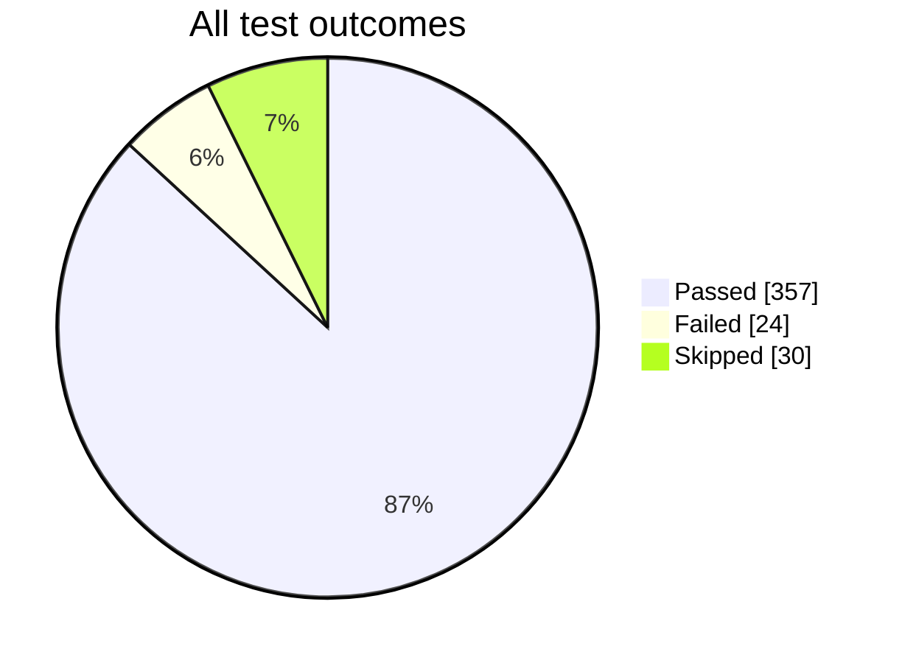

# AI Head Node Validation Reports - 2026-08-17

> Per-module analysis generated from `dmr_all_test-aug17.log`.

## Portfolio Summary

| Modules | Tests | Passed | Failed | Skipped | Executed pass rate |
|---:|---:|---:|---:|---:|---:|
| 13 | 411 | 357 | 24 | 30 | 93.7% |

## Module Reports

| Module | Status | Passed | Failed | Skipped | Duration | Report |
|---|---|---:|---:|---:|---:|---|
| Bottleneck & Roofline Analysis | **PASS** | 25 | 0 | 0 | 37.88s | [01_bottleneck_analysis.md](01_bottleneck_analysis.md) |
| CPU Validation | **PASS** | 32 | 0 | 1 | 635.69s (0:10:35) | [02_cpu_validation.md](02_cpu_validation.md) |
| Memory Subsystem Validation | **FAIL** | 27 | 1 | 0 | 27.74s | [03_memory_validation.md](03_memory_validation.md) |
| GPU Validation | **PASS** | 53 | 0 | 0 | 29.43s | [04_gpu_validation.md](04_gpu_validation.md) |
| PCIe, NVLink & P2P Validation | **PASS** | 69 | 0 | 8 | 97.49s (0:01:37) | [05_interconnect_validation.md](05_interconnect_validation.md) |
| Node Bring-up & Workload Acceptance | **FAIL** | 39 | 3 | 9 | 2331.58s (0:38:51) | [06_node_validation.md](06_node_validation.md) |
| Agentic AI KPI Validation | **PASS** | 9 | 0 | 0 | 21.08s | [07_agentic_ai_validation.md](07_agentic_ai_validation.md) |
| AI Pipeline KPI Validation | **PASS** | 34 | 0 | 4 | 88.98s (0:01:28) | [08_ai_pipeline_kpis.md](08_ai_pipeline_kpis.md) |
| System Health & Reliability | **FAIL** | 36 | 1 | 2 | 61.60s (0:01:01) | [09_system_health_and_reliability.md](09_system_health_and_reliability.md) |
| System Configuration Validation | **PASS** | 8 | 0 | 0 | 6.24s | [10_system_config_report.md](10_system_config_report.md) |
| vLLM Prefill Validation | **PASS** | 2 | 0 | 1 | 267.14s (0:04:27) | [11_vllm_prefill_validation.md](11_vllm_prefill_validation.md) |
| Performance Suite | **PASS** | 23 | 0 | 3 | 1736.34s (0:28:56) | [12_performance_suite.md](12_performance_suite.md) |
| MLPerf Suite | **FAIL** | 0 | 19 | 2 | 1877.65s (0:31:17) | [13_mlperf_suite.md](13_mlperf_suite.md) |

## Priority Findings

1. MLPerf is blocked primarily by missing or incomplete MLCommons/model prerequisites: 19 failed, 2 skipped.
2. Node acceptance has three targeted failures: GPU 0 D2H bandwidth, vLLM utilization sampling, and YOLO worker collection.
3. Memory has one STREAM Triad shortfall; aggregate memory bandwidth remains healthy.
4. System health has one `torch.compile` performance regression while compile correctness passes.
5. Bottleneck, CPU, GPU, interconnect, agentic AI, AI pipeline, system config, vLLM prefill, and performance suite modules recorded no failures.
