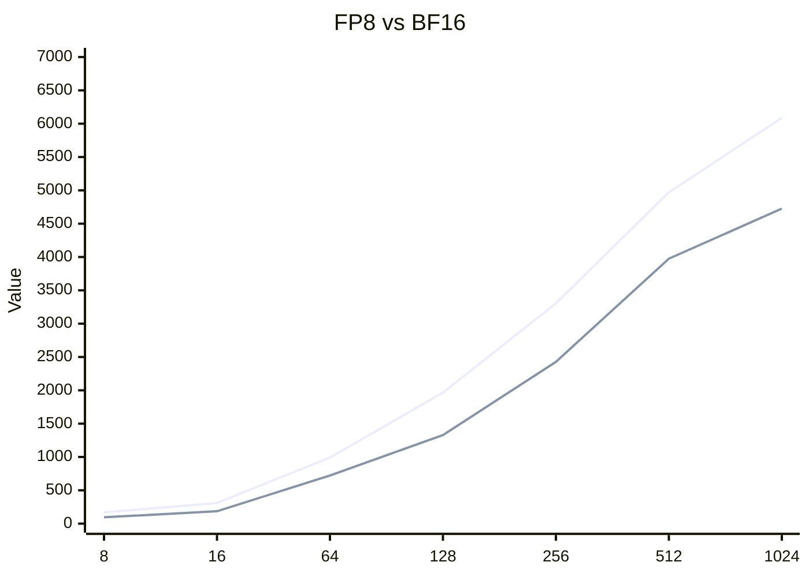
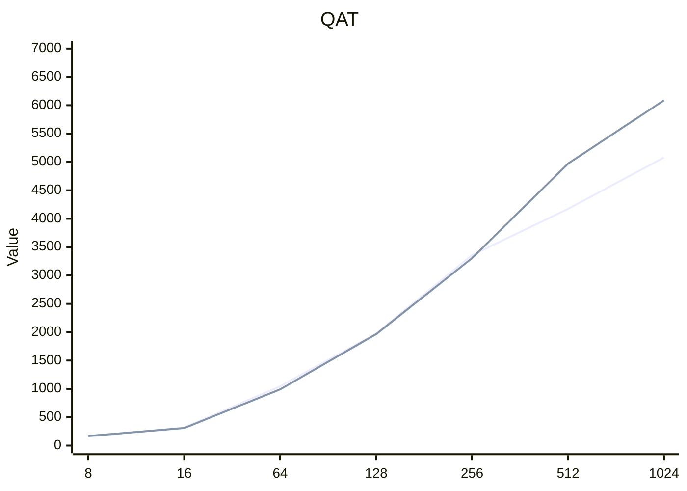
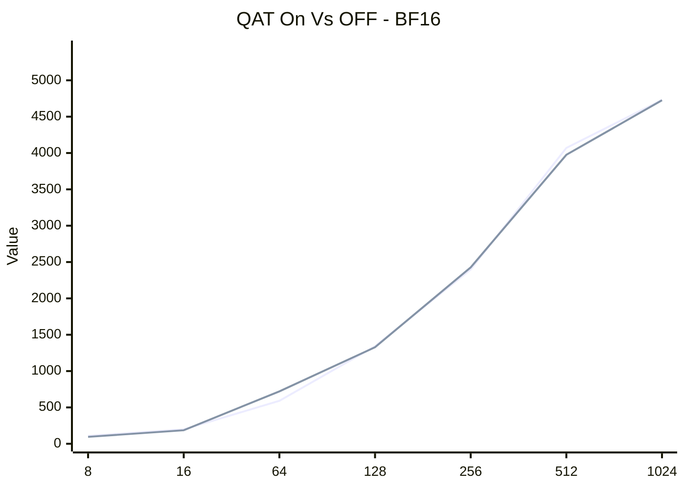

# llama-70B run - Markdown View

Generated: 2026-09-01 12:12:05

## Workbook Summary

- Source file: llama-70B run.xlsx
- Sheet count parsed: 1
- Primary sheet: Sheet1
- Charts found: 3

## Sheet Data

### Sheet1

#### Table Block 1

| Batch Size | Tokens/s QAT ON FP8 | Tokens/s QAT OFF FP8 | Tokens/s QAT ON NoFP8 | Tokens/s QAT OFF NoFP8 | OFF vs ON (FP8) | OFF vs ON (NoFP8) | FP8 Gain vs NoFP8 (QAT ON) | FP8 Gain vs NoFP8 (QAT OFF) |
|---|---|---|---|---|---|---|---|---|
| 8 | 157 | 169 | 110 | 95 | 0.1 | -0.1 | 0.4 | 0.8 |
| 16 | 317 | 309 | 198 | 186 | -0.0 | -0.1 | 0.6 | 0.7 |
| 64 | 1045 | 992 | 591 | 721 | -0.1 | 0.2 | 0.8 | 0.3 |
| 128 | 1975 | 1965 | 1341 | 1328 | -0.0 | -0.0 | 0.5 | 0.5 |
| 256 | 3358 | 3305 | 2397 | 2427 | -0.0 | 0.0 | 0.4 | 0.4 |
| 512 | 4172 | 4970 | 4070 | 3975 | 0.2 | -0.0 | 0.0 | 0.3 |
| 1024 | 5080 | 6087 | 4731 | 4726 | 0.2 | -0.0 | 0.1 | 0.3 |
| 2048 | Error | Error | Error | Error | Error | Error | Error | Error |

#### Table Block 2

| Batch Size | Tokens/s FP8 | Tokens/s BF16 | Delta |
|---|---|---|---|
| 8 | 169 | 95 | 43.0 |
| 16 | 309 | 186 | 40.0 |
| 64 | 992 | 721 | 27.0 |
| 128 | 1965 | 1328 | 32.0 |
| 256 | 3305 | 2427 | 27.0 |
| 512 | 4970 | 3975 | 20.0 |
| 1024 | 6087 | 4726 | 22.0 |

#### Table Block 3

| Batch Size | Tokens/s QAT ON FP8 | Tokens/s QAT OFF FP8 | Delta |
|---|---|---|---|
| 8 | 157 | 169 | -8.0 |
| 16 | 317 | 309 | 2.0 |
| 64 | 1045 | 992 | 5.0 |
| 128 | 1975 | 1965 | 1.0 |
| 256 | 3358 | 3305 | 2.0 |
| 512 | 4172 | 4970 | -19.0 |
| 1024 | 5080 | 6087 | -20.0 |

#### Table Block 4

| Batch Size | Tokens/s QAT ON BF16 | Tokens/s QAT OFF BF16 | Delta |
|---|---|---|---|
| 8 | 110 | 95 | 13.0 |
| 16 | 198 | 186 | 6.0 |
| 64 | 591 | 721 | -22.0 |
| 128 | 1341 | 1328 | 1.0 |
| 256 | 2397 | 2427 | -1.0 |
| 512 | 4070 | 3975 | 2.0 |
| 1024 | 4731 | 4726 | 0.0 |

## Charts

### Chart 1: FP8 vs BF16

Source object: xl/charts/chart1.xml

| Category | Tokens/s FP8 | Tokens/s BF16 |
|---|---|---|
| 8 | 169 | 95 |
| 16 | 309 | 186 |
| 64 | 992 | 721 |
| 128 | 1965 | 1328 |
| 256 | 3305 | 2427 |
| 512 | 4970 | 3975 |
| 1024 | 6087 | 4726 |

### Chart 2: QAT

Source object: xl/charts/chart2.xml

| Category | Tokens/s QAT ON FP8 | Tokens/s QAT OFF FP8 |
|---|---|---|
| 8 | 157 | 169 |
| 16 | 317 | 309 |
| 64 | 1045 | 992 |
| 128 | 1975 | 1965 |
| 256 | 3358 | 3305 |
| 512 | 4172 | 4970 |
| 1024 | 5080 | 6087 |

### Chart 3: QAT On Vs OFF - BF16

Source object: xl/charts/chart3.xml

| Category | Tokens/s QAT ON BF16 | Tokens/s QAT OFF BF16 |
|---|---|---|
| 8 | 110 | 95 |
| 16 | 198 | 186 |
| 64 | 591 | 721 |
| 128 | 1341 | 1328 |
| 256 | 2397 | 2427 |
| 512 | 4070 | 3975 |
| 1024 | 4731 | 4726 |

