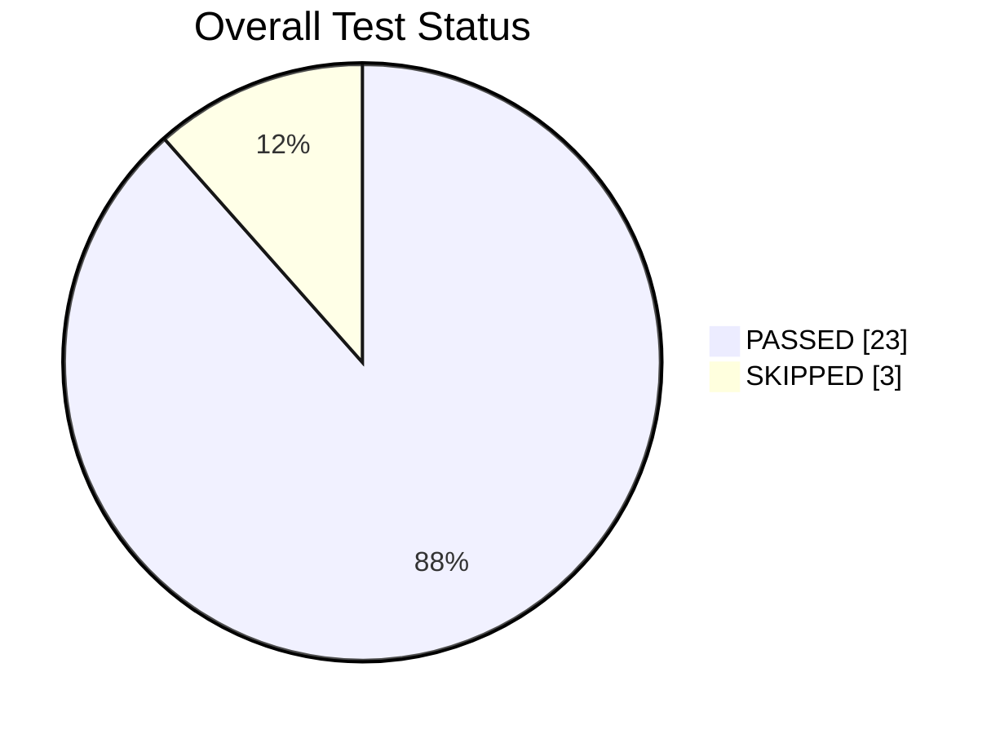

# Performance 4GPU Test Report

- **Source log:** `performance_4gpu_70_070826.log`
- **Generated:** 2026-08-07 16:46
- **Platform:** Linux · Python 3.12+ · pytest 9.1.1+
- **Node:** 4× GPU Configuration

## 1. Executive Summary

| Metric | Value |
|---|---|
| Total tests | 26 |
| 🟢 Passed | 23 |
| 🔴 Failed | 0 |
| 🟡 Skipped | 3 |
| Pass rate | 88.5% |
| Test sessions | 1 |
| KPI datapoints captured | 0 |

## 2. Results by Session

| Session | Test file(s) | Passed | Failed | Skipped | Total | Pass % |
|---|---|---|---|---|---|---|
| 1 | test_performance_suite.py | 23 | 0 | 3 | 26 | 88% |

## 3. KPI Highlights & Graphs

## 4. Failures & Skips

### 4.1 Failures

| Session | Test | Reason |
|---|---|---|

### 4.2 Skips

| Session | Test | Reason |
|---|---|---|
| 1 | test_performance_suite.py::::test_performance_case_suite[AI_HOSTCPU_PERF_TEST_ID_002] | Missing required binaries: ['nvbandwidth'])                     [  7%] |
| 1 | test_performance_suite.py::::test_performance_case_suite[AI_HOSTCPU_PERF_TEST_ID_010] | TRT-LLM case is disabled by default to avoid package conflicts |
| 1 | test_performance_suite.py::::test_performance_case_suite[AI_HOSTCPU_PERF_TEST_ID_011] | AI_HOSTCPU_PERF_TEST_ID_011: genai-perf could not collect |

## 5. Test-Case-Wise Detail

### Session 1

#### `tests/test_performance_suite.py`

🟢 PASSED — ::test_performance_case_suite[AI_HOSTCPU_PERF_TEST_ID_001]

_No KPI datapoints captured for this test._

🟡 SKIPPED — ::test_performance_case_suite[AI_HOSTCPU_PERF_TEST_ID_002]

- **Reason:** Missing required binaries: ['nvbandwidth'])                     [  7%]

_No KPI datapoints captured for this test._

🟢 PASSED — ::test_performance_case_suite[AI_HOSTCPU_PERF_TEST_ID_003]

_No KPI datapoints captured for this test._

🟢 PASSED — ::test_performance_case_suite[AI_HOSTCPU_PERF_TEST_ID_004]

_No KPI datapoints captured for this test._

🟢 PASSED — ::test_performance_case_suite[AI_HOSTCPU_PERF_TEST_ID_005]

_No KPI datapoints captured for this test._

🟢 PASSED — ::test_performance_case_suite[AI_HOSTCPU_PERF_TEST_ID_006]

_No KPI datapoints captured for this test._

🟢 PASSED — ::test_performance_case_suite[AI_HOSTCPU_PERF_TEST_ID_007]

_No KPI datapoints captured for this test._

🟢 PASSED — ::test_performance_case_suite[AI_HOSTCPU_PERF_TEST_ID_008]

_No KPI datapoints captured for this test._

🟢 PASSED — ::test_performance_case_suite[AI_HOSTCPU_PERF_TEST_ID_009]

_No KPI datapoints captured for this test._

🟡 SKIPPED — ::test_performance_case_suite[AI_HOSTCPU_PERF_TEST_ID_010]

- **Reason:** TRT-LLM case is disabled by default to avoid package conflicts

_No KPI datapoints captured for this test._

🟡 SKIPPED — ::test_performance_case_suite[AI_HOSTCPU_PERF_TEST_ID_011]

- **Reason:** AI_HOSTCPU_PERF_TEST_ID_011: genai-perf could not collect

_No KPI datapoints captured for this test._

🟢 PASSED — ::test_performance_case_suite[AI_HOSTCPU_PERF_TEST_ID_012]

_No KPI datapoints captured for this test._

🟢 PASSED — ::test_performance_case_suite[AI_HOSTCPU_PERF_TEST_ID_013]

_No KPI datapoints captured for this test._

🟢 PASSED — ::test_performance_case_suite[AI_HOSTCPU_PERF_TEST_ID_014]

_No KPI datapoints captured for this test._

🟢 PASSED — ::test_performance_case_suite[AI_HOSTCPU_PERF_TEST_ID_015]

_No KPI datapoints captured for this test._

🟢 PASSED — ::test_performance_case_suite[AI_HOSTCPU_PERF_TEST_ID_016]

_No KPI datapoints captured for this test._

🟢 PASSED — ::test_performance_case_suite[AI_HOSTCPU_PERF_TEST_ID_017]

_No KPI datapoints captured for this test._

🟢 PASSED — ::test_performance_case_suite[AI_HOSTCPU_PERF_TEST_ID_018]

_No KPI datapoints captured for this test._

🟢 PASSED — ::test_performance_case_suite[AI_HOSTCPU_PERF_TEST_ID_019]

_No KPI datapoints captured for this test._

🟢 PASSED — ::test_performance_case_suite[AI_HOSTCPU_PERF_TEST_ID_020]

_No KPI datapoints captured for this test._

🟢 PASSED — ::test_performance_case_suite[AI_HOSTCPU_PERF_TEST_ID_021]

_No KPI datapoints captured for this test._

🟢 PASSED — ::test_performance_case_suite[AI_HOSTCPU_PERF_TEST_ID_022]

_No KPI datapoints captured for this test._

🟢 PASSED — ::test_performance_case_suite[AI_HOSTCPU_PERF_TEST_ID_023]

_No KPI datapoints captured for this test._

🟢 PASSED — ::test_performance_case_suite[AI_HOSTCPU_PERF_TEST_ID_024]

_No KPI datapoints captured for this test._

🟢 PASSED — ::test_performance_case_suite[AI_HOSTCPU_PERF_TEST_ID_025]

_No KPI datapoints captured for this test._

🟢 PASSED — ::test_performance_case_suite[AI_HOSTCPU_PERF_TEST_ID_026]

_No KPI datapoints captured for this test._

